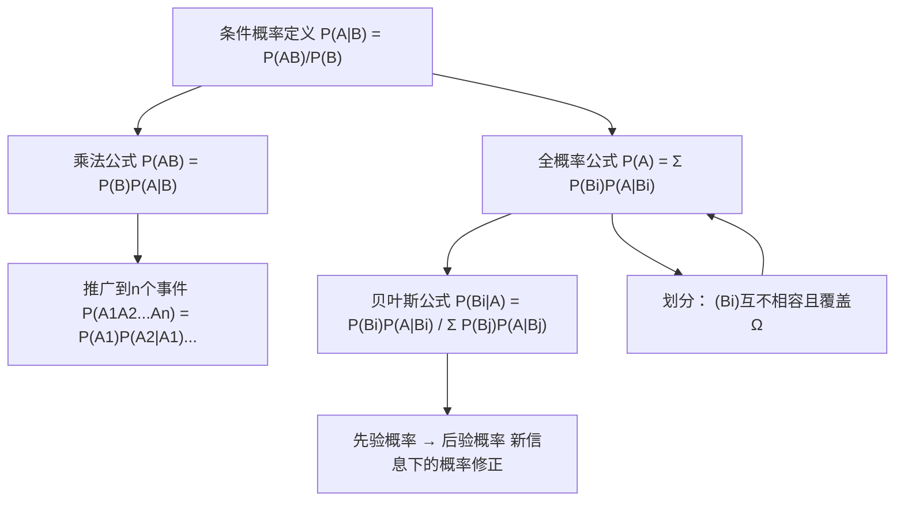
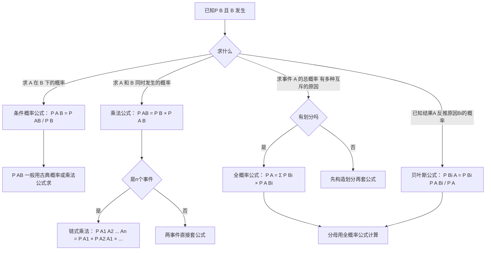

# 第1章 条件概率 — 知识点梳理

## 一、本章核心脉络

**核心问题**：当我们已经知道某个事件发生了，如何在这个"新信息"下重新评估另一个事件的概率？更进一步，如何用"原因"的概率和"原因→结果"的条件概率，反推"结果→原因"的概率？



> 这个顺序从最基础的条件概率定义出发，推导出乘法公式（"同时发生"的链式法则），再由乘法公式和划分概念推导出全概率公式（"结果"的综合概率），最终引出贝叶斯公式（从"结果"反推"原因"的概率）——这正是概率论中最具洞察力的推理工具之一。

---

## 二、条件概率的定义与基本性质（核心）

### 2.1 定义1.4.1

设 $(\Omega, \mathscr{F}, P)$ 为概率空间，$A \in \mathscr{F}$，$B \in \mathscr{F}$，且 $P(B) > 0$，则在事件 $B$ 已发生的条件下，事件 $A$ 发生的**条件概率**定义为

$$P(A|B) = \frac{P(AB)}{P(B)}$$

> **一句话来说**：条件概率就是把样本空间"缩小"到 $B$ 上，然后看 $A$ 在 $B$ 里面占多大比例——$P(AB)$ 是 $A$ 和 $B$ 的"共同面积"，$P(B)$ 是新的"总面积"。

**直观理解**：原本我们是在整个 $\Omega$ 上度量概率。一旦知道 $B$ 发生了，我们就不再关心 $\Omega \setminus B$ 的部分——$B$ 成了新的"全集"。$P(A|B)$ 就是在 $B$ 这个新全集里，$A \cap B$ 所占的"相对大小"。

### 2.2 条件概率是合法的概率

**定理1.4.1**：设 $P(B) > 0$，则 $P(\cdot|B)$ 是 $(\Omega, \mathscr{F})$ 上的概率测度，即满足三条公理：

1. **非负性**：$\forall A \in \mathscr{F}$，$0 \leq P(A|B) \leq 1$
2. **规范性**：$P(\Omega|B) = 1$
3. **完全可加性**：若 $A_i \in \mathscr{F}$ 两两互不相容，则

$$P\left(\bigcup_{i=1}^{\infty} A_i \middle| B\right) = \sum_{i=1}^{\infty} P(A_i|B)$$

> **一句话来说**：条件概率不是"打折版"的概率——它完全满足概率的三条公理，所以在条件概率下，所有概率的性质（加法公式、多除少补、连续性等）全部照常成立。

### 2.3 条件概率的基本运算性质

由三条公理直接推出（$P(B) > 0$）：

- $P(\Phi | B) = 0$
- $P(\overline{A} | B) = 1 - P(A|B)$
- $P(A_1 \cup A_2 | B) = P(A_1|B) + P(A_2|B) - P(A_1 A_2 | B)$
- 若 $A_1 \supset A_2$，则 $P(A_1 - A_2 | B) = P(A_1|B) - P(A_2|B)$

> [!hint] 记忆技巧
> "条件概率就是缩小样本空间后的普通概率"——所有无条件概率的公式，在竖线右边加一个 $|B$ 就变成了条件概率公式。

---

## 三、乘法公式（核心）

### 3.1 两个事件的乘法公式

由条件概率定义 $P(A|B) = \frac{P(AB)}{P(B)}$，移项得：

$$P(AB) = P(B) \cdot P(A|B) \quad (P(B) > 0)$$

由对称性：

$$P(AB) = P(A) \cdot P(B|A) \quad (P(A) > 0)$$

> **一句话来说**：两个事件"同时发生"的概率 = 第一个发生的概率 x 在第一个发生的条件下第二个发生的概率。乘法公式把"交事件"的概率拆成了"一步接一步"的乘积。

**直观理解**：乘法公式的本质是把"同时"拆成"先后"——先让 $B$ 发生（概率 $P(B)$），然后在这个前提下再让 $A$ 发生（概率 $P(A|B)$）。因此计算交事件概率等价于沿着一条"因果链"前进。

### 3.2 推广到 $n$ 个事件

**定理1.4.2（一般乘法公式）**：设 $A_1, A_2, \ldots, A_n \in \mathscr{F}$，且 $P(A_1 A_2 \cdots A_{n-1}) > 0$，则

$$P(A_1 A_2 \cdots A_n) = P(A_1) \cdot P(A_2|A_1) \cdot P(A_3|A_1 A_2) \cdots P(A_n|A_1 A_2 \cdots A_{n-1})$$

> **一句话来说**：$n$ 个事件同时发生 = 第一步的概率 x 第二步在第一步已发生的条件下的概率 x ... x 第 $n$ 步在前 $n-1$ 步都已发生的条件下的概率。

**步骤点评**：这个公式在"无放回抽样"问题中极为有用。每次抽取后，剩余物品的构成发生变化，条件概率也随之改变。乘法公式自然地逐层处理了这种依赖关系。

**例（源自例1.4.9的思路）**：袋中有 $n$ 个红球、$m$ 个白球，三人依次不放回各取一球。则

$$P(A_1 A_2 A_3) = \frac{n}{m+n} \cdot \frac{n-1}{m+n-1} \cdot \frac{n-2}{m+n-2}$$

---

## 四、全概率公式（核心）

### 4.1 划分（Partition）

**定义1.4.2**：设 $\Omega$ 为样本空间，事件组 $B_1, B_2, \ldots, B_n$ 满足：

1. $B_i \cap B_j = \Phi$，$i \neq j$（**两两互不相容**）
2. $\bigcup_{i=1}^{n} B_i = \Omega$（**完全覆盖**）
3. $P(B_i) > 0$，$i = 1, 2, \ldots, n$

则称 $\{B_1, B_2, \ldots, B_n\}$ 为 $\Omega$ 的一个**有限划分**（或称**完备事件组**）。

若可列无穷个事件满足类似条件，则称为**可列划分**。

> **一句话来说**：划分就是把样本空间 $\Omega$ 切成若干互不重叠的"碎片"，所有碎片拼起来正好是 $\Omega$ —— 每一块代表一种互斥的"情况"。

**直观理解**：划分的直观意义是"分类"——把导致某个结果的所有可能"原因"或"情形"列出来。每个 $B_i$ 是一种互斥的情况，所有情况合起来穷尽了所有可能性。

**划分不唯一**：对于同一个 $\Omega$，可以有不同的划分方式（粗分或细分），选择哪个划分取决于你关心的"原因"是什么。

### 4.2 全概率公式

**定理1.4.3（全概率公式）**：设 $\{B_1, B_2, \ldots, B_n\}$ 是 $\Omega$ 的一个有限划分，$P(B_i) > 0$，则对任意事件 $A \in \mathscr{F}$，有

$$P(A) = \sum_{i=1}^{n} P(B_i) \cdot P(A|B_i)$$

对于可列划分，公式推广为 $P(A) = \sum_{i=1}^{\infty} P(B_i) \cdot P(A|B_i)$。

> **一句话来说**：全概率公式就是"分情况加权平均"——把事件 $A$ 的概率拆成"每种情况发生的概率"乘以"在这种情况下了 $A$ 发生的条件概率"，再加总。

**直观理解**：

```
A 的概率 = (情况1的概率 × 情况1下A发生的概率)
         + (情况2的概率 × 情况2下A发生的概率)
         + ...
```

相当于说：$A$ 的总概率是 $A$ 在各子区域上的概率的加权和，权重就是各子区域本身的概率。示意图：

```
     Ω
  ┌─────┬─────┬─────┐
  │ B₁  │ B₂  │ B₃  │
  │  ▓▓  │      │  ▓▓  │  ← ▓▓ = A 落在该区域的部分
  └─────┴─────┴─────┘
```

$A$ 的总"面积" = $B_1$ 中 $A$ 的部分 + $B_2$ 中 $A$ 的部分 + $B_3$ 中 $A$ 的部分。

**证明（概要）**：

$$
\begin{aligned}
P(A) &= P(A \cap \Omega) = P(A \cap (\cup_i B_i)) = P(\cup_i (A B_i)) \\
&= \sum_i P(A B_i) \quad (\text{因为} AB_i \text{互不相容}) \\
&= \sum_i P(B_i) P(A|B_i) \quad (\text{乘法公式})
\end{aligned}
$$

**步骤点评**：关键一步是将 $A$ 用划分"展开"——$A = A \cap \Omega = A \cap (\cup B_i) = \cup (A B_i)$。这个技巧在全概率公式和贝叶斯公式的推导中反复出现。

### 4.3 全概率公式的应用场景

| 场景 | 划分 $\{B_i\}$ 的含义 | 典型问题 |
|:--|:--|:--|
| 多车间生产 | 不同车间 | 任取一件产品的次品率 |
| 多阶段抽样 | 各阶段的抽取组合 | 例1.4.9 — 不放回摸球 |
| 信号传输 | 发送的符号 | 接收端收到某信号的概率 |
| 医学检验 | 是否患病 | 检验结果为阳性的总概率 |

---

## 五、贝叶斯公式（核心 / 难点）

### 5.1 贝叶斯公式

**定理1.4.4（贝叶斯公式）**：设 $\{B_1, B_2, \ldots, B_n\}$ 是 $\Omega$ 的一个有限划分，$P(B_i) > 0$，$P(A) > 0$，则

$$P(B_i | A) = \frac{P(B_i) \cdot P(A|B_i)}{\displaystyle\sum_{j=1}^{n} P(B_j) \cdot P(A|B_j)} = \frac{P(B_i) \cdot P(A|B_i)}{P(A)}$$

> **一句话来说**：贝叶斯公式回答的是"逆概率"问题——如果观察到了结果 $A$ 发生了，这个结果有多大概率是由原因 $B_i$ 导致的？

### 5.2 先验概率 vs 后验概率

这是贝叶斯公式最核心的思想：

| 概念 | 符号 | 含义 | 时间关系 |
|:--|:--|:--|:--|
| **先验概率** | $P(B_i)$ | 试验前已知的关于"原因"的概率（基于历史经验） | 试验前 |
| **后验概率** | $P(B_i \| A)$ | 观察到结果 $A$ 后，对"原因"概率的修正 | 试验后 |
| **似然** | $P(A \| B_i)$ | "原因 $B_i$ 导致结果 $A$"的可能性 | — |

贝叶斯公式的作用：**用新信息（$A$ 发生了）来修正我们对原因 $B_i$ 的信念**。

$$P(B_i|A) = \frac{P(B_i) \cdot P(A|B_i)}{P(A)} \propto \text{先验概率} \times \text{似然}$$

> **直观理解**：贝叶斯推理就像侦探破案——开始你有一个"嫌疑人列表"（先验概率），发现新证据 $A$ 后，你根据"每个嫌疑人制造这个证据的可能性"（似然），来更新你对每个嫌疑人的怀疑程度（后验概率）。

### 5.3 例1.4.10 — 次品来源推断（贝叶斯公式经典应用）

**题目**：某工厂4个车间生产同一种产品，产量占比分别为 15%、20%、30%、35%，次品率分别为 0.05、0.04、0.03、0.02。任取一件发现是次品，问最可能来自哪个车间？

> [!solution]- 点击展开详细解析
> **步骤分解**：
>
> **第1步 — 建立划分**：$B_i = \{\text{产品来自第 i 个车间}\}$，$i = 1,2,3,4$
>
> - $P(B_1) = 0.15$，$P(B_2) = 0.20$，$P(B_3) = 0.30$，$P(B_4) = 0.35$
>
> **第2步 — 已知条件概率**：
>
> - $P(A|B_1) = 0.05$，$P(A|B_2) = 0.04$，$P(A|B_3) = 0.03$，$P(A|B_4) = 0.02$
>
> **第3步 — 全概率公式求 $P(A)$**：
>
> $$
> \begin{aligned}
> P(A) &= 0.15 \times 0.05 + 0.20 \times 0.04 + 0.30 \times 0.03 + 0.35 \times 0.02 \\
> &= 0.0075 + 0.0080 + 0.0090 + 0.0070 \\
> &= 0.0315
> \end{aligned}
> $$
>
> **第4步 — 贝叶斯公式求后验概率**：
>
> | 车间 | $P(B_i)P(A\|B_i)$ | 后验概率 $P(B_i\|A)$ | 比较 |
> |:--|:--|:--|:--|
> | 1 | $0.15 \times 0.05 = 0.0075$ | $15/63 \approx 0.238$ | |
> | 2 | $0.20 \times 0.04 = 0.0080$ | $16/63 \approx 0.254$ | |
> | 3 | $0.30 \times 0.03 = 0.0090$ | $18/63 \approx 0.286$ | **最大** |
> | 4 | $0.35 \times 0.02 = 0.0070$ | $14/63 \approx 0.222$ | |
>
> **结论**：次品最可能来自第3车间。
>
> > **步骤点评**：注意！先验概率最高的是第4车间（35%），后验概率最高的却是第3车间。这是因为第3车间的次品率（0.03）虽低，但高于第4车间（0.02），且产量不小（30%）。先验和后验可能完全不同。

### 5.4 例1.4.11 — 医学诊断中的贝叶斯陷阱（难点）

**题目**：人群中肝癌患者比例 0.0004。诊断方法对患者的准确率为 0.95，对非患者的准确率为 0.9。一人被诊断为肝癌，求他确实患肝癌的概率。

> [!solution]- 点击展开详细解析
> **步骤分解**：
>
> **已知**：
> - $P(B) = 0.0004$（患病率极低——先验概率极小）
> - $P(A|B) = 0.95$（灵敏度很高）
> - $P(\overline{A}|\overline{B}) = 0.9$（特异度，即"正确诊断非患者"的概率）
> - 所以 $P(A|\overline{B}) = 1 - 0.9 = 0.1$（假阳性率）
>
> **计算**：
>
> $$
> \begin{aligned}
> P(B|A) &= \frac{P(B)P(A|B)}{P(B)P(A|B) + P(\overline{B})P(A|\overline{B})} \\
> &= \frac{0.0004 \times 0.95}{0.0004 \times 0.95 + (1 - 0.0004) \times (1 - 0.9)} \\
> &= \frac{0.00038}{0.00038 + 0.09996} \\
> &= \frac{0.00038}{0.10034} \approx 0.0038
> \end{aligned}
> $$
>
> **结论**：被诊断为肝癌的人中，真正患肝癌的概率仅为 **0.38%**！
>
> > **直观理解（贝叶斯陷阱的核心洞察）**：虽然诊断准确率看起来很高（95%），但因为疾病本身极端罕见（0.04%），绝大多数阳性结果是假阳性！假阳性率 10% 作用在庞大的健康人群（99.96%）上，产生的假阳性数量远远超过了真阳性数量。这就是为什么"筛查罕见病"必须非常谨慎——先验概率对后验概率有压倒性的影响。

---

## 六、全概率公式与贝叶斯公式的关系

| 维度 | 全概率公式 | 贝叶斯公式 |
|:--|:--|:--|
| **方向** | 原因 → 结果 | 结果 → 原因 |
| **目标** | 求 $P(A)$（结果的综合概率） | 求 $P(B_i\|A)$（某一原因的后验概率） |
| **结构** | 加权平均 | 归一化的加权乘积 |
| **等价形式** | — | $P(B_i\|A) = \frac{P(B_i)P(A\|B_i)}{P(A)}$ |

两者在使用时的关系：

```
先验 P(Bi) + 似然 P(A|Bi)
        │
        ├──→ 全概率公式 → P(A) = Σ P(Bi)P(A|Bi)
        │
        └──→ 贝叶斯公式 → P(Bi|A) = P(Bi)P(A|Bi) / P(A)
                                  后验概率
```

> **一句话来说**：全概率公式和贝叶斯公式是同一组信息（先验+似然）的两种不同"读法"——前者向下游走（求结果的概率），后者向上游走（反推原因的概率）。

---

## 七、概率树方法（核心解题工具）

用树形图直观地组织条件概率的计算：

```
         Ω
         │
    ┌────┴────┐
   B₁         B₂
  P(B₁)      P(B₂)
    │          │
 ┌──┴──┐   ┌──┴──┐
 A    Ā    A    Ā
P(A|B₁)   ...  ...
```

**使用规则**：

1. **第一层分支**对应划分 $\{B_i\}$，分支上的权重是先验概率 $P(B_i)$。
2. **第二层分支**对应条件概率 $P(A|B_i)$。
3. **路径概率**（一路乘下去）：$P(B_i A) = P(B_i) \cdot P(A|B_i)$。
4. **全概率公式** = 所有到达 $A$ 的路径概率之和。
5. **贝叶斯公式** = 某条到达 $A$ 的路径概率 / 所有到达 $A$ 的路径概率之和。

> **一句话来说**：概率树就是把"分情况讨论"画成一棵树——顺藤摸瓜（乘法公式），汇总青瓜（全概率），逆推藤蔓（贝叶斯）。

---

## 判定/决策流程



---

## 核心公式速查表

| 名称 | 公式 | 条件 |
|:--|:--|:--|
| 条件概率 | $P(A\|B) = \dfrac{P(AB)}{P(B)}$ | $P(B) > 0$ |
| 乘法公式（两事件） | $P(AB) = P(B)P(A\|B) = P(A)P(B\|A)$ | $P(B) > 0$ 或 $P(A) > 0$ |
| 乘法公式（n事件） | $P(A_1 \cdots A_n) = P(A_1)P(A_2\|A_1) \cdots P(A_n\|A_1 \cdots A_{n-1})$ | $P(A_1 \cdots A_{n-1}) > 0$ |
| 全概率公式 | $P(A) = \sum_{i} P(B_i)P(A\|B_i)$ | $\{B_i\}$ 是划分 |
| 贝叶斯公式 | $P(B_i\|A) = \dfrac{P(B_i)P(A\|B_i)}{\sum_j P(B_j)P(A\|B_j)}$ | $\{B_i\}$ 划分，$P(A) > 0$ |
| 划分条件 | $B_i B_j = \Phi\ (i \neq j)$，$\cup B_i = \Omega$，$P(B_i) > 0$ | — |
| 条件概率是概率测度 | $P(\cdot\|B)$ 满足三条公理 | $P(B) > 0$ |
| 先验-后验关系 | $P(B_i\|A) \propto P(B_i) \times P(A\|B_i)$ | — |

---

## 易错点与注意事项

> [!warning] 易错点

1. **$P(A|B) \neq P(B|A)$（核心易错点）**：条件概率不可交换！$P(A|B)$ 是以 $B$ 为条件的 $A$ 的概率，$P(B|A)$ 是以 $A$ 为条件的 $B$ 的概率。两者通常不等。区分方法是看竖线后面是谁——竖线后面是"已发生"的事件，前面是"待求"的事件。

2. **$P(AB) = P(A|B) P(B)$ 而非 $P(A|B) + P(B)$**：交事件的概率用乘法，不是加法。加法用于互不相容事件的并。很多初学者混淆了这一点。

3. **划分必须满足互不相容和完全覆盖**：全概率公式和贝叶斯公式的前提是 $\{B_i\}$ 构成 $\Omega$ 的划分。如果漏掉了某个重要情况，公式就不成立。验证划分完整性的一个好方法：$\sum_i P(B_i) = 1$。

4. **先验概率对后验概率的影响可能远超直觉（贝叶斯陷阱）**：例1.4.11 中，诊断准确率高达 95%，但后验概率仅 0.38%。因为疾病极其罕见（先验 $0.0004$），即使很小的假阳性率（0.1）作用于庞大的健康人群，也会产生比真阳性多得多的假阳性。**罕见病的单次筛查阳性，不能直接断定为患病。**

5. **条件概率不是两个概率的除法，而是"相对面积"**：$P(A|B)$ 的本质是在 $B$ 内部 $A$ 占的比例，不只是在 $\Omega$ 中两个概率的比值。用文氏图理解远比套公式可靠。

6. **贝叶斯公式的分母是归一化因子**：分母 $\sum_j P(B_j)P(A|B_j)$ 就是 $P(A)$（全概率公式）。贝叶斯公式本质上就是 $P(B_i|A) = P(B_i A) / P(A)$——分子是乘法公式的结果，分母确保所有后验概率之和为 1。

7. **乘法公式的链式结构要求前 $n-1$ 个事件的概率大于 0**：否则条件概率无定义。如果某个中间事件概率为 0，乘积必为 0，但公式形式上仍成立（$0 = 0 \times \ldots$）。

8. **全概率公式和贝叶斯公式中的划分 $\{B_i\}$ 不唯一**：选择划分的技巧在于让 $P(A|B_i)$ 容易计算。通常把 $\{B_i\}$ 取为"原因事件"或"上一阶段的所有可能结果"。

---

## 相关知识点链接

- **前置**：[[01a-随机事件的直观意义及其运算]] — 划分概念用到事件的互不相容和并运算
- **前置**：[[01b-概率的直观意义及其运算]] — 条件概率是一种合法的概率，继承所有概率性质
- **前置**：[[01c-概率模型与公理化结构]] — 条件概率 $P(\cdot|B)$ 是 $(\Omega, \mathscr{F})$ 上的概率测度
- **并列**：[[01d-事件的独立性]] — 独立性是条件概率的特例：$P(A|B) = P(A)$ 意味着独立
- **后续**：贝叶斯统计 — 贝叶斯公式是贝叶斯统计学派的核心工具
- **后续**：[[02c-连续型随机变量及概率密度]] — 条件密度、条件分布的条件化思想由此而来
- **后续**：[[03c-条件分布]] — 条件概率从事件推广到随机变量的条件分布

---

## 作业与练习

参见习题库中第1章对应节次的习题，重点练习：

1. 直接使用条件概率定义：已知某些事件发生，用古典概率或乘法公式求 $P(AB)$ 后代入 $P(A|B)$
2. 乘法公式的链式展开：不放回抽样中的"逐次"概率计算
3. 全概率公式：识别划分（不同来源/不同情况），计算综合概率
4. 贝叶斯公式：已知结果反推原因，分清先验和似然
5. 医学诊断中的贝叶斯推理：理解为何罕见病筛查阳性 ≠ 确诊
