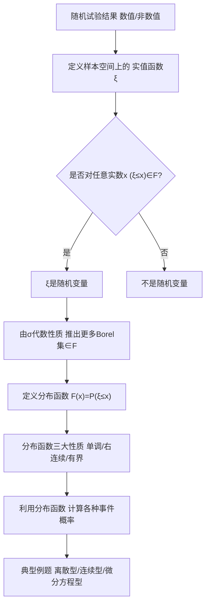
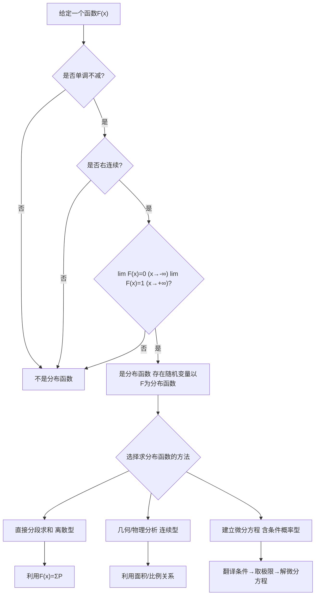

# 第2章 随机变量及分布函数 — 知识点梳理

## 一、本章核心脉络

**核心问题**：如何将不确定的随机现象转化为确定性的数学函数，从而用分析工具研究概率规律？

图中共有两条演进线索：纵向是从「试验结果」到「分布函数」的定义链（为什么先定义随机变量再定义分布函数——因为后者是前者的概率描述）；横向是分布函数从定义到性质再到应用的工具链（概率的三大性质→分布函数的三大性质→利用性质求解实际问题）。

## 二、随机变量的引入

### 2.1 直观动机：从试验结果到数值

随机试验的结果有两类：
- **数值型**：降雨量、候车人数、交通事故次数
- **非数值型**：天气（晴/多云/雨）、化验结果（阳性/阴性）

为了统一用数学方法研究，我们希望在样本空间上定义一个实值函数，将所有样本点"数量化"。

> **一句话来说**：随机变量就是把"不确定会出现哪个结果"这件事变成"不确定会取哪个实数"——把随机性装进一个实值函数里，从而可以用微积分、代数等数学工具来处理。

### 2.2 引入随机变量后的转化

定义样本空间 $\Omega$ 上的实值函数 $\xi(\omega)$ 后：
- 随机事件 $A \subset \Omega$ → 实数子集 $B = \{\xi(\omega): \omega \in A\} \subset \mathbb{R}$
- 概率 $P(A)$ → $P(\xi \in B)$

**关键问题**：为使 $P(\xi \in B)$ 有定义，需要 $\{\xi \in B\} \in \mathscr{F}$（即 B 的原像必须是事件域中的事件）。那么需要对哪些 $B \subset \mathbb{R}$ 满足这个条件？

## 三、随机变量的严格定义（**核心**）

### 3.1 定义2.1.1

设 $(\Omega, \mathscr{F}, P)$ 是概率空间，$\xi(\omega)$ 是定义在 $\Omega$ 上的单值实函数。若对任意实数 $x \in \mathbb{R}$，有

$$\{\omega: \xi(\omega) \leq x\} = \{\xi \leq x\} \in \mathscr{F},$$

则称 $\xi(\omega)$ 是概率空间 $(\Omega, \mathscr{F}, P)$ 上的**随机变量（Random Variable）**，记为 $\xi$。

> **一句话来说**：随机变量不是"变量"而是"函数"——它的定义域是样本空间，值域是实数集，关键要求是它能"兼容"概率空间的事件结构（即对任意截断点 x，满足 $\xi \leq x$ 的样本点构成一个可测事件）。

### 3.2 为什么只要求 $\{\xi \leq x\} \in \mathscr{F}$？

由 $\sigma$ 代数的运算封闭性，从 $\{\xi \leq x\} \in \mathscr{F}$ 可推出以下集合均属于 $\mathscr{F}$：

- $\{\xi > x\} = \Omega - \{\xi \leq x\} \in \mathscr{F}$
- $\{\xi < x\} = \bigcup_{k=1}^{\infty}\{\xi \leq x - \frac{1}{k}\} \in \mathscr{F}$
- $\{\xi = x\} = \{\xi \leq x\} - \{\xi < x\} \in \mathscr{F}$
- $\{\xi \geq x\}$、$\{x_1 < \xi < x_2\}$、$\{x_1 \leq \xi \leq x_2\}$ 等也都属于 $\mathscr{F}$

事实上，可证明对任意 Borel $\sigma$ 代数中的集合 $B$，均有 $\{\xi \in B\} \in \mathscr{F}$。这包含了实际中所有关心的取值范围（区间、点等）。

> **一句话来说**：只要求 $\{\xi \leq x\}$ 可测就够了——利用 $\sigma$ 代数的性质，所有"正常"集合（Borel集）的逆像都可测，正好覆盖了我们关心的所有事件类型。

### 3.3 三条注解

- **注1**：$\{\omega: \xi(\omega) \leq x\} = \{\xi \leq x\} \in \mathscr{F}$ 使 $P\{\xi \leq x\}$ 总有意义。
- **注2**：同一概率空间上可以定义不同的随机变量。
- **注3**（等价定义）：若对任意实数 $x \in \mathbb{R}$，有 $\{\omega: \xi(\omega) < x\} \in \mathscr{F}$，则 $\xi$ 也是随机变量。两种定义等价。

随机变量将样本空间数值化、变量化，是对随机现象进行量化分析的重要手段。**随机变量的引进是概率论发展进程中的一次飞跃**——它完整地描述试验结果，使我们可以用量化分析方法来研究随机现象的统计规律性。

## 四、分布函数的引入（**难点**）

### 4.1 定义2.1.2

设 $\xi(\omega)$ 是定义在概率空间 $(\Omega, \mathscr{F}, P)$ 上的随机变量，$x$ 是任意实数，称函数

$$F(x) = P\{\xi \leq x\} = P\{\omega: \xi(\omega) \leq x\}, \quad x \in \mathbb{R}$$

为随机变量 $\xi$ 的**分布函数（Cumulative Distribution Function）**，也记为 $F_{\xi}(x)$。

> **一句话来说**：分布函数 $F(x)$ 就是"随机变量不超过 x 的概率"随 x 变化的函数——它把离散的概率值串联成一条完整的曲线，概率信息全部编码在其中。

### 4.2 分布函数的直观理解

- $F(x)$ 的函数值表示事件"随机点 $\xi$ 落在 $(-\infty, x]$ 内（$\{\xi \leq x\}$）"的概率。
- 分布函数的增量 $\Delta F = F(x_2) - F(x_1) = P\{x_1 < \xi \leq x_2\}$，是事件"随机点 $\xi$ 落在 $(x_1, x_2]$ 内"的概率。

**总结**：分布函数是概率，其增量也是概率。分布函数将概率的计算**函数化**——可用分布函数来方便地计算随机变量在 Borel 集合上取值的概率。

### 4.3 分布函数的三大性质（定理2.1.1）

1. **单调不降**：若 $x_1 < x_2$，则 $F(x_1) \leq F(x_2)$。
2. **右连续**：对 $\forall x \in \mathbb{R}$，有 $F(x+0) = F(x)$。
3. **有界性**：$0 \leq F(x) \leq 1$，且 $\lim_{x \to -\infty}F(x) = 0$，$\lim_{x \to +\infty}F(x) = 1$。

**直观理解**：
- 单调性：x 越大，"不超过 x" 涵盖的样本点越多，概率自然不降——来自概率的单调性。
- 右连续："从右边逼近 x"等价于事件列的递减交，由概率的连续性保证。
- 有界性：从 $-\infty$ 到 $+\infty$，确定性的"无"到确定性的"全"——来自必然事件和不可能事件的概率。

**证明核心洞察**（性质2右连续）：
由于 $F(x)$ 单调不减，只需证 $\lim_{n \to \infty}F(x+\frac{1}{n}) = F(x)$。因
$$\{\xi \leq x+\frac{1}{n}\} \supset \{\xi \leq x+\frac{1}{n+1}\} \supset \cdots, \quad \bigcap_{n=1}^{\infty}\{\xi \leq x+\frac{1}{n}\} = \{\xi \leq x\},$$
由概率的下连续性即得上式。性质3类似地使用概率的连续性。

### 4.4 三条重要注解

**注1**：分布函数本质是概率，故分布函数的三条性质均来源于概率的相应性质。

**注2**（逆定理）：定理2.1.1的逆定理也成立——若函数 $F(x), x \in \mathbb{R}$ 满足性质1)~3)，则一定存在一个概率空间上的随机变量 $\xi$ 以 $F(x)$ 为分布函数。这为通过函数性质"反向构造"随机变量提供了理论保证。

**注3**：常用分布函数的性质（尤其是右连续性）来确定其未知参数。

> **一句话来说**：三条性质是分布函数的"身份证"——任何分布函数必须同时具有这三个特征，反过来，任何具有这三个特征的函数都可以作为某个随机变量的分布函数。

## 五、分布函数的确定（典型例题）

### 5.1 随机变量定义示例（E1~E5）

| 试验 | 样本空间 | 随机变量定义 |
|:--|:--|:--|
| $E_1$ 抛硬币 | $\Omega_1 = \{H, T\}$ | $\xi(H)=1,\ \xi(T)=0$（正面次数） |
| $E_2$ 检验N件产品 | $\Omega_2 = \{0,1,2,\ldots,N\}$ | $\xi(k)=k$（次品数） |
| $E_3$ 测量身高 | $\Omega_3 = (0, +\infty)$ | $\xi(x)=x$（身高值） |
| $E_4$ 向单位圆投点 | $\Omega_4 = \{(x,y)\mid x^2+y^2 \leq 1\}$ | $\xi(x,y)=\sqrt{x^2+y^2}$（到圆心距离） |
| $E_5$ 股价走势 | $\Omega_5 = \{上升,持平,下跌\}$ | $\xi(\omega_1)=1,\ \xi(\omega_2)=0,\ \xi(\omega_3)=-1$ |

共同特点：都是定义在样本空间上的实值函数。

### 5.2 例1：摸彩赌博（离散型——阶梯函数）

**题目**：袋中有8白8黑共16子。摸出5子，按白子数给彩金：5白→20元，4白→2元，3白→0.5元，其他→0元。求随机变量 $\xi$（彩金）的分布函数。

> [!solution]- 点击展开详细解析
> **步骤分解**：
>
> 1. 确定 $\xi$ 的取值与对应概率：
>    - $P\{\xi=20\} = P\{5\} = C_8^5/C_{16}^5 = 0.0128$
>    - $P\{\xi=2\} = P\{4\} = C_8^1 C_8^4 / C_{16}^5 = 0.1282$
>    - $P\{\xi=0.5\} = P\{3\} = C_8^2 C_8^3 / C_{16}^5 = 0.3589$
>    - $P\{\xi=0\} = P\{0,1,2\} = 1 - 0.3589 - 0.1282 - 0.0128 = 0.5001$
>
> 2. 分段求 $F(x) = P\{\xi \leq x\}$：
>    - $x < 0$：$F(x) = P(\emptyset) = 0$
>    - $0 \leq x < 0.5$：$F(x) = P\{\xi=0\} = 0.5001$
>    - $0.5 \leq x < 2$：$F(x) = 0.5001 + 0.3589 = 0.8590$
>    - $2 \leq x < 20$：$F(x) = 0.8590 + 0.1282 = 0.9872$
>    - $x \geq 20$：$F(x) = 1$
>
> 3. **特点**：这是一个**单调不降、有界、右连续的阶梯函数**。在不连续点处的阶跃值恰为 $P\{\xi=k\}$。
>
> **点评**：此例完整展示了"随机变量→概率分布→分布函数"的链条。分布函数 $F(x)$ 统一描述了所有 $\{\xi \leq x\}$ 型事件的概率，无需逐个讨论随机事件。

### 5.3 例2：射击靶子（连续型——处处连续函数）

**题目**：靶子是半径2米的圆盘，击中任一同心圆盘的概率与该圆盘面积成正比，射击均能中靶。用 $X$ 表示弹着点与圆心的距离，求 $X$ 的分布函数。

> [!solution]- 点击展开详细解析
> **步骤分解**：
>
> 1. 确定比例常数：由 $1 = P\{0 < X \leq 2\} = k \cdot 2^2 = 4k$，得 $k = 1/4$。
> 2. 分段求 $F(x)$：
>    - $x < 0$：$F(x) = 0$
>    - $0 \leq x < 2$：$F(x) = P\{X \leq 0\} + P\{0 < X \leq x\} = 0 + \frac{1}{4}x^2 = \frac{x^2}{4}$
>    - $x \geq 2$：$F(x) = 1$
> 3. 即 $F(x) = \begin{cases} 0, & x < 0; \\ \frac{x^2}{4}, & 0 \leq x < 2; \\ 1, & x \geq 2. \end{cases}$
>
> **特点**：这是一个**单调不降、有界、连续的函数**（与例1的阶梯函数形成对比，体现了离散型与连续型的本质区别）。

### 5.4 例3：电子管寿命（连续型——微分方程导出）

**题目**：使用了 $t$ 小时的电子管在以后的 $\Delta t$ 小时内损坏的概率等于 $\lambda\Delta t + o(\Delta t)$，其中 $\lambda > 0$ 为常数。求寿命 $T$ 的分布函数。

> [!solution]- 点击展开详细解析
> **步骤分解**：
>
> 1. 当 $t < 0$ 时：$F(t) = P\{T \leq t\} = 0$（寿命非负）。
>
> 2. 当 $t \geq 0$ 时：由题设条件
>    $$P\{T \leq t+\Delta t \mid T > t\} = \lambda\Delta t + o(\Delta t)$$
>    $$\Leftrightarrow \frac{P(t < T \leq t+\Delta t)}{P(T > t)} = \lambda\Delta t + o(\Delta t)$$
>    $$\Leftrightarrow \frac{F(t+\Delta t) - F(t)}{1 - F(t)} = \lambda\Delta t + o(\Delta t)$$
>
> 3. 移项变形：
>    $$\frac{F(t+\Delta t) - F(t)}{\Delta t} = \left(\lambda + \frac{o(\Delta t)}{\Delta t}\right)(1 - F(t))$$
>
> 4. 令 $\Delta t \to 0$，得微分方程：
>    $$\begin{cases} \frac{dF(t)}{dt} = \lambda[1 - F(t)] \\ F(0) = 0 \end{cases}$$
>
> 5. 求解得：$F(t) = \begin{cases} 1 - e^{-\lambda t}, & t \geq 0; \\ 0, & t < 0. \end{cases}$
>
> **特点**：这是一个**单调不降、有界、连续的函数**，即指数分布的分布函数。此题展示了分布函数的一种"加工方式"——从问题的物理条件出发，利用条件概率导出微分方程。

> **一句话来说**：通过条件概率关系建立微分方程是求分布函数的重要方法——先翻译条件为概率等式，然后取极限得到微分方程，最后求解。

### 5.5 例4：根据性质确定参数

**题目**：随机变量 $\xi$ 的分布函数为
$$F(x) = \begin{cases} 0, & x \leq a; \\ k(x-a), & a < x \leq b; \\ 1, & x > b. \end{cases}$$
求 $k$。

> [!solution]- 点击展开详细解析
> **解**：利用分布函数的右连续性。在 $x = b$ 处：
> $$\lim_{x \to b^+}F(x) = 1 = F(b) = k(b-a)$$
> 故 $k = \frac{1}{b-a}$。
>
> **点评**：这是"注3"的直接应用——利用分布函数的性质反求未知参数。关键在于找到函数表达式切换的边界点，利用该点处的连续性（或右连续性）建立等式。

## 判定/决策流程

## 核心公式速查表

| 概念 | 公式 | 说明 |
|:--|:--|:--|
| 随机变量定义 | $\{\omega: \xi(\omega) \leq x\} \in \mathscr{F},\ \forall x \in \mathbb{R}$ | $\xi$ 是从 $\Omega$ 到 $\mathbb{R}$ 的可测函数 |
| 分布函数定义 | $F(x) = P\{\xi \leq x\}$ | 随机变量不超过 $x$ 的概率 |
| 增量公式 | $F(x_2) - F(x_1) = P\{x_1 < \xi \leq x_2\}$ | 分布函数之差 = 区间概率 |
| 右连续 | $F(x+0) = F(x)$ | 从右侧逼近的值等于函数值 |
| 单调性 | $x_1 < x_2 \Rightarrow F(x_1) \leq F(x_2)$ | 分布函数单调不减 |
| 边界值 | $\lim_{x\to -\infty}F(x) = 0,\ \lim_{x\to +\infty}F(x) = 1$ | 完整的概率范围 |
| 离散型概率还原 | $P\{\xi = k\} = F(k) - F(k-0)$ | 分布函数在跳跃点的阶跃值 |
| 由分布函数求概率 | $P\{a < \xi \leq b\} = F(b) - F(a)$ | 右端点减左端点 |

## 易错点与注意事项

> [!warning] 易错点与注意事项
>
> 1. **随机变量不是普通变量**：$\xi$ 是从样本空间到实数的函数（$\xi: \Omega \to \mathbb{R}$），不是微积分中"可以自由取值的变量"。$\xi$ 的取值由试验结果决定，具有概率结构。
>
> 2. **右连续 vs 左连续**：分布函数是**右**连续的（$F(x+0) = F(x)$），但一般不是左连续的。左极限 $F(x-0)$ 与 $F(x)$ 的差恰好是 $P\{\xi = x\}$。这里容易和某些教材的定义混淆（有些教材定义 $F(x) = P\{\xi < x\}$ 则得到左连续）。
>
> 3. **必要条件 vs 充分条件**：单调不减、右连续、边界值0/1 是分布函数的**充要条件**（定理2.1.1及其逆定理），不是单向的。任何一个满足这三条的函数"一定是"某个随机变量的分布函数。
>
> 4. **$F(x)$ 的增量才对应区间概率**：$F(x)$ 本身是累积概率（$-\infty$ 到 $x$），不是某点的概率。在连续点处 $P\{\xi = x\} = 0$，概率"藏"在增量 $F(b)-F(a)$ 中。
>
> 5. **例3的微分方程推导**：从条件概率关系出发时，"损坏概率 = $\lambda\Delta t + o(\Delta t)$"是线性近似的核心假设（指数分布的无记忆性的来源），不是随意取的形式。$o(\Delta t)$ 项在取极限后消失，不影响最终结果。

## 相关知识点链接

- **前置**：[[01-概率空间与事件域]]（$\sigma$ 代数、概率的定义与性质是理解随机变量定义和分布函数性质的基础——随机变量要求"可测"，分布函数性质依赖于概率的单调性和连续性）
- **后续**：[[02b-离散型随机变量-知识梳理]]（离散型随机变量是本章的直接特殊化——分布律是分布函数的离散形式）
- **后续**：[[02c-连续型随机变量-知识梳理]]（连续型随机变量与例2/例3紧密衔接——密度函数是分布函数的导数）

## 作业与练习

本章对应习题见 [[习题库/第2章-随机变量的分布]]。重点练习：
1. 判断一个函数是否为分布函数（验证三大性质）
2. 给定随机试验场景，构造分布函数（参考例1~例3的三种模式）
3. 利用分布函数性质求未知参数（参考例4）
4. 从分布函数还原概率分布（离散型的阶跃值）
