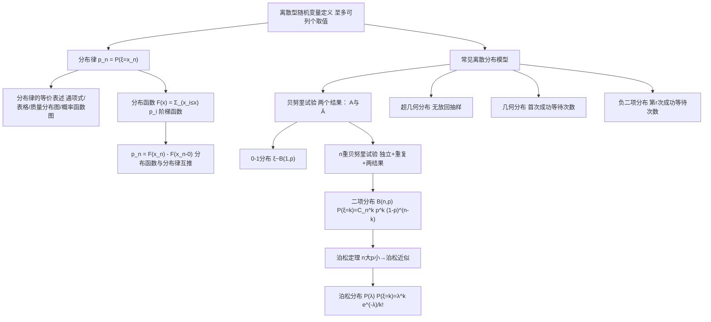
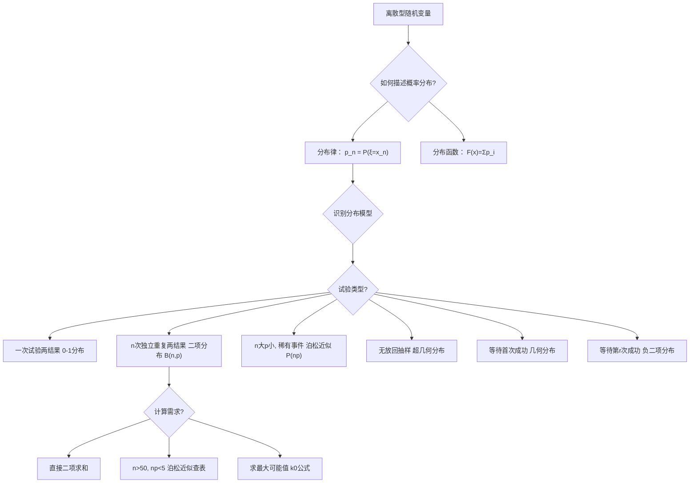

# 第2章 离散型随机变量 — 知识点梳理

## 一、本章核心脉络

**核心问题**：当一个随机变量只能取有限个或可列个值时，如何完整、直观地描述它的概率分布？有哪些经典的离散型概率模型？

> [!info] 学习导读
> **必要先修**：先掌握[[课程/概率论/知识点解析梳理/02a-随机变量及分布函数-知识梳理|随机变量与分布函数]]。
> **来源边界**：正文依据[[课程/概率论/PPT课件/MD/C2.2 离散型随机变量|C2.2 课件源文]]重组；模型选择提示与自测属于补充解释。
> **阅读路线**：分布律 → 分布函数 → 0-1/二项分布 → 泊松近似 → 超几何、几何与负二项分布。

图的演进逻辑：先从最一般的"离散型"定义出发，建立分布律和分布函数两套等价描述工具；然后从最简单的贝努里试验（两结果）出发，逐步扩展到 n 重贝努里试验（二项分布），再通过极限过程导出泊松分布；最后补充无放回抽样（超几何）、等待时间（几何/负二项）等变体模型。

## 二、离散型随机变量与分布律（**核心**）

### 2.1 定义2.2.1

如果随机变量 $\xi$ 至多取可列无穷个数值：$x_1, x_2, \ldots$，记 $p_n = P\{\xi = x_n\}$，且满足

- (1) $p_n \geq 0,\ \forall n$（**非负性**）
- (2) $\sum_{n=1}^{\infty} p_n = 1$（**规范性/归一性**）

则称 $\xi$ 是**离散型随机变量（Discrete Random Variable）**，称

$$p_n = P\{\xi = x_n\},\quad n = 1, 2, \ldots$$

为 $\xi$ 的**分布律（Distribution Law）**（通项式形式）。

> **一句话来说**：离散型随机变量的全部概率信息浓缩在一张"取值-概率"的对应表中——每个可能取值 $x_n$ 上分配一个概率质量 $p_n$，总质量为1。

### 2.2 分布律的三种表示形式

| 形式 | 表示方式 | 优点 |
|:--|:--|:--|
| **通项式** | $p_n = P\{\xi = x_n\},\ n = 1,2,\ldots$ | 紧凑，适合推导 |
| **表格** | $\begin{array}{c\|c\|c\|c\|c} \xi & x_1 & x_2 & \cdots & x_n \\ \hline P\{\xi = x_i\} & p_1 & p_2 & \cdots & p_n \end{array}$ | 直观，快速查阅 |
| **图形** | 质量分布图 / 概率函数图 | 可视化概率大小的相对关系 |

两种图形描述：
- **质量分布图**：总质量为1，在 $x_n$ 处置质量为 $p_n$ 的质点。
- **概率函数图**：以 $x_n$ 为横坐标、$p_n$ 为纵坐标的离散点图。

> [!hint] 记忆技巧
> 分布律 = "取值列表 + 概率列表"，两者一一对应。验证分布律只需两件事：所有概率非负，所有概率之和为1。

### 2.3 分布函数与分布律的关系

对于离散型随机变量 $\xi$，其分布函数为

$$F(x) = P\{\xi \leq x\} = \sum_{x_i \leq x} P\{\xi = x_i\} = \sum_{x_i \leq x} p_i$$

这是一个**右连续的阶梯函数**，在每个取值点 $x_n$ 处有跳跃，跳跃高度恰好为 $p_n$。

**反过来**，由分布函数 $F(x)$ 可还原分布律：

$$p_n = \lim_{k \to \infty}\left[F(x_n) - F(x_n - \frac{1}{k})\right] = F(x_n) - F(x_n - 0),\quad n = 1, 2, \ldots$$

> **一句话来说**：分布律和分布函数是描述离散型随机变量概率分布的**等价工具**——分布律"纵向"看各点的概率质量，分布函数"横向"连成阶梯曲线。分布律更直观，分布函数更方便计算区间概率。

**思考**：分布律和分布函数哪一个更直观？——分布律直接展示每个取值的概率大小，对离散型而言通常更直观；但分布函数统一了离散型和连续型的描述框架。

## 三、贝努里试验与0-1分布（**核心**）

### 3.1 贝努里试验（Bernoulli Trial）

**贝努里试验**：仅有两个基本事件 $A$ 和 $\overline{A}$ 的随机试验，且 $P(A) = p\ (0 < p < 1)$。

常见实例：
- 抛一枚硬币（正面/反面）
- 检查一件产品是否合格
- 射击是否命中
- 考试是否通过

> **一句话来说**：贝努里试验是概率论中最简单的试验模型——只有"是/否"、"成功/失败"两种结果，它是构建所有离散分布最基本的"原子"。

### 3.2 0-1分布

令 $\xi = \begin{cases} 1, & \text{若事件A发生;} \\ 0, & \text{若事件A不发生.} \end{cases}$（$\xi$ 是一次试验中事件 $A$ 出现的次数）

则 $\xi$ 的分布律为：

| $\xi$ | 0 | 1 |
|:--|:--|:--|
| $P\{\xi = x_i\}$ | $1-p$ | $p$ |

称 $\xi$ 服从**0-1分布**（也称**两点分布**）。

## 四、n重贝努里试验与二项分布（**核心**）

### 4.1 n重贝努里试验

**定义2.2.2**：将试验 $E$ 按下述条件重复进行 $n$ 次——

1. 每次试验的条件不变（**重复性**）；
2. 各次试验的结果互不影响（**独立性**）。

称这 $n$ 次试验为 $n$ 次重复独立试验。若 $E$ 是贝努里试验，则称为 **$n$ 重贝努里试验**（贝努里概型）。

**判定 n 重贝努里试验的三个条件**：独立性、重复性、只有两个结果。

> **一句话来说**：n 重贝努里试验就是把同一个"是/否"试验独立地重复做 n 次——关心的是 n 次中"是"出现了多少次。

### 4.2 二项分布

$n$ 重贝努里试验中事件 $A$ 发生 $k$ 次的概率为

$$p_n(k) = C_n^k p^k (1-p)^{n-k},\quad k = 0, 1, 2, \ldots, n.$$

若随机变量 $\xi$ 的分布列为

$$P\{\xi = k\} = C_n^k p^k (1-p)^{n-k},\quad k = 0, 1, 2, \ldots, n,$$

则称 $\xi$ 服从**二项分布（Binomial Distribution）**，记为 $\xi \sim B(n, p)$。

> **一句话来说**：二项分布描述的是"n 次独立重复试验中成功次数的概率分布"——$C_n^k$ 选位置（哪 k 次成功），$p^k$ 成功 k 次，$(1-p)^{n-k}$ 失败 n-k 次。

**特例**：0-1 分布可以看作 $\xi \sim B(1, p)$。

**典型应用场景**：
- 产品抽检试验（抽 n 件产品中的次品数）
- 强弱对抗试验（n 次独立比赛中的获胜次数）
- 设备排障试验

### 4.3 二项分布的最大可能值

二项分布 $B(n, p)$ 中概率最大的 $k$ 值（最大可能值）：

$$k_0 = \begin{cases} (n+1)p \text{ 和 } (n+1)p-1, & \text{若 }(n+1)p \text{ 为整数}; \\ [(n+1)p], & \text{否则}. \end{cases}$$

**推导核心**：考察相邻项比值
$$\frac{b(k; n, p)}{b(k-1; n, p)} = \frac{C_n^k p^k (1-p)^{n-k}}{C_n^{k-1} p^{k-1} (1-p)^{n-k+1}} = \frac{(n-k+1)p}{k(1-p)} = 1 + \frac{(n+1)p - k}{k(1-p)}$$
当 $k < (n+1)p$ 时比值 > 1（递增），当 $k > (n+1)p$ 时比值 < 1（递减），最大值出现在 $(n+1)p$ 附近。

> **一句话来说**：二项分布概率先增后减（单峰），最大概率点约在 $np$ 附近——试验次数乘成功概率，符合直觉。

## 五、泊松分布与泊松定理（**难点**）

### 5.1 从二项分布到泊松分布

**动机问题**：考察 $[0,1)$ 年内某路口发生的交通事故次数。

将 $[0,1)$ 年分成 $n$ 个小时间段，做三个合理假设：
1. 每小段时间内恰好发生一次事故的概率与时间长度成正比，为 $\lambda/n$；
2. 每小段时间内发生两次以上事故是不可能的；
3. 各段时间内是否发生事故相互独立。

此时事故次数 $X_n \sim B(n, \lambda/n)$，其分布律为

$$P(X_n = k) = C_n^k \left(\frac{\lambda}{n}\right)^k \left(1 - \frac{\lambda}{n}\right)^{n-k},\quad k = 0, 1, 2, \ldots, n.$$

当 $n \to \infty$ 时取极限：

$$\lim_{n \to \infty} P(X_n = k) = \frac{\lambda^k e^{-\lambda}}{k!},\quad k = 0, 1, 2, \ldots$$

> **一句话来说**：泊松分布是二项分布的极限形态——当试验次数趋于无穷、每次成功的概率趋于零（"稀有事件"），但期望次数保持为常数 $\lambda$ 时，二项分布"收敛"为泊松分布。

### 5.2 定义2.2.3

若随机变量 $\xi$ 的分布律为

$$P\{\xi = k\} = \frac{\lambda^k}{k!} e^{-\lambda},\quad k = 0, 1, 2, \ldots;\quad (\lambda > 0),$$

则称 $\xi$ 服从参数为 $\lambda$ 的**泊松分布（Poisson Distribution）**，记为 $\xi \sim P(\lambda)$。

### 5.3 泊松定理（定理2.2.1）

若 $\lim_{n \to \infty} n p_n = \lambda\ (\lambda \geq 0)$，则有

$$\lim_{n \to \infty} b(k; n, p_n) = \lim_{n \to \infty} C_n^k p_n^k (1-p_n)^{n-k} = \frac{\lambda^k}{k!} e^{-\lambda},\quad k = 0, 1, 2, \ldots$$

**证明核心洞察**（以 $k \geq 1$ 为例）：

令 $\lambda_n = n p_n$，则

$$b(k; n, p_n) = \frac{n(n-1)\cdots(n-k+1)}{k!} p_n^k (1-p_n)^{n-k} = \frac{\lambda_n^k}{k!} \left(1-\frac{1}{n}\right)\left(1-\frac{2}{n}\right)\cdots\left(1-\frac{k-1}{n}\right) \left(1-\frac{\lambda_n}{n}\right)^{n \cdot \frac{n-k}{n}}$$

取极限：
- $\lambda_n^k \to \lambda^k$
- 连乘积 $\to 1$（对固定 $k$）
- $(1-\frac{\lambda_n}{n})^n \to e^{-\lambda}$

> **一句话来说**：泊松定理的证明精髓在于将二项系数拆解、重组，使 $n$ 进入指数位置，从而利用极限 $\lim_{n\to\infty}(1-\frac{\lambda}{n})^n = e^{-\lambda}$。

### 5.4 泊松分布的实际应用条件

由条件 $\lim_{n \to \infty} n p_n = \lambda$ 可知 $\{p_n\}$ 与 $\{1/n\}$ 同阶无穷小。因此：

1. **二项分布的泊松近似**：当 $n$ 足够大、$p$ 较小（一般 $n > 50,\ np < 5$）时，
   $$b(k; n, p) = C_n^k p^k (1-p)^{n-k} \approx \frac{\lambda^k}{k!} e^{-\lambda}, \quad \text{其中 } \lambda = np.$$

2. **稀有事件原理**：实际问题中，大量独立重复试验中"稀有事件"出现的次数可认为服从泊松分布——这是泊松分布广泛存在的原因。

**典型应用**：
- 设备排障试验（多台设备独立运转中的故障数）
- 存储问题（库存管理中的需求量）
- 电话交换台的呼叫次数
- 放射性物质在单位时间内的衰变次数

### 5.5 泊松分布的最大可能值

$$\frac{P(k; \lambda)}{P(k-1; \lambda)} = \frac{\lambda}{k}$$

$$k_0 = \begin{cases} \lambda \text{ 和 } \lambda-1, & \text{若 } \lambda \text{ 为整数}; \\ [\lambda], & \text{否则}. \end{cases}$$

## 六、其他常用离散型分布

### 6.1 超几何分布（分类取球问题）

**模型**：袋中有 $N$ 个球，其中 $M$ 个红球，$N-M$ 个白球。从袋中**无放回**地任取 $n$ 个球，其中红球个数 $\xi$ 的分布律为

$$P\{\xi = m\} = \frac{C_M^m C_{N-M}^{n-m}}{C_N^n},\quad m = 0, 1, 2, \ldots, l;\quad l = \min(n, M).$$

称 $\xi$ 服从**超几何分布（Hypergeometric Distribution）**。

> **一句话来说**：超几何分布是二项分布的"无放回版本"——抽取不再独立（每次抽取改变剩余球的比例），但公式结构类似：分子是"选 m 个红球 × 选 n-m 个白球"，分母是"所有选 n 个球的方式"。

**与二项分布的关系**：当 $N$ 很大而 $n$ 相对很小时，无放回近似于有放回，超几何分布近似于二项分布 $B(n, M/N)$。

**典型应用**：产品抽检试验（无放回抽样）。

### 6.2 几何分布

随机变量 $\xi$ 的分布列为

$$P\{\xi = k\} = p(1-p)^{k-1},\quad k = 1, 2, \ldots$$

称 $\xi$ 服从**几何分布（Geometric Distribution）**。

> **一句话来说**：几何分布回答的问题是"独立重复试验中，第一次成功发生在第几次"——前 $k-1$ 次全失败（概率 $(1-p)^{k-1}$），第 $k$ 次成功（概率 $p$）。

**典型应用**：产品检验试验（逐个检查，直到发现第一个废品为止的检查次数）。

### 6.3 负二项分布（帕斯卡分布）

随机变量 $\xi$ 的分布列为

$$P\{\xi = k\} = C_{k-1}^{r-1} p^r (1-p)^{k-r},\quad k = r, r+1, \ldots$$

称 $\xi$ 服从**负二项分布（Negative Binomial Distribution）**，也称帕斯卡分布。

> **一句话来说**：负二项分布回答"直到第 $r$ 次成功时总共做了多少次试验"——第 $k$ 次恰好是第 $r$ 次成功，所以前 $k-1$ 次中有 $r-1$ 次成功（$C_{k-1}^{r-1}$ 种排列），加上最后第 $k$ 次成功。

**注意**：几何分布是负二项分布在 $r=1$ 时的特例。

## 七、典型例题

### 7.1 例1：有放回与无放回抽样的对比

**题目**：设一批同类产品共 $N$ 个，其中次品 $M$ 个。
- (1) 有放回地取出 $n$ 个，求次品件数 $\xi$ 的分布列。
- (2) 无放回地取出 $n$ 个，求次品件数 $\xi$ 的分布列。

> [!solution]- 点击展开详细解析
> **解**：
> 1. **有放回**：各次抽到次品与否相互独立，抽 $n$ 件 = $n$ 重贝努里试验 → **二项分布**：
>    $$P(\xi = k) = C_n^k \left(\frac{M}{N}\right)^k \left(1 - \frac{M}{N}\right)^{n-k},\quad k = 0, 1, 2, \ldots, n.$$
>
> 2. **无放回**：各次不再独立 → **超几何分布**：
>    $$P(\xi = k) = \frac{C_M^k C_{N-M}^{n-k}}{C_N^n},\quad k = 0, 1, 2, \ldots, \min(M, n).$$
>
> **点评**：此题清晰展示了有放回/无放回导致分布模型的本质区别——前者是独立重复→二项分布，后者是有限总体不放回→超几何分布。

### 7.2 例2：强弱两队对抗赛

**题目**：强弱两队进行乒乓球对抗赛，得胜人数多的一方获胜。强队每个队员获胜概率为 0.6。以下哪个方案对弱队更有利？
- (1) 双方各出 3 人；
- (2) 双方各出 7 人。

> [!solution]- 点击展开详细解析
> **解**：
>
> 1. **方案(1)**：3 重贝努里试验，弱队获胜队员数 $\xi \sim B(3, 0.4)$。弱队赢得比赛需 $\xi > 1$（即 2 或 3 人获胜）：
>    $$P = \sum_{k=2}^{3} C_3^k (0.4)^k (0.6)^{3-k} \approx 0.352.$$
>
> 2. **方案(2)**：7 重贝努里试验，弱队获胜队员数 $\eta \sim B(7, 0.4)$。弱队赢得比赛需 $\eta > 3$（即 4~7 人获胜）：
>    $$P = \sum_{k=4}^{7} C_7^k (0.4)^k (0.6)^{7-k} \approx 0.290.$$
>
> **结论**：方案(1) 更有利（0.352 > 0.290）。人数少时随机波动大，弱队"爆冷"概率更高——直觉上，比赛人数越多，强者优势越稳定。

### 7.3 例3：机床故障工人配置

**题目**：300 台独立运转的同类机床，每台故障概率 0.01，一人排除一台故障。问至少需要多少名工人，才能保证不能及时排除故障的概率小于 0.01？

> [!solution]- 点击展开详细解析
> **解**：
>
> 1. $\xi \sim B(300, 0.01)$（同时发生故障的机床数）。
>
> 2. 需 $P\{\xi > N\} < 0.01$，即 $1 - \sum_{k=0}^{N} C_{300}^k (0.01)^k (0.99)^{300-k} < 0.01$。
>
> 3. 由于 $n = 300$ 大，$p = 0.01$ 小，$np = 3 < 5$，用泊松近似 $\xi \approx P(3)$：
>    $$P\{\xi > N\} = \sum_{k=N+1}^{\infty} \frac{3^k}{k!} e^{-3} < 0.01.$$
>
> 4. 查泊松分布表（$\lambda = 3$）：
>    - $P\{\xi > 7\} = 1 - P\{\xi \leq 7\} = 1 - 0.9881 = 0.0119 > 0.01$
>    - $P\{\xi > 8\} = 1 - P\{\xi \leq 8\} = 1 - 0.9962 = 0.0038 < 0.01$
>
> 5. 故至少需要 **8** 个修理工人。
>
> **补充**：$\xi \sim B(300, 0.01)$ 的最大可能值 $k_0 = [(300+1) \times 0.01] = [3.01] = 3$，即同一时刻损坏 3 台设备的可能性最大。
>
> **点评**：此题完整展示了"建模→近似→查表→决策"的工程流程。泊松近似使原本计算量巨大的二项求和变得可行。

### 7.4 例4：商店存货问题

**题目**：某商店每月销售量 $\xi \sim P(10)$（$\lambda = 10$）。为了以 95% 的概率保证不脱销，月底应存多少商品（只在月底进货）？

> [!solution]- 点击展开详细解析
> **解**：设月底存货为 $a$ 件，需求 $P\{\xi \leq a\} \geq 0.95$。
>
> 查泊松分布表（$\lambda = 10$）：
> - $\sum_{k=0}^{14} \frac{10^k}{k!} e^{-10} \approx 0.9166 < 0.95$
> - $\sum_{k=0}^{15} \frac{10^k}{k!} e^{-10} \approx 0.9513 > 0.95$
>
> 故月底存货不少于 **15** 件即可。
>
> **补充**：最可能销售件数 $k_0 = \lambda = 10$（件）。

### 7.5 例5：废品检查（几何分布与负二项分布）

**题目**：产品废品率为 $p\ (0 < p < 1)$，对产品逐个检查，求：
- (1) 检查到第 1 个废品时已检查个数 $\xi$ 的分布律。
- (2) 检查到第 5 个废品时已检查个数 $\eta$ 的分布律。

> [!solution]- 点击展开详细解析
> **解**：
>
> **(1) 几何分布**：事件 $\{\xi = k\}$ = 第 $k$ 次是废品，前 $k-1$ 次均为合格品。
> $$P\{\xi = k\} = p(1-p)^{k-1},\quad k = 1, 2, \ldots$$
>
> **(2) 负二项分布**：事件 $\{\eta = k\}$ = 第 $k$ 次是第 5 个废品，前 $k-1$ 次中恰有 4 个废品。
> - 指定的 5 次出现废品概率：$p^5 (1-p)^{k-5}$
> - 前 $k-1$ 次中选 4 次出现废品：$C_{k-1}^4$ 种
> $$P\{\eta = k\} = C_{k-1}^4 p^5 (1-p)^{k-5},\quad k = 5, 6, \ldots$$

## 判定/决策流程

## 核心公式速查表

| 分布 | 分布律 | 参数 | 记号 | 应用场景 |
|:--|:--|:--|:--|:--|
| 0-1分布 | $P(\xi=1)=p,\ P(\xi=0)=1-p$ | $0<p<1$ | $B(1,p)$ | 一次贝努里试验 |
| 二项分布 | $P(\xi=k)=C_n^k p^k (1-p)^{n-k}$ | $n\geq 1,\ 0<p<1$ | $B(n,p)$ | n重贝努里试验中成功次数 |
| 泊松分布 | $P(\xi=k)=\frac{\lambda^k}{k!}e^{-\lambda}$ | $\lambda>0$ | $P(\lambda)$ | 稀有事件计数 |
| 超几何分布 | $P(\xi=m)=\frac{C_M^m C_{N-M}^{n-m}}{C_N^n}$ | $N,M,n$ | — | 无放回抽样 |
| 几何分布 | $P(\xi=k)=p(1-p)^{k-1}$ | $0<p<1$ | — | 首次成功等待次数 |
| 负二项分布 | $P(\xi=k)=C_{k-1}^{r-1}p^r(1-p)^{k-r}$ | $0<p<1,\ r\geq 1$ | — | 第r次成功等待次数 |
| 分布律→分布函数 | $F(x)=\sum_{x_i \leq x} p_i$ | — | — | 阶梯函数，跳跃点为 $x_i$ |
| 分布函数→分布律 | $p_n=F(x_n)-F(x_n-0)$ | — | — | 阶跃高度 = 概率 |
| 二项最大可能值 | $k_0=[(n+1)p]$ 或 $(n+1)p$ 与 $(n+1)p-1$ | — | — | 单峰，约在 np 处 |
| 泊松最大可能值 | $k_0=[\lambda]$ 或 $\lambda$ 与 $\lambda-1$ | — | — | 单峰，约在 $\lambda$ 处 |

## 易错点与注意事项

> [!warning] 易错点与注意事项
>
> 1. **分布律 vs 分布函数**：分布律 $p_n = P\{\xi = x_n\}$ 是点的概率，分布函数 $F(x) = P\{\xi \leq x\}$ 是累积概率。两者等价但不要混淆——$p_n$ 是离散型的"核心"，$F(x)$ 是统一框架。
>
> 2. **二项分布的前提条件**：必须同时满足**独立性**（各次试验互不影响）、**重复性**（条件不变）、**两结果性**（仅关注 A 与 $\overline{A}$）。缺一不可。例如，无放回抽样不满足独立性，不能用二项分布。
>
> 3. **泊松近似的条件**：$n \to \infty$ 且 $np_n \to \lambda$ 意味着 $p_n \to 0$（稀有事件）。即二项分布的泊松近似只在**大 n、小 p**时才准确——如果 p 接近 0.5，即使 n 很大也不能用泊松近似。
>
> 4. **必要条件 vs 充分条件**：$\lim_{n\to\infty} n p_n = \lambda$ 是泊松定理成立的**充分条件**（在这个条件下二项分布收敛于泊松分布）。如果 $n p_n \to \infty$，则二项分布近似于正态分布（后续章节），而非泊松分布。
>
> 5. **超几何分布与二项分布**：当 $N$ 很大而 $n$ 相对较小时，超几何分布 ≈ $B(n, M/N)$，但**两者是不同的分布**——一个是有限总体无放回，一个是无限总体（或有放回）。选择模型时先判断抽样方式。
>
> 6. **几何分布的取值范围**：$k = 1, 2, \ldots$（从 1 开始，不是 0）。有些教材采用"失败次数"版本：$P\{\xi = k\} = p(1-p)^k,\ k=0,1,2,\ldots$。注意区分定义版本。
>
> 7. **负二项分布与二项分布**：二项分布是"固定 n 次试验，数成功次数"；负二项分布是"固定成功次数 r，数试验次数"。两者方向相反，不要混淆。几何分布是负二项分布在 $r=1$ 的特例。
>
> 8. **最大可能值公式的使用**：$[(n+1)p]$ 表示向下取整。当 $(n+1)p$ 为整数时有两个并列的最大可能值（$(n+1)p$ 和 $(n+1)p-1$），不是只有一个。

## 自测（新编）

判断模型：从含 $M$ 件次品的 $N$ 件产品中不放回抽取 $n$ 件，次品数服从什么分布？若改为每次独立放回抽取，次品数又服从什么分布？

> [!hint]- 提示
> 关键在于各次抽取是否独立、成功概率是否保持不变。

> [!solution]- 解析
> 不放回抽取时服从超几何分布；放回且每次独立时服从二项分布 $B(n,M/N)$。两者不能仅因“都是计数”就混用。

## 相关知识点链接

- **前置**：[[02a-随机变量及分布函数-知识梳理]]（分布函数的定义与性质是理解 $F(x) = \sum p_i$ 和 $p_n = F(x_n) - F(x_n-0)$ 的基础——本章的分布律-分布函数互推依赖于分布函数的阶梯函数性质）
- **前置**：[[01-概率空间与事件域]]（事件独立性是定义 n 重贝努里试验的前提，组合计数 $C_n^k$ 是二项分布的基础）
- **后续**：[[02c-连续型随机变量-知识梳理]]（连续型随机变量与离散型对照——连续型的概率密度类比于分布律，分布函数从阶梯函数变为连续函数）
- **后续**：[[03-多维随机变量]]（多项分布是二项分布在多维的推广）

## 作业与练习

本章对应习题见 [[习题库/第2章-随机变量的分布]]。重点练习：
1. 给定场景判断使用哪种离散分布（区分有放回/无放回、固定次数/固定成功数）
2. 二项分布的概率计算及泊松近似（例3、例4模式）
3. 最大可能值的计算
4. 几何分布与负二项分布的应用题（例5模式）
5. 综合应用题（如"强弱对抗""设备排障"等需要先建模再计算的题目）
