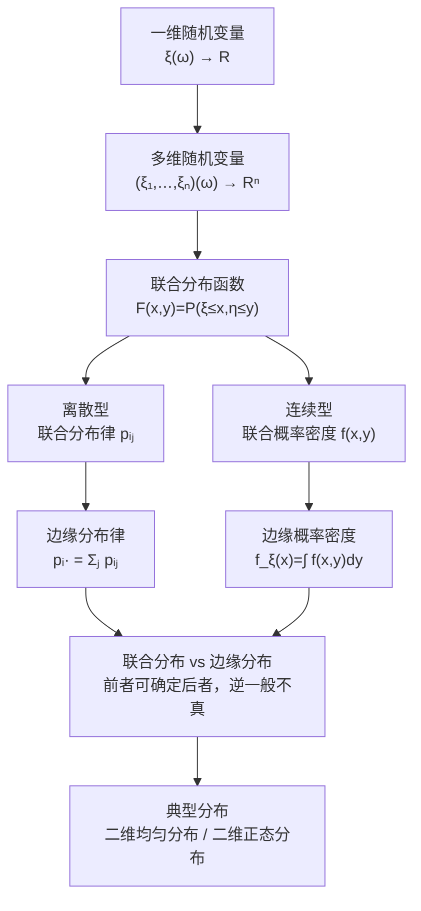
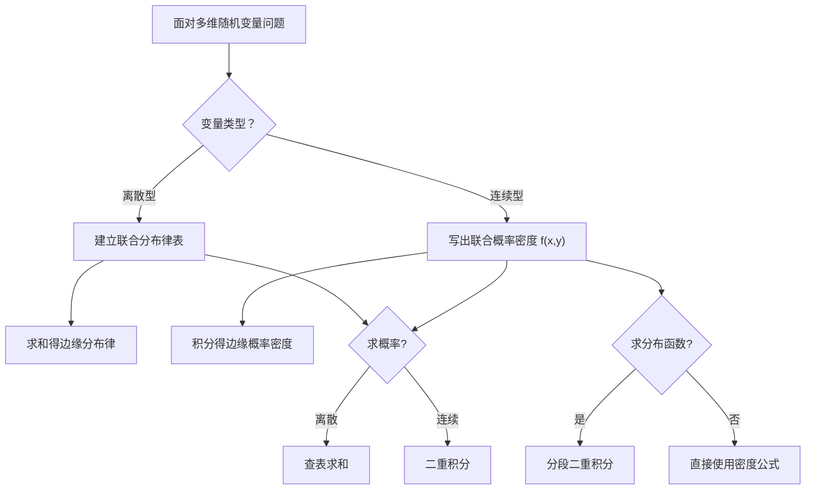

## 一、本章核心脉络

**核心问题**：在一个随机试验中，我们常常需要同时考虑多个数量指标（如身高与体重、炮弹落点的横纵坐标），如何用数学工具描述它们的联合行为？

> [!info] 学习导读
> **必要先修**：先掌握[[课程/概率论/知识点解析梳理/02a-随机变量及分布函数-知识梳理|一维分布函数]]与[[课程/概率论/知识点解析梳理/02c-连续型随机变量及概率密度-知识梳理|一维概率密度]]。
> **来源边界**：正文依据[[课程/概率论/PPT课件/MD/C3.1 多维随机变量及其分布|C3.1 课件源文]]重组；几何直觉与自测属于补充解释。
> **阅读路线**：联合分布函数 → 离散联合分布律/连续联合密度 → 边缘化 → 二维均匀与二维正态。



这个顺序体现了"从一般到具体、从定义到应用"的认识逻辑：先建立多维随机变量的一般数学框架（分布函数及其性质），再分化为离散和连续两种具体类型，最后聚焦两个最重要的二维分布模型。

---

## 二、多维随机变量的引入及联合分布函数（核心）

### 2.1 从一维到多维

**定义 3.1.1** 如果 $\xi$ 和 $\eta$ 是定义在同一概率空间 $(\Omega, \mathscr{F}, P)$ 上的两个随机变量，称 $(\xi, \eta)$ 为**二维随机变量**（Bivariate Random Variables）。

> 一句话来说：二维随机变量就是把两个"有关系的"随机变量打包在一起，它们共享同一个概率空间，因此可以讨论它们的联合行为。

等价地，$(\xi, \eta)$ 是 $(\Omega, \mathscr{F}, P)$ 到 $\mathbb{R}^2$ 的映射：

$$\omega \mapsto (\xi(\omega), \eta(\omega))$$

**直观理解**：设 $\Omega = \{\text{电子科大全体男生}\}$，任选一名男生 $\omega \in \Omega$，其身高 $H(\omega)$ 和体重 $W(\omega)$ 就是定义在 $\Omega$ 上的二维随机变量 $(H, W)$——一个样本点对应两个变量值。

**关键洞察——"二维随机变量"与"两个随机变量"的区别**：
- 两个"分开放置"的随机变量 $\xi$ 和 $\eta$：只知道各自的分布，不知道它们之间的关联
- 二维随机变量 $(\xi, \eta)$：不仅知道各自的分布，还能刻画 $\xi$ 和 $\eta$ 之间的依赖关系

**思考题**：设 $\xi$ 是抛一枚均匀硬币正面出现的次数，$\eta$ 是掷一粒均匀骰子得到的点数。$(\xi, \eta)$ 能看成二维随机变量吗？如果可以，它们定义在哪个概率空间上？

（答：可以。定义在 $\Omega = \{(H, d): H \in \{0,1\}, d \in \{1,2,\ldots,6\}\}$ 上，$\xi(\omega) = H$, $\eta(\omega) = d$。）

---

### 2.2 联合分布函数

**定义 3.1.2** 对任意实数对 $(x, y) \in \mathbb{R}^2$，称二元函数

$$F(x, y) = P\{\xi \leq x, \eta \leq y\}$$

为 $(\xi, \eta)$ 的**联合分布函数**（Joint CDF）。

> 一句话来说：联合分布函数 $F(x,y)$ 给出了随机点落在以 $(x,y)$ 为顶点的左下无穷矩形中的概率。

**几何意义**：在 $xOy$ 平面上，$F(x,y)$ 等于随机点 $(\xi, \eta)$ 落入以 $(x,y)$ 为右上顶点的无穷矩形（向左下无限延伸）的概率。

**矩形区域概率公式**：

$$P\{x_1 < \xi \leq x_2, y_1 < \eta \leq y_2\} = F(x_2, y_2) - F(x_1, y_2) - F(x_2, y_1) + F(x_1, y_1)$$

> 直观理解：这类似于二维容斥——取整个大矩形减左边一条减下边一条，再加回被重复减去的左下角。

---

### 2.3 边缘分布函数

一维随机变量 $\xi$、$\eta$ 的分布函数 $F_{\xi}(x)$ 与 $F_{\eta}(y)$ 称为 $(\xi, \eta)$ 的**边缘分布函数**（Marginal Distribution Function）。

由联合分布函数可确定边缘分布函数：

$$F_{\xi}(x) = P\{\xi \leq x\} = P\{\xi \leq x, \eta \leq +\infty\} = \lim_{y \to +\infty} F(x, y)$$

$$F_{\eta}(y) = P\{\eta \leq y\} = P\{\xi \leq +\infty, \eta \leq y\} = \lim_{x \to +\infty} F(x, y)$$

> 一句话来说：边缘分布就是从联合分布中"抹去"另一个变量的信息——让另一个变量取遍所有可能值。

**练习**：已知 $(\xi, \eta)$ 的联合分布函数为

$$F(x, y) = \begin{cases} (1 - e^{-2x})(1 - e^{-3y}), & x > 0, y > 0 \\ 0, & \text{其他} \end{cases}$$

求 $F_{\xi}(x)$ 和 $F_{\eta}(y)$。

答案：

$$F_{\xi}(x) = \begin{cases} 1 - e^{-2x}, & x > 0 \\ 0, & \text{其他} \end{cases}, \quad F_{\eta}(y) = \begin{cases} 1 - e^{-3y}, & y > 0 \\ 0, & \text{其他} \end{cases}$$

**核心问题：能否由边缘分布函数确定联合分布函数？一般不能！**

原因：边缘分布只包含单个变量的信息，丢失了变量之间的关联信息。

---

### 2.4 联合分布函数的四条性质（定理 3.1.1）

**定理 3.1.1** 联合分布函数 $F(x, y)$ 满足以下四条性质：

| 性质 | 内容 | 与一维类比 |
|:-----|:-----|:----------|
| **1. 单调不减性** | $x_1 < x_2$ 时 $F(x_1, y) \leq F(x_2, y)$；$y_1 < y_2$ 时 $F(x, y_1) \leq F(x, y_2)$ | 相同——分别对每个变量单调 |
| **2. 有界性** | $0 \leq F(x, y) \leq 1$；$\lim_{x \to -\infty} F(x, y) = 0$；$\lim_{y \to -\infty} F(x, y) = 0$；$\lim_{x \to +\infty, y \to +\infty} F(x, y) = 1$ | 二维：双极限；一维：单极限 |
| **3. 右连续性** | $\lim_{x \to x_0^+} F(x, y) = F(x_0, y)$；$\lim_{y \to y_0^+} F(x, y) = F(x, y_0)$ | 相同——分别关于每个变量右连续 |
| **4. 相容性** | 对 $x_1 < x_2, y_1 < y_2$：$F(x_2, y_2) - F(x_1, y_2) - F(x_2, y_1) + F(x_1, y_1) \geq 0$ | **二维特有**——保证矩形概率非负（一维是 $F(x_2) - F(x_1) \geq 0$） |

> 直观理解：性质 4 是二维独有的，原因是二维需要保证落入任何矩形的概率非负，而一维只需保证单调性即可。

**注**：若二元函数 $F(x, y)$ 满足上述四个性质，则必存在二维随机变量 $(\xi, \eta)$ 以 $F(x, y)$ 为分布函数。这和 Kolmogorov 存在性定理一致。

---

### 2.5 n 维随机变量及其分布函数

**定义 3.1.3** 若 $\xi_1, \xi_2, \ldots, \xi_n$ 是定义在同一概率空间 $(\Omega, \mathscr{F}, P)$ 上的 $n$ 个随机变量，称 $(\xi_1, \xi_2, \ldots, \xi_n)$ 为 $n$ 维随机变量。

> 一句话来说：n 维随机变量就是 n 个共享同一随机源的变量的联合体。

**定义 3.1.4** $n$ 维随机变量的**联合分布函数**为

$$F(x_1, x_2, \ldots, x_n) = P\{\xi_1 \leq x_1, \xi_2 \leq x_2, \ldots, \xi_n \leq x_n\}, \quad (x_1, \ldots, x_n) \in \mathbb{R}^n$$

由 $n$ 维联合分布函数可确定其中任意 $k$ 个分量的 $k$ 维**边缘分布函数**：

$$F_{\xi_1}(x_1) = F(x_1, +\infty, +\infty, \ldots, +\infty)$$

$$F_{\xi_1, \xi_2}(x_1, x_2) = F(x_1, x_2, +\infty, \ldots, +\infty)$$

---

## 三、二维离散型随机变量及其联合分布律

### 3.1 定义与基本条件

**定义 3.1.5** 设二维随机变量 $(\xi, \eta)$ 至多取可列对数值 $(x_i, y_j), i,j = 1, 2, \ldots$，且

$$P\{\xi = x_i, \eta = y_j\} = p_{ij}, \quad i,j = 1, 2, \ldots$$

若满足：
1. $p_{ij} \geq 0, \quad i,j = 1, 2, \ldots$
2. $\sum_i \sum_j p_{ij} = 1$

则称 $(\xi, \eta)$ 为**二维离散型随机变量**，$\{p_{ij}\}$ 为**联合分布律**。

> 一句话来说：联合分布律是一个"概率质量表"，每个格子 $(i,j)$ 对应两个变量同时取特定值的概率。

### 3.2 联合分布律与联合分布函数的关系

$$F(x, y) = P\{\xi \leq x, \eta \leq y\} = \sum_{x_i \leq x} \sum_{y_j \leq y} p_{ij}$$

> 直观理解：分布函数 = 把矩形区域（左下）内所有"概率质量"加起来。

### 3.3 边缘分布律

由联合分布律可确定 $\xi$、$\eta$ 各自的分布律：

$$P\{\xi = x_i\} = \sum_{j=1}^{+\infty} p_{ij} = p_{i\cdot}, \quad i = 1, 2, \ldots$$

$$P\{\eta = y_j\} = \sum_{i=1}^{\infty} p_{ij} = p_{\cdot j}, \quad j = 1, 2, \ldots$$

> 一句话来说：边缘分布律就是把联合分布表的每一行（或每一列）加起来——"抹去"另一个变量。

**联合分布列和边缘分布列的表格表示**：

| $\xi \setminus \eta$ | $y_1$ | $y_2$ | $\cdots$ | $y_j$ | $\cdots$ | $\xi$ 的边缘 |
|:---:|:---:|:---:|:---:|:---:|:---:|:---:|
| $x_1$ | $p_{11}$ | $p_{12}$ | $\cdots$ | $p_{1j}$ | $\cdots$ | $p_{1\cdot}$ |
| $x_2$ | $p_{21}$ | $p_{22}$ | $\cdots$ | $p_{2j}$ | $\cdots$ | $p_{2\cdot}$ |
| $\vdots$ | | | | | $\vdots$ | $\vdots$ |
| $x_i$ | $p_{i1}$ | $p_{i2}$ | | $p_{ij}$ | | $p_{i\cdot}$ |
| $\vdots$ | | | | | $\vdots$ | $\vdots$ |
| $\eta$ 的边缘 | $p_{\cdot 1}$ | $p_{\cdot 2}$ | $\cdots$ | $p_{\cdot j}$ | $\cdots$ | $1$ |

**核心问题：能否用边缘分布律来确定联合分布律？一般不能！**

原因：联合分布不仅与每个分量的边缘分布有关，还与各分量之间的联系（**依赖关系**）有关。

---

### 3.4 典型例题

**例 3.1.1（二维两点分布）** 用剪刀随机去剪一次悬挂有小球的绳子，剪中的概率为 $p$。设 $\xi$ 表示剪中绳子的次数，$\eta$ 表示小球下落的次数。求 $(\xi, \eta)$ 的联合分布律。

> [!solution]- 点击展开详细解析
> **分析**：
> - 剪中绳子 $\Rightarrow$ 小球下落，故 $\xi = 1 \Rightarrow \eta = 1$（不可能 $\xi=1$ 而 $\eta=0$）
> - 没剪中 $\Rightarrow$ 小球不下落，故 $\xi = 0 \Rightarrow \eta = 0$（不可能 $\xi=0$ 而 $\eta=1$）
> - 这是一个逻辑蕴含关系，体现变量间的**依赖**。
>
> | $\xi \setminus \eta$ | $0$ | $1$ |
> |:---:|:---:|:---:|
> | $0$ | $1-p$ | $0$ |
> | $1$ | $0$ | $p$ |
>
> > 点评：这个例子直观展示了"边缘分布相同但联合分布完全不同"的现象——边缘分布与逻辑关系共同决定联合分布。

**例 3.1.2** 在 $\{1, 2, 3, 4\}$ 中随机取出一数 $\xi$，再随机地从 $1 \sim \xi$ 中取一数 $\eta$，求 $(\xi, \eta)$ 的联合分布律。

> [!solution]- 点击展开详细解析
> **解**：$\xi$ 的分布律为 $P\{\xi = i\} = 1/4$, $i = 1,2,3,4$。
>
> $$p_{ij} = P\{\xi = i, \eta = j\} = P\{\xi = i\} \cdot P\{\eta = j \mid \xi = i\} = \begin{cases} 0, & j > i \\ \frac{1}{4} \cdot \frac{1}{i}, & j \leq i \end{cases}, \quad j = 1,2,3,4$$
>
> **联合分布表**：
>
> | $\xi \setminus \eta$ | 1 | 2 | 3 | 4 | 边缘 $p_{i\cdot}$ |
> |:---:|:---:|:---:|:---:|:---:|:---:|
> | 1 | 1/4 | 0 | 0 | 0 | 1/4 |
> | 2 | 1/8 | 1/8 | 0 | 0 | 1/4 |
> | 3 | 1/12 | 1/12 | 1/12 | 0 | 1/4 |
> | 4 | 1/16 | 1/16 | 1/16 | 1/16 | 1/4 |
> | 边缘 $p_{\cdot j}$ | 25/48 | 13/48 | 7/48 | 1/16 | 1 |
>
> > 点评：上三角全为零——因为 $\eta$ 取值不能超过 $\xi$，这反映了两个变量之间的约束关系。

---

## 四、二维连续型随机变量及其联合概率密度（核心）

### 4.1 定义

**定义 3.1.6** 设二维随机变量 $(\xi, \eta)$ 的联合分布函数为 $F(x, y)$，若存在非负函数 $f(x, y)$ 使得对任意实数组 $(x, y)$，有

$$F(x, y) = \int_{-\infty}^{x} \int_{-\infty}^{y} f(u, v) \,du\,dv$$

则称 $(\xi, \eta)$ 是**二维连续型随机变量**，$f(x, y)$ 为**联合概率密度函数**（Joint PDF）。

> 一句话来说：联合概率密度 $f(x, y)$ 是随机点在平面上各处的"概率集中度"——类似于平面上的面密度。

### 4.2 联合概率密度的性质

| 性质 | 内容 | 含义 |
|:-----|:-----|:-----|
| 1) 非负性 | $f(x, y) \geq 0$ | 概率密度不能为负 |
| 2) 归一化 | $\int_{-\infty}^{+\infty} \int_{-\infty}^{+\infty} f(x, y) \,dx\,dy = 1$ | 全平面的总概率为 1 |
| 3) 与分布函数的关系 | 若 $f$ 在 $(x,y)$ 邻域连续且满足一定条件，则 $\frac{\partial^2 F(x, y)}{\partial x \partial y} = f(x, y)$ | $f$ 是 $F$ 的二阶混合偏导数 |
| 4) 区域概率 | $P\{(\xi, \eta) \in G\} = \iint_G f(x, y) \,dx\,dy$ | 概率 = 密度在区域上的二重积分 |

> 直观理解性质 3：$f(x, y) \approx \frac{P\{x < \xi \leq x + \Delta x, y < \eta \leq y + \Delta y\}}{\Delta x \Delta y}$ 当 $\Delta x, \Delta y$ 很小时——密度就是单位面积上的概率。

### 4.3 联合概率密度的物理解释（面密度类比）

将单位质量的细沙随机洒在 $xOy$ 平面上：
- $f(x, y)$ 代表 $(x, y)$ 点处细沙的**面密度**
- 面密度的归一化：$\int_{-\infty}^{+\infty} \int_{-\infty}^{+\infty} f(x, y) \,dx\,dy = 1$（总质量 = 1）
- 细沙落入区域 $G$ 的概率 = $\iint_G f(x, y) \,dx\,dy$（= 区域上的质量）

> 直觉：概率密度曲面 $z = f(x, y)$ 下方、区域 $G$ 上方的**曲顶柱体体积** = 随机点落入 $G$ 的概率。$f(x, y)$ 越大（曲面越高），随机点落在该点附近的概率越大。

### 4.4 边缘概率密度

关于 $\xi$ 和 $\eta$ 的**边缘概率密度**为：

$$f_{\xi}(x) = \int_{-\infty}^{+\infty} f(x, y) \,dy$$

$$f_{\eta}(y) = \int_{-\infty}^{+\infty} f(x, y) \,dx$$

> 一句话来说：对 $y$ 积分"抹去" $\eta$ 的信息，得到的是只看 $\xi$ 时它的概率密度。

**证明思路**：
$$F_{\xi}(x) = F(x, +\infty) = \int_{-\infty}^{x} \left[ \int_{-\infty}^{+\infty} f(u, v) \,dv \right] du$$
对 $x$ 求导：$f_{\xi}(x) = F_{\xi}'(x) = \int_{-\infty}^{+\infty} f(x, v) \,dv$

---

### 4.5 典型例题

**例 3.1.3** 已知 $f(x, y) = \begin{cases} 4xy, & 0 \leq x \leq 1, 0 \leq y \leq 1 \\ 0, & \text{其他} \end{cases}$，求联合分布函数 $F(x, y)$。

> [!solution]- 点击展开详细解析
> **解**：这是由密度求分布函数的典型计算，需要分区域讨论：
>
> | 区域 | $F(x, y)$ | 原因 |
> |:-----|:-----|:-----|
> | $x < 0$ 或 $y < 0$ | $0$ | 积分区域为空 |
> | $0 \leq x < 1, 0 \leq y < 1$ | $x^2 y^2$ | $4\int_0^x \int_0^y uv\,du\,dv$ |
> | $0 \leq x < 1, y \geq 1$ | $x^2$ | $y$ 超出非零区，上限取 1 |
> | $x \geq 1, 0 \leq y < 1$ | $y^2$ | $x$ 超出非零区，上限取 1 |
> | $x \geq 1, y \geq 1$ | $1$ | 积分覆盖整个非零区域 |
>
> 综上所述：
>
> $$F(x, y) = \begin{cases} 0, & x < 0 \text{ 或 } y < 0 \\ x^2 y^2, & 0 \leq x < 1, 0 \leq y < 1 \\ x^2, & 0 \leq x < 1, y \geq 1 \\ y^2, & x \geq 1, 0 \leq y < 1 \\ 1, & x \geq 1, y \geq 1 \end{cases}$$
>
> > 点评：求二维分布函数的核心是**正确确定积分区域**（被积函数非零区域与 $(-\infty, x] \times (-\infty, y]$ 的交集）。

**例 3.1.4** 已知 $f(x, y) = \begin{cases} \frac{1}{2x^2 y}, & 1 \leq x < +\infty, \frac{1}{x} \leq y \leq x \\ 0, & \text{其他} \end{cases}$，求 $f_{\eta}(y)$。

> [!solution]- 点击展开详细解析
> **分析**：求边缘概率密度时，固定 $y$ 对 $x$ 积分。关键：不同的 $y$ 值，积分下限不同！
>
> - 当 $0 < y \leq 1$ 时：积分下限为 $1/y$
> - 当 $1 < y$ 时：积分下限为 $y$
>
> $$f_{\eta}(y) = \begin{cases} 0, & y \leq 0 \\ \int_{1/y}^{+\infty} \frac{1}{2x^2 y} \,dx = \frac{1}{2}, & 0 < y \leq 1 \\ \int_{y}^{+\infty} \frac{1}{2x^2 y} \,dx = \frac{1}{2y^2}, & 1 < y \end{cases}$$
>
> > 点评：**含参变量积分的上下限确定**是求边缘密度的核心难点。建议画出 $f(x, y)$ 的非零区域，对不同 $y$ 分段讨论。

**例 3.1.5** 已知 $f(x, y) = \begin{cases} a(3x^2 + xy), & 0 \leq x \leq 1, 0 \leq y \leq 2 \\ 0, & \text{其他} \end{cases}$，求 (1) $a$; (2) 边缘概率密度; (3) $P\{\xi + \eta > 1\}$。

> [!solution]- 点击展开详细解析
> **解**：
>
> (1) 由归一化条件：
>
> $$\int_0^2 \left[ \int_0^1 a(3x^2 + xy) \,dx \right] dy = 1 \Rightarrow a = \frac{1}{3}$$
>
> (2) 边缘概率密度：
>
> $$f_{\eta}(y) = \begin{cases} 0, & y < 0 \\ \int_0^1 (x^2 + \frac{1}{3}xy) \,dx = \frac{1}{3} + \frac{1}{6}y, & 0 \leq y \leq 2 \\ 0, & 2 < y \end{cases}$$
>
> (3) 区域概率（关键：二重积分区域是 $f$ 的非零区域与 $x+y>1$ 的交集）：
>
> $$P\{\xi + \eta > 1\} = \iint_{x+y>1} f(x, y) \,dx\,dy = \int_0^1 \left[ \int_{1-x}^{2} f(x, y) \,dy \right] dx = \frac{65}{72}$$

---

## 五、二维均匀分布（核心）

设 $G \subset \mathbb{R}^2$，面积为 $S(G)$。若二维随机变量 $(\xi, \eta)$ 的联合概率密度为

$$f(x, y) = \begin{cases} \frac{1}{S(G)}, & (x, y) \in G \\ 0, & \text{其他} \end{cases}$$

则称 $(\xi, \eta)$ 在 $G$ 上服从**均匀分布**，记为 $(\xi, \eta) \sim U(G)$。

> 一句话来说：二维均匀分布意味着随机点在区域 $G$ 内每个位置"等可能"出现。

**核心性质**：若 $(\xi, \eta) \sim U(G)$ 且 $D \subset G$，则

$$P\{(\xi, \eta) \in D\} = \iint_D \frac{1}{S(G)} \,dx\,dy = \frac{S(D)}{S(G)}$$

概率**仅与面积之比有关**，与 $D$ 在 $G$ 中的具体位置无关。这正是"均匀"的本质。

### 5.1 应用：蒙特卡罗法（随机模拟法）

**基本思想**：为求解数学/物理/工程问题，先建立一个概率模型使参数 = 问题的解，然后通过抽样试验计算统计特征来逼近解。

**案例——计算圆周率**：
- 在正方形 $ABCD$（边长 2，面积 4）中均匀撒 $n$ 个点
- 统计落入单位圆（面积 $\pi$）的点数 $m$
- $\frac{\pi}{4} \approx \frac{m}{n} \Rightarrow \pi \approx \frac{4m}{n}$

**算法框架**：
```
输入: 点的个数 n
m = 0
重复 n 次:
    x = -1 + 2*rand()
    y = -1 + 2*rand()
    若 x^2 + y^2 <= 1: m = m + 1
pi_近似 = 4*m/n
```

> 直观理解：当 $n$ 很大时，点的比例趋向面积比，这是大数定律的直接应用。

---

## 六、二维正态分布（难点）

### 6.1 定义

设 $(\xi, \eta)$ 的联合概率密度为

$$f(x, y) = \frac{1}{2\pi \sigma_1 \sigma_2 \sqrt{1 - \rho^2}} \exp\left\{ -\frac{1}{2(1-\rho^2)} \left[ \frac{(x-\mu_1)^2}{\sigma_1^2} - 2\rho \frac{(x-\mu_1)(y-\mu_2)}{\sigma_1 \sigma_2} + \frac{(y-\mu_2)^2}{\sigma_2^2} \right] \right\}, \quad (x, y) \in \mathbb{R}^2$$

其中 $\mu_1, \mu_2, \sigma_1 > 0, \sigma_2 > 0$ 为常数，$|\rho| < 1$。

记为 $(\xi, \eta) \sim N(\mu_1, \sigma_1^2; \mu_2, \sigma_2^2; \rho)$。

> 一句话来说：二维正态分布由五个参数决定——两个均值（位置）、两个方差（散布）、一个相关系数 $\rho$（椭圆方向和压扁程度）。

**参数含义**：
| 参数 | 含义 |
|:-----|:-----|
| $\mu_1, \mu_2$ | $\xi$ 和 $\eta$ 的均值（密度曲面中心位置） |
| $\sigma_1^2, \sigma_2^2$ | $\xi$ 和 $\eta$ 的方差（各自方向上的散布程度） |
| $\rho$ | 相关系数，控制椭圆截面的方向和扁平程度 |

**分布特点**：中间多，四周少——密度曲面是"钟形"曲面。

### 6.2 边缘分布仍然是正态分布（命题）

> **命题**：若 $(\xi, \eta) \sim N(\mu_1, \sigma_1^2; \mu_2, \sigma_2^2; \rho)$，则 $\xi \sim N(\mu_1, \sigma_1^2)$，$\eta \sim N(\mu_2, \sigma_2^2)$。

**证明核心**：通过积分可得

$$f_{\xi}(x) = \int_{-\infty}^{+\infty} f(x, y) \,dy = \frac{1}{\sigma_1 \sqrt{2\pi}} e^{-\frac{(x-\mu_1)^2}{\sigma_1^2}}, \quad x \in \mathbb{R}$$

同理 $f_{\eta}(y) = \frac{1}{\sigma_2 \sqrt{2\pi}} e^{-\frac{(y-\mu_2)^2}{\sigma_2^2}}$。

> 直观理解：无论 $\rho$ 取何值（只要 $|\rho| < 1$），二维正态的边缘分布始终是一维正态——$\rho$ 不影响边缘的分布类型，只影响关联程度。

### 6.3 逆命题不成立！

边缘分布都是正态分布，**联合分布未必是二维正态分布**！

**反例**：设 $(X, Y)$ 的联合概率密度为

$$f(x, y) = \frac{1}{2\pi} e^{-\frac{x^2 + y^2}{2}} (1 + \sin x \sin y), \quad (x, y) \in \mathbb{R}^2$$

可以验证：
- $f_X(x) = \frac{1}{\sqrt{2\pi}} e^{-\frac{x^2}{2}}$，即 $X \sim N(0,1)$
- $f_Y(y) = \frac{1}{\sqrt{2\pi}} e^{-\frac{y^2}{2}}$，即 $Y \sim N(0,1)$
- 但 $(X, Y)$ 显然不服从二维联合正态分布！

> 一句话来说：**边缘正态不能保证联合正态**，这再次印证了"边缘分布不能确定联合分布"。

### 6.4 不同参数下的散点图

- $N(0,1;0,1;0)$：圆形散布，$\xi$ 与 $\eta$ 无关
- $N(2,1;1,1;0.7)$：椭圆散布，正相关
- $N(0,4;0,1;-0.3)$：椭圆散布，负相关，纵向散布大于横向
- $N(2,4;1,1;0)$：圆形散布（方差比不同），独立

---

## 七、判定/决策流程



---

## 八、核心公式速查表

| 概念 | 离散型 | 连续型 |
|:-----|:-----|:-----|
| **联合分布** | $p_{ij} = P\{\xi = x_i, \eta = y_j\}$ | $f(x, y)$ 满足 $F = \iint f$ |
| **联合分布函数** | $F(x, y) = \sum_{x_i \leq x} \sum_{y_j \leq y} p_{ij}$ | $F(x, y) = \int_{-\infty}^{x} \int_{-\infty}^{y} f(u,v)\,du\,dv$ |
| **归一化** | $\sum_i \sum_j p_{ij} = 1$ | $\iint_{\mathbb{R}^2} f(x,y) \,dx\,dy = 1$ |
| **边缘分布** | $p_{i\cdot} = \sum_j p_{ij}$ | $f_{\xi}(x) = \int_{-\infty}^{+\infty} f(x,y) \,dy$ |
| **区域概率** | $\sum_{(x_i,y_j) \in G} p_{ij}$ | $P\{(\xi,\eta) \in G\} = \iint_G f(x,y) \,dx\,dy$ |
| **矩形概率** | $F(x_2, y_2) - F(x_1, y_2) - F(x_2, y_1) + F(x_1, y_1)$ | 同上 + 二重积分 |
| **密度与分布函数关系** | — | $\frac{\partial^2 F}{\partial x \partial y} = f(x, y)$ |
| **二维均匀分布** | — | $f(x,y) = 1/S(G)$, $(x,y) \in G$ |
| **二维正态分布** | — | $f(x,y) = \frac{1}{2\pi\sigma_1\sigma_2\sqrt{1-\rho^2}} \exp\{-\frac{1}{2(1-\rho^2)}[\cdots]\}$ |

---

## 九、易错点与注意事项

> [!warning] 易错点

1. **"两个随机变量"与"二维随机变量"的本质区别**：前者只管各自的分布，后者还需刻画其依赖关系。判断题目要求时注意区分。

2. **边缘分布不能确定联合分布**（必要条件，非充分条件）：
   - 就算知道了 $\xi \sim N(0,1)$ 和 $\eta \sim N(0,1)$，也**不能**推出 $(\xi, \eta)$ 是二维正态分布
   - 联合分布 = 边缘分布 + 依赖结构

3. **二维正态的边缘分布是一维正态，逆命题不成立**（充分非必要条件）：
   - 正向：二维正态 $\Rightarrow$ 边缘正态 ✓
   - 逆向：边缘正态 $\Rightarrow$ 二维正态 ✗

4. **求边缘密度时积分上下限的确定**：需要画出 $f(x, y)$ 的非零区域，对不同 $y$ 分段确定 $x$ 的积分范围。最容易出错的是积分限随参数变化的情况。

5. **联合分布函数的四条性质中，相容性是二维独有的**：一维只需单调性，二维必须额外保证矩形概率非负。

6. **区分 $\int_{-\infty}^{+\infty} f(x, y) \,dy$ 和 $\int_{-\infty}^{+\infty} \int_{-\infty}^{+\infty} f(x, y) \,dx\,dy$**：前者是关于 $x$ 的函数（边缘密度），后者是常数 1（归一化）。

---

## 十、自测（新编）

设联合密度 $f(x,y)=2$，其中 $0<x<y<1$，其他处为 $0$。求 $X$ 的边缘密度。

> [!hint]- 提示
> 固定 $x$ 后，由区域约束确定 $y$ 的积分范围。

> [!solution]- 解析
> 当 $0<x<1$ 时，$y\in(x,1)$，故 $f_X(x)=\int_x^1 2\,dy=2(1-x)$；其他处为 $0$。积分结果再对 $x\in(0,1)$ 积分等于 $1$。

## 十一、相关知识点链接

- [[C2.1 随机变量及分布函数]]：一维分布函数是本章的基础，联合分布函数的定义和性质是其直接推广
- [[C3.2 随机变量的独立性]]：本章末尾提出的核心问题"能否由边缘分布确定联合分布"在那里得到完整回答
- [[C3.3 条件分布]]：条件分布是边缘分布概念的进一步延伸，体现"给定一个变量后另一个变量的行为"

---

## 十二、作业与练习

- 教材 P147 例 1、例 2
- 本节思考题（7 题）建议全部完成
- 建议重点练习：由密度求分布函数（分段讨论）、由联合密度求边缘密度（含参变量积分、不同分段）、区域概率计算
