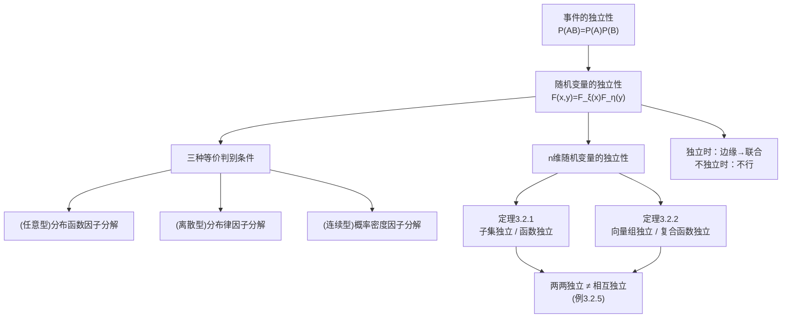
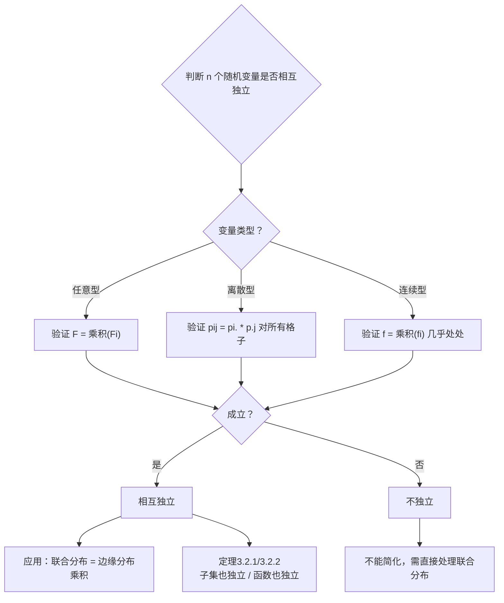

## 一、本章核心脉络

**核心问题**：两个（或多个）随机变量之间，什么时候"互不影响"？如何用分布函数精确刻画这种关系？知道了独立性，联合分布和边缘分布之间的鸿沟能否被填平？

这条脉络从事件独立自然进化到随机变量独立，核心是"分布函数的因子分解"。独立性的价值在于：一旦确认独立，我们就能用边缘分布轻易构建联合分布，这在实际问题中至关重要。

---

## 二、二维随机变量的相互独立性（核心）

### 2.1 定义

**定义 3.2.1** 设 $(\xi, \eta)$ 是二维随机变量，若对**任意**实数对 $(x, y)$ 均有

$$P\{\xi \leq x, \eta \leq y\} = P\{\xi \leq x\} \cdot P\{\eta \leq y\}$$

成立，则称 $\xi$ 与 $\eta$ **相互独立**（independent）。

> 一句话来说：两个随机变量独立意味着，关于它们的一切概率事件都可以"拆开相乘"——$\xi$ 取什么值完全不影响 $\eta$ 的概率行为。

**用分布函数等价表述**：

$$F(x, y) = F_{\xi}(x) \cdot F_{\eta}(y), \quad \forall (x, y) \in \mathbb{R}^2$$

若 $\xi$ 与 $\eta$ 不独立，则称它们是**相依**（dependent）的。

**意义**：对任意实数对 $(x, y)$，随机事件 $\{\xi \leq x\}$ 与 $\{\eta \leq y\}$ 在给定概率空间上都相互独立。

**独立性的更强表述**：$\xi$ 与 $\eta$ 相互独立 $\Leftrightarrow$ 对任意 Borel 点集 $B_1, B_2$，有

$$P\{\xi \in B_1, \eta \in B_2\} = P\{\xi \in B_1\} \cdot P\{\eta \in B_2\}$$

> 直观理解：两个随机变量的取值情况**不会互相影响**——不仅仅是对"小于等于某值"的事件，而是对任何可测事件都成立。

**练习**：$\xi$ 与 $\eta$ 相互独立 $\Leftrightarrow$ 对任意实数 $x_1 < x_2$, $y_1 < y_2$，有

$$P\{x_1 < \xi \leq x_2, y_1 < \eta \leq y_2\} = P\{x_1 < \xi \leq x_2\} \cdot P\{y_1 < \eta \leq y_2\}$$

这从定义直接推出（利用分布函数的线性组合）。

---

### 2.2 三种类型的等价判别条件（本章核心）

下表汇总了判断独立性的等价条件：

| 类型 | $\xi$ 与 $\eta$ 相互独立的充要条件 | 成立范围 |
|:-----|:-----|:-----|
| **任意型** | $F(x, y) = F_{\xi}(x) \cdot F_{\eta}(y)$ | 对所有 $(x, y)$ 成立 |
| **离散型** | $p_{ij} = p_{i\cdot} \cdot p_{\cdot j}$ | 对所有 $(x_i, y_j)$ 成立 |
| **连续型** | $f(x, y) = f_{\xi}(x) \cdot f_{\eta}(y)$ | 在平面上除去"面积"为 0 的集合外成立 |

> 一句话来说：独立性 = 联合分布可以**因式分解**为边缘分布的乘积。无论是分布函数、分布律还是概率密度，断裂的标准统一且一致。

**离散型证明要点**：

- **必要性**：通过构造嵌套事件列 $\{x_i - \frac{1}{n} < \xi \leq x_i, y_j - \frac{1}{n} < \eta \leq y_j\}$，利用概率连续性定理取极限，得 $P\{\xi = x_i, \eta = y_j\} = P\{\xi = x_i\} \cdot P\{\eta = y_j\}$
- **注**：若要否定独立性，只需找到一个点 $(x_i, y_j)$ 使 $p_{ij} \neq p_{i\cdot} \cdot p_{\cdot j}$

**核心结论**：随机变量相互独立时，由边缘分布可确定联合分布；不独立时则**一般不行**。

---

## 三、典型例题解析

### 例 3.2.1 — 判断 ξ 与 |ξ| 是否独立

设 $\xi$ 的概率密度为 $f(x) = \frac{1}{2}e^{-|x|}$, $x \in \mathbb{R}$。问 $\xi$ 与 $|\xi|$ 是否相互独立？

> [!solution]- 点击展开详细解析
> **分析**：判断独立需验证 $P\{\xi \leq a, |\xi| \leq b\} = P\{\xi \leq a\} \cdot P\{|\xi| \leq b\}$ 对所有 $(a, b)$ 成立。
>
> **关键观察**：$\{|\xi| \leq a\} = \{-a \leq \xi \leq a\} \subset \{\xi \leq a\}$（对 $a > 0$）
>
> 因此：
> $$P\{\xi \leq a, |\xi| \leq a\} = P\{|\xi| \leq a\}$$
>
> 而 $P\{\xi \leq a\} \cdot P\{|\xi| \leq a\} < P\{|\xi| \leq a\}$（因 $0 < P\{\xi \leq a\} < 1$）
>
> 故 $\xi$ 与 $|\xi|$ **不相互独立**。
>
> > 点评：这个例子说明**函数关系破坏独立性**：$|\xi|$ 由 $\xi$ 完全确定，两者自然不独立。

---

### 例 3.2.2 — 利用独立性填表

设 $\xi$ 与 $\eta$ 相互独立，填出空白处的数值。

| $\xi \setminus \eta$ | $y_1$ | $y_2$ | $y_3$ | $p_{i\cdot}$ |
|:---:|:---:|:---:|:---:|:---:|
| $x_1$ | 1/24 | 1/8 | 1/12 | 1/4 |
| $x_2$ | 1/8 | 3/8 | 1/4 | 3/4 |
| $p_{\cdot j}$ | 1/6 | 1/2 | 1/3 | 1 |

> [!solution]- 点击展开详细解析
> **验证**：检查每格是否满足 $p_{ij} = p_{i\cdot} \cdot p_{\cdot j}$。
> - $1/24 = (1/4)(1/6)$ ✓
> - $1/8 = (1/4)(1/2)$ ✓
> - $1/12 = (1/4)(1/3)$ ✓
> - ...以此类推，全部满足。
>
> > 点评：独立性给了我们一个"快速填表"的方法——只需知道边缘分布，联合表直接相乘即可。

---

### 例 3.2.3 — 连续型：判断是否独立

设 $(\xi, \eta)$ 具有联合概率密度

$$f(x, y) = \begin{cases} 2, & 0 < x < 1, 0 < y < x \\ 0, & \text{其他} \end{cases}$$

问 $\xi$、$\eta$ 是否相互独立？

> [!solution]- 点击展开详细解析
> **解**：
>
> 首先求边缘密度：
>
> $$f_{\xi}(x) = \begin{cases} \int_0^x 2 \,dy = 2x, & 0 < x < 1 \\ 0, & \text{其他} \end{cases}$$
>
> $$f_{\eta}(y) = \begin{cases} \int_y^1 2 \,dx = 2(1-y), & 0 < y < 1 \\ 0, & \text{其他} \end{cases}$$
>
> 在 $0 < x < 1$ 且 $0 < y < x$ 时：
>
> $$f(x, y) = 2 \neq f_{\xi}(x) \cdot f_{\eta}(y) = 2x \cdot 2(1-y) = 4x(1-y)$$
>
> 因存在面积不为 0 的区域使 $f \neq f_{\xi} f_{\eta}$，故 $\xi$ 与 $\eta$ **不相互独立**。
>
> > 点评：核心技巧——**只需在一个面积不为零的区域中找到不相等点**，即可否定独立性。注意本例子中 $f$ 的非零区域 $0 < y < x$ 是一个三角形，不是矩形——这也是不独立的一个几何信号。

---

### 例 3.2.4 — 利用独立性求概率

设 $\xi$、$\eta$ 相互独立，$\xi \sim U(0, a)$，$\eta \sim U(0, \pi/2)$，且 $0 < b < a$。求 $P\{\xi < b\cos \eta\}$。

> [!solution]- 点击展开详细解析
> **解**：
>
> 因独立，联合密度 = 边缘密度的乘积：
>
> $$f(x, y) = f_{\xi}(x) \cdot f_{\eta}(y) = \begin{cases} \frac{2}{a\pi}, & 0 < x < a, 0 < y < \pi/2 \\ 0, & \text{其他} \end{cases}$$
>
> $$P\{\xi < b\cos \eta\} = \iint_D \frac{2}{a\pi} \,dx\,dy = \frac{2}{a\pi} \cdot S(D) = \frac{2b}{a\pi}$$
>
> 其中 $D = \{(x, y): 0 < x < b\cos y, 0 < y < \pi/2\}$。
>
> > 点评：独立性的"红利"——联合密度直接由边缘密度相乘得到，后续的概率计算（二重积分）因此变得可行。

### 例 3.2.4（补充）— 独立变量的函数独立性

$\xi$、$\eta$ 相互独立，证明 $\xi^2$ 与 $\eta^2$ 相互独立。

> [!solution]- 点击展开详细解析
> **证明**：只需验证 $F_{\xi^2, \eta^2}(x, y) = F_{\xi^2}(x) \cdot F_{\eta^2}(y)$。
>
> 当 $x < 0$ 或 $y < 0$ 时，两端均为 0。
>
> 当 $x \geq 0, y \geq 0$ 时：
>
> $$P\{\xi^2 \leq x, \eta^2 \leq y\} = P\{-\sqrt{x} \leq \xi \leq \sqrt{x}, -\sqrt{y} \leq \eta \leq \sqrt{y}\}$$
>
> 由独立性 $= P\{-\sqrt{x} \leq \xi \leq \sqrt{x}\} \cdot P\{-\sqrt{y} \leq \eta \leq \sqrt{y}\} = P\{\xi^2 \leq x\} \cdot P\{\eta^2 \leq y\}$。
>
> > 直观理解：独立变量分别做变换后仍然独立——独立性在"分头"变换下保持不变。

**思考**：逆命题成立吗？即 $\xi^2$ 与 $\eta^2$ 独立能否推出 $\xi$ 与 $\eta$ 独立？

---

### 例 3.2.5 — 两两独立 vs 相互独立（理解难点）

将一枚均匀硬币独立地掷两次，定义事件：

- $A_1 = \{\text{掷第一次出现正面}\}$
- $A_2 = \{\text{掷第二次出现正面}\}$
- $A_3 = \{\text{正、反面各出现一次}\}$

令 $\xi_i = \begin{cases} 1, & A_i \text{ 发生} \\ 0, & \text{否则} \end{cases}$，$i = 1, 2, 3$。

> [!solution]- 点击展开详细解析
> **结果**：
>
> - $\xi_1$ 与 $\xi_2$ 相互独立 ✓
> - $\xi_1$ 与 $\xi_3$ 相互独立 ✓
> - $\xi_2$ 与 $\xi_3$ 相互独立 ✓
> - $\xi_1, \xi_2, \xi_3$ **两两独立**
>
> 但验证三个变量是否**相互独立**：
>
> $$P\{\xi_1 = 0, \xi_2 = 0, \xi_3 = 1\} = P(\emptyset) = 0 \neq \frac{1}{2^3} = P\{\xi_1 = 0\} \cdot P\{\xi_2 = 0\} \cdot P\{\xi_3 = 1\}$$
>
> 故 $\xi_1, \xi_2, \xi_3$ **不相互独立**！
>
> > 一句话来说：两两独立不等于相互独立。两两独立只保证任意一对乘积分解；相互独立要求全体联合分解决，这是一个更强的条件。

---

## 四、多维随机变量的独立性

### 4.1 定义

**定义 3.2.2** 设 $n$ 维随机变量 $(\xi_1, \xi_2, \ldots, \xi_n)$ 的联合分布函数为 $F(x_1, x_2, \ldots, x_n)$，$\xi_i$ 的分布函数为 $F_{\xi_i}(x_i)$。若对任意实数 $x_1, x_2, \ldots, x_n$ 均有

$$F(x_1, x_2, \ldots, x_n) = \prod_{i=1}^n F_{\xi_i}(x_i)$$

则称 $\xi_1, \xi_2, \ldots, \xi_n$ **相互独立**。

> 直观理解：此定义等价于事件 $\{\xi_1 \leq x_1\}, \{\xi_2 \leq x_2\}, \ldots, \{\xi_n \leq x_n\}$ 相互独立——不仅全体乘积成立，且任意子集的乘积也成立（通过取极限 $x_i \to +\infty$ 可得）。

**充要条件**：$n$ 维随机变量 $(\xi_1, \ldots, \xi_n)$ 相互独立 $\Leftrightarrow$ 对任意 Borel 点集 $B_1, \ldots, B_n$，有

$$P\{\xi_1 \in B_1, \ldots, \xi_n \in B_n\} = P\{\xi_1 \in B_1\} \cdots P\{\xi_n \in B_n\}$$

### 4.2 独立随机变量序列

**定义 3.2.3** 设 $\xi_1, \xi_2, \ldots, \xi_n, \ldots$ 为随机变量序列，若其任意有限维随机向量 $(\xi_{i_1}, \xi_{i_2}, \ldots, \xi_{i_k})$（$1 < k$）都相互独立，则称该序列是**相互独立随机变量序列**。

> 一句话来说：独立序列意味着任意有限个变量都是相互独立的——这是一个"无限版本"的独立性定义，为后续大数定律和中心极限定理奠定基础。

---

## 五、独立性的运算封闭性定理（核心）

### 5.1 定理 3.2.1 — 子集独立与函数独立

若 $n$ 维随机变量 $(\xi_1, \xi_2, \ldots, \xi_n)$ 相互独立，则：

1. **子集独立性**：其中任意 $k$ 个随机变量 $(2 \leq k \leq n)$ 也相互独立
2. **函数独立性**：随机变量 $g_1(\xi_1), g_2(\xi_2), \ldots, g_n(\xi_n)$ 也相互独立（$g_i$ 是任意实变函数）

> 一句话来说：独立性具有"遗传性"——取子集保持独立，"分头"做函数变换也保持独立。

**注**：随机变量相互独立则一定两两独立，但**逆命题不真**（见例 3.2.5）。

### 5.2 定理 3.2.2 — 向量组独立与复合函数独立

若 $n$ 维随机变量 $(\xi_1, \xi_2, \ldots, \xi_n)$ 相互独立，则：

1. $m$ 维随机向量 $(\xi_1, \ldots, \xi_m)$ 与 $n-m$ 维随机向量 $(\xi_{m+1}, \ldots, \xi_n)$ 也相互独立
2. $\eta_i = h_i(\xi_{i_1}, \xi_{i_2}, \ldots, \xi_{i_{n_i}})$（$i = 1, 2, \ldots, k$）也相互独立，其中 $\{i_1, \ldots, i_{n_i}\}$ 是 $\{1, 2, \ldots, n\}$ 的一个划分，$h_i$ 是实变连续函数

> 直观理解：把独立变量分成不相交的若干组，每组内可以做任意的连续变换，变换后的各组仍然相互独立——独立性可以"分组打包"。

---

## 六、二维正态分布与独立性

**关键结论**：二维正态随机变量 $(\xi, \eta) \sim N(\mu_1, \sigma_1^2; \mu_2, \sigma_2^2; \rho)$ 中：

$$\xi \text{ 与 } \eta \text{ 相互独立 } \Leftrightarrow \rho = 0$$

> 一句话来说：对于二维正态分布，**独立性与不相关等价**（$\rho = 0$ 既是独立的必要条件也是充分条件）。这是二维正态分布的一个特殊性质，一般分布中 $\rho = 0$ 只意味着不相关，不一定独立。

**验证**：当 $\rho = 0$ 时，联合密度退化为

$$f(x, y) = \frac{1}{2\pi \sigma_1 \sigma_2} \exp\left\{ -\frac{1}{2}\left[ \frac{(x-\mu_1)^2}{\sigma_1^2} + \frac{(y-\mu_2)^2}{\sigma_2^2} \right] \right\} = f_{\xi}(x) \cdot f_{\eta}(y)$$

正好是两个一维正态密度的乘积。

---

## 七、判定/决策流程

---

## 八、核心公式速查表

| 条件 | 判别公式 |
|:-----|:-----|
| 任意型独立 | $F(x, y) = F_{\xi}(x) \cdot F_{\eta}(y)$，$\forall (x, y)$ |
| 离散型独立 | $p_{ij} = p_{i\cdot} \cdot p_{\cdot j}$，$\forall (x_i, y_j)$ |
| 连续型独立 | $f(x, y) = f_{\xi}(x) \cdot f_{\eta}(y)$，a.e. |
| n 维独立 | $F(x_1, \ldots, x_n) = \prod_{i=1}^n F_{\xi_i}(x_i)$ |
| 独立时联合密度 | $f(x_1, \ldots, x_n) = \prod_{i=1}^n f_{\xi_i}(x_i)$ |
| 二维正态独立条件 | $\rho = 0$ |

---

## 九、易错点与注意事项

> [!warning] 易错点与注意事项

1. **两两独立 $\neq$ 相互独立**（充分条件 vs 必要条件）：
   - 相互独立 $\Rightarrow$ 两两独立 ✓（必要条件）
   - 两两独立 $\Rightarrow$ 相互独立 ✗（非充分条件）
   - 例 3.2.5 是经典反例：三个二元示性变量两两独立，但三者不相互独立

2. **独立性与不相关**：
   - $\xi$ 与 $\eta$ 独立 $\Rightarrow$ $\text{Cov}(\xi, \eta) = 0$ ✓
   - $\text{Cov}(\xi, \eta) = 0$ $\Rightarrow$ $\xi$ 与 $\eta$ 独立 ✗（一般情况）
   - 但对于二维正态分布：独立 $\Leftrightarrow$ $\rho = 0$（特例！）

3. **独立变量的函数独立性是有条件的**：
   - 如果 $\xi_1, \xi_2$ 独立，$g_1(\xi_1)$ 和 $g_2(\xi_2)$ 一定独立（各管各）
   - 但如果函数"交叉"了（如 $g_1(\xi_1, \xi_2)$ 和 $g_2(\xi_1, \xi_2)$），一般不再独立
   - 例外：定理 3.2.2 中变量被划分到不相交的子集时，各组独立

4. **否定独立性只需一个反例**：对于离散型，找到一组 $(x_i, y_j)$ 使 $p_{ij} \neq p_{i\cdot} p_{\cdot j}$；对于连续型，找到一个面积不为零的区域使 $f \neq f_{\xi} f_{\eta}$

5. **$f(x, y)$ 的非零区域形状可以作为直觉判据**：如果非零区域不是矩形（如三角形 $0 < y < x < 1$），则 $\xi$ 和 $\eta$ 很可能不独立——变量取值区间互相制约。

---

## 十、相关知识点链接

- [[C1.5 事件的独立性]]：随机事件独立的定义是本章的理论基础——随机变量的独立本质上是"所有事件同时独立"
- [[C3.1 多维随机变量及其分布]]：联合分布函数与边缘分布函数的概念在本章中得到关键应用——独立性 = 联合 = 边缘乘积
- [[C3.3 条件分布]]：独立性可以用条件分布等价地定义——$f_{\xi|\eta}(x|y) = f_{\xi}(x)$ 即给定 $\eta$ 不改变 $\xi$ 的分布

---

## 十一、作业与练习

- 教材 P147 例 1、例 2（验证离散型独立性）
- 本节思考题（3 题）
- 重点练习：离散型填表验证独立性、连续型通过 $f = f_{\xi}f_{\eta}$ 判断独立性、利用独立性求联合密度及概率
