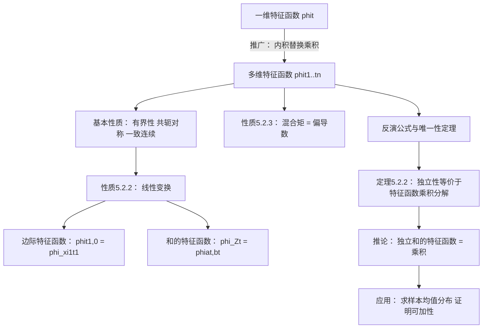
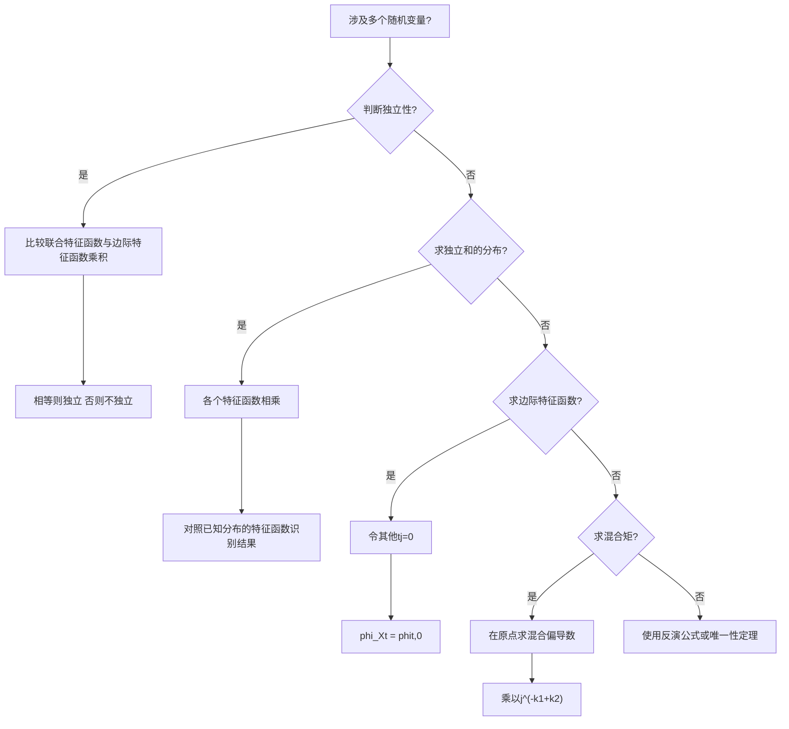

# 一、本章核心脉络

**核心问题**：一维特征函数可以方便地处理单个随机变量，但实际问题经常涉及多个随机变量的联合行为。多维特征函数能否继承一维的所有优良性质？独立性这个关键概念在特征函数语言下如何表达？

> [!info] 学习导读
> **必要先修**：先掌握[[课程/概率论/知识点解析梳理/05a-一维特征函数的定义及性质-知识梳理|一维特征函数]]与[[课程/概率论/知识点解析梳理/03b-随机变量的独立性-知识梳理|随机变量独立性]]。
> **来源边界**：正文依据[[课程/概率论/PPT课件/MD/5.2 多维随机变量的特征函数|5.2 课件源文]]重组；独立和视角与自测属于补充学习内容。
> **阅读路线**：联合特征函数 → 线性变换与边际 → 混合矩 → 惟一性 → 独立性乘积分解 → 独立和。

答案是：多维特征函数不仅是性质的自然推广，更提供了一个**判定独立性的最优工具**——随机变量相互独立当且仅当联合特征函数等于边际特征函数的乘积。这比用分布函数判定独立性强得多。

> 这个顺序体现了"从定义到基本性质，再到独立性刻画，最后到具体应用"的学习路径：先确立多维特征函数的基本框架，然后用它解决最核心的独立和分布问题——这是特征函数最强大的应用场景。

# 二、多维特征函数的定义

## 2.1 $n$ 维特征函数

**定义 5.2.1** 设 $n$ 维随机向量 $(\xi_1, \xi_2, \cdots, \xi_n)$ 的分布函数为 $F(x_1, x_2, \cdots, x_n)$，则它的特征函数为

$$\varphi(t_1, t_2, \cdots, t_n) = E[e^{j(t_1\xi_1 + \cdots + t_n\xi_n)}] = \int_{-\infty}^{\infty} \cdots \int_{-\infty}^{\infty} e^{j(t_1x_1 + \cdots + t_nx_n)} dF(x_1, \cdots, x_n)$$

> 一句话来说：多维特征函数就是把一维的乘积 $t\xi$ 替换为内积 $t_1\xi_1 + \cdots + t_n\xi_n$，本质上是对联合分布函数做多维傅里叶-斯蒂尔杰斯变换。

## 2.2 二维特例

二维随机变量 $(\xi_1, \xi_2)$ 的特征函数定义为：

$$\varphi(t_1, t_2) = E[e^{j(t_1\xi_1 + t_2\xi_2)}] = \int_{-\infty}^{\infty} \int_{-\infty}^{\infty} e^{j(t_1x + t_2y)} dF(x, y)$$

### 两种具体形式

| 类型 | 特征函数形式 |
|:-----|:------------|
| 连续型 | $\displaystyle \varphi(t_1, t_2) = \int_{-\infty}^{\infty} \int_{-\infty}^{\infty} e^{j(t_1x + t_2y)} f(x, y) \, dx \, dy$ |
| 离散型 | $\displaystyle \varphi(t_1, t_2) = \sum_{r} \sum_{s} e^{j(t_1x_r + t_2y_s)} p_{r,s}$ |

# 三、多维特征函数的基本性质

## 3.1 性质 5.2.1：一维性质的直接推广

设二维随机变量 $(\xi_1, \xi_2)$ 的特征函数为 $\varphi(t_1, t_2)$，则：

1. $\varphi(0, 0) = 1$，且对任意 $t_1, t_2 \in \mathbb{R}$，有 $|\varphi(t_1, t_2)| \leq \varphi(0, 0) = 1$
2. $\overline{\varphi(t_1, t_2)} = \varphi(-t_1, -t_2)$
3. $\varphi(t_1, t_2)$ 在实平面上一致连续
4. **边际特征函数**：$\varphi(t_1, 0) = \varphi_{\xi_1}(t_1)$，$\varphi(0, t_2) = \varphi_{\xi_2}(t_2)$

> 一句话来说：性质 (4) 是最实用的——把不需要的变量对应的 $t$ 设为 0，就能从联合特征函数中提取出边际特征函数。

**直观理解**：令 $t_2 = 0$，则 $e^{j(t_1\xi_1 + 0 \cdot \xi_2)} = e^{jt_1\xi_1}$，联合特征函数退化为 $\xi_1$ 的一维特征函数。这比从联合分布函数积分求边际分布简单得多。

## 3.2 性质 5.2.2：线性变换下的特征函数（核心）

设 $(\xi_1, \xi_2)$ 的特征函数为 $\varphi(t_1, t_2)$，则：

**(1) 仿射变换**：随机变量 $(a_1\xi_1 + b_1, a_2\xi_2 + b_2)$ 的特征函数为

$$e^{j(t_1b_1 + t_2b_2)} \varphi(a_1t_1, a_2t_2)$$

**(2) 线性组合**：随机变量 $Z = a\xi_1 + b\xi_2 + c$ 的特征函数为

$$\varphi_Z(t) = e^{jtc} \varphi(at, bt), \quad t \in \mathbb{R}$$

> 一句话来说：想求两个随机变量线性组合的特征函数，直接把联合特征函数的两个自变量分别缩放为 $at$ 和 $bt$ 即可——不需要先求 $Z$ 的分布。

**特别重要**：$\varphi_{\xi_1 + \xi_2}(t) = \varphi(t, t)$

这意味只要知道联合特征函数，把两个自变量都取为 $t$，就得到和的特征函数。这是后续独立性应用的基础。

## 3.3 性质 5.2.3：特征函数与混合矩

如果 $E(\xi_1^{k_1} \xi_2^{k_2})$ 存在，则

$$E(\xi_1^{k_1} \xi_2^{k_2}) = j^{-(k_1 + k_2)} \left[ \frac{\partial^{k_1 + k_2} \varphi(t_1, t_2)}{\partial t_1^{k_1} \partial t_2^{k_2}} \right]_{t_1 = t_2 = 0}$$

> 一句话来说：混合矩就是特征函数在原点的混合偏导数——对 $t_1$ 求 $k_1$ 次导、对 $t_2$ 求 $k_2$ 次导，就能"拉下"因子 $\xi_1^{k_1} \xi_2^{k_2}$。

**直观理解**：$\frac{\partial}{\partial t_1} e^{j(t_1\xi_1 + t_2\xi_2)} = j\xi_1 e^{j(t_1\xi_1 + t_2\xi_2)}$。在原点处 $e^{j(t_1\xi_1 + t_2\xi_2)} = 1$，每次对 $t_1$ 求导"提取"一个 $j\xi_1$，对 $t_2$ 求导"提取"一个 $j\xi_2$，最后除以 $j^{k_1+k_2}$ 即得 $E(\xi_1^{k_1}\xi_2^{k_2})$。

# 四、反演公式与惟一性定理

## 4.1 二维反演公式

**定理 5.2.1（反演公式）** 设 $\varphi(t_1, t_2)$ 是 $(\xi_1, \xi_2)$ 的特征函数，$F(x_1, x_2)$ 是其分布函数，则

$$P\{a_1 < \xi_1 \leq b_1, a_2 < \xi_2 \leq b_2\}$$

$$= \lim_{\substack{T_1 \to \infty \\ T_2 \to \infty}} \frac{1}{(2\pi)^2} \int_{-T_1}^{T_1} \int_{-T_2}^{T_2} \frac{e^{-jt_1a_1} - e^{-jt_1b_1}}{jt_1} \cdot \frac{e^{-jt_2a_2} - e^{-jt_2b_2}}{jt_2} \varphi(t_1, t_2) \, dt_1 \, dt_2$$

其中 $a_k, b_k$ 需满足：$(\xi_1, \xi_2)$ 落在矩形边界上的概率为零。

> 一句话来说：二维反演公式是一维的自然推广——把两个"核函数"乘起来，就能从联合特征函数恢复出随机向量落在任意矩形区域的概率。

**直观理解**：一维反演公式用一个积分核 $\frac{e^{-jta} - e^{-jtb}}{jt}$ 来"筛选"区间 $(a, b]$；二维反演公式则用两重积分和两个核函数的乘积来"筛选"矩形区域。本质上都是利用了 $\int_0^\infty \frac{\sin \alpha t}{t} dt = \frac{\pi}{2} \text{sgn}(\alpha)$ 的筛选性质。

## 4.2 惟一性定理

**推论 5.2.1（唯一性定理）** 分布函数 $F(x_1, x_2)$ 和特征函数 $\varphi(t_1, t_2)$ 一一对应，唯一确定。

> 一句话来说：和一维一样，联合特征函数和联合分布函数之间也是"知道一个就等于知道另一个"的关系。

# 五、独立随机变量和的特征函数（本章核心）

## 5.1 独立性判定定理

**定理 5.2.2** $n$ 维随机变量 $\xi_1, \xi_2, \cdots, \xi_n$ 相互独立的**充要条件**是

$$\varphi(t_1, t_2, \cdots, t_n) = \prod_{k=1}^{n} \varphi_{\xi_k}(t_k)$$

> 一句话来说：随机变量相互独立当且仅当联合特征函数可以分解为各自特征函数的乘积——这是判定独立性最简洁的充要条件。

**为什么这个条件如此强大**：用分布函数判定独立性需要验证 $F(x_1,\ldots,x_n) = \prod F_{\xi_k}(x_k)$ 对所有 $(x_1,\ldots,x_n)$ 成立——无穷多个条件。而用特征函数只需验证一个函数等式。

## 5.2 推论 1：独立和的分布

设 $\xi_1, \xi_2, \cdots, \xi_n$ 相互独立，令 $\eta = \sum_{i=1}^{n} \xi_i$，则

$$\varphi_\eta(t) = \prod_{i=1}^{n} \varphi_{\xi_i}(t)$$

**证明**：在定理 5.2.2 中取 $t_1 = t_2 = \cdots = t_n = t$，则

$$\varphi(t, t, \cdots, t) = E[e^{jt(\xi_1 + \cdots + \xi_n)}] = E[e^{jt\eta}] = \varphi_\eta(t) = \prod_{i=1}^{n} \varphi_{\xi_i}(t)$$

> 一句话来说：独立随机变量之和的特征函数等于各自特征函数的乘积——这是特征函数最大的实用价值：**卷积变乘积**。

**注意区分**：
- 定理 5.2.2 的条件 $\varphi(t_1, \cdots, t_n) = \prod \varphi_{\xi_k}(t_k)$ 是**独立性的充要条件**（强条件）。
- 推论 1 的结论 $\varphi_\eta(t) = \prod \varphi_{\xi_i}(t)$ 仅依赖独立性（是独立性的**必要条件**），它反过来**不能**推出独立性。

## 5.3 推论 2：独立同分布情形

设 $\xi_1, \xi_2, \cdots, \xi_n$ 相互独立同分布，特征函数均为 $\varphi(t)$，则

$$\eta = \sum_{i=1}^{n} \xi_i \quad \Rightarrow \quad \varphi_\eta(t) = [\varphi(t)]^n$$

> 一句话来说：i.i.d. 随机变量之和的特征函数就是单个特征函数的 $n$ 次方。

## 5.4 典型例题

### 例 5.2.1：样本均值的分布

设 $\xi_1, \xi_2, \cdots, \xi_n$ 相互独立同服从 $N(\mu, \sigma^2)$，求 $\overline{\xi} = \frac{1}{n}\sum_{i=1}^{n} \xi_i$ 的分布。

> [!solution]- 点击展开详细解析
> **逐步分析**：
> 1. $N(\mu, \sigma^2)$ 的特征函数：$\varphi(t) = \exp\left(-\frac{\sigma^2}{2}t^2 + j\mu t\right)$
> 2. 利用推论 2：$\varphi_{\sum \xi_i}(t) = [\varphi(t)]^n = \exp\left(-\frac{n\sigma^2}{2}t^2 + jn\mu t\right)$
> 3. 利用性质 5.2.2（缩放 $\frac{1}{n}$）：
>    $\varphi_{\overline{\xi}}(t) = \varphi_{\frac{1}{n}\sum \xi_i}(t) = \varphi_{\sum \xi_i}\left(\frac{t}{n}\right) = \left[\varphi\left(\frac{t}{n}\right)\right]^n$
> 4. 代入：
>    $$\varphi_{\overline{\xi}}(t) = \left\{\exp\left[-\frac{\sigma^2}{2}\left(\frac{t}{n}\right)^2 + j\mu\frac{t}{n}\right]\right\}^n = \exp\left[-\frac{t^2}{2}\left(\frac{\sigma}{\sqrt{n}}\right)^2 + j\mu t\right]$$
> 5. 由惟一性定理：$\overline{\xi} \sim N\left(\mu, \frac{\sigma^2}{n}\right)$
> 
> **点评**：用特征函数证明样本均值的分布只需要两行，而直接求 $n$ 重卷积几乎不可行。

### 例 5.2.2：二项分布的特征函数（用独立和视角）

$\eta \sim B(n, p)$，写出其特征函数。

> [!solution]- 点击展开详细解析
> **逐步分析**：
> 1. 将二项分布随机变量表为 $n$ 个独立伯努利之和：$\eta = \sum_{k=1}^{n} \xi_k$，其中 $\xi_k \sim B(1, p)$
> 2. 单个伯努利的特征函数：$\varphi_{\xi_k}(t) = q + pe^{it}$
> 3. 由推论 2：$\varphi_\eta(t) = (q + pe^{it})^n$
> 
> **点评**：这个推导比直接用定义做二项式展开要自然得多——本质是"独立和"的结构。

### 关于可加性

**重要结论**：以下分布具有可加性（独立同分布随机变量之和仍属于同一分布族）：
- 二项分布
- 泊松分布
- 负二项分布
- 正态分布
- $\Gamma$ 分布
- $\chi^2$ 分布
- 柯西分布

**不具有可加性的例子**：均匀分布、指数分布——两个独立同分布均匀/指数随机变量之和不属于原来的分布族。

> 一句话来说：一个分布是否有可加性，本质上取决于其特征函数在乘法下是否封闭——特征函数乘积的形式是否还在同一参数族里。

### 例 5.2.3：随机游走（难点）

设 $\xi_1, \xi_2, \cdots, \xi_n$ 相互独立，$P\{\xi_i = -1\} = p$，$P\{\xi_i = 1\} = q = 1 - p$，求：

(1) $\eta_2 = \xi_1 + \xi_2$ 的分布律
(2) $\eta_n = \xi_1 + \cdots + \xi_n$ 的分布律

> [!solution]- 点击展开详细解析
> **逐步分析**：
> 
> **(1)** $\eta_2$ 的分布律：
> 1. 单个 $\xi_i$ 的特征函数：$\varphi_{\xi_i}(t) = pe^{jt} + qe^{-jt}$
> 2. $\varphi_{\eta_2}(t) = [pe^{jt} + qe^{-jt}]^2 = p^2 e^{2jt} + 2pq + q^2 e^{-2jt}$
> 3. 对照离散型特征函数形式 $\sum p_k e^{jkt}$，读出：
> 
> | $\eta_2$ | $-2$ | $0$ | $2$ |
> |:--------:|:----:|:---:|:---:|
> | $P$ | $q^2$ | $2pq$ | $p^2$ |
> 
> **(2)** $\eta_n$ 的分布律：
> 1. $\varphi_{\eta_n}(t) = [pe^{jt} + qe^{-jt}]^n = \sum_{k=0}^{n} C_n^k p^k q^{n-k} e^{jt(2k-n)}$
> 2. 令 $m = 2k - n$，则 $k = \frac{m+n}{2}$，所以 $m$ 的可能取值为 $-n, -n+2, \cdots, n-2, n$
> 3. 由惟一性定理：
> 
> $$P\{\eta_n = m\} = \begin{cases} C_n^{\frac{m+n}{2}} p^{\frac{m+n}{2}} q^{\frac{n-m}{2}}, & m = -n, -n+2, \cdots, n-2, n \\ 0, & \text{其他} \end{cases}$$
> 
> **点评**：这里 $m$ 取间隔为 2 的整数是因为每一步走 $\pm 1$，$n$ 步后的位置与 $n$ 有相同的奇偶性。

# 六、判定/决策流程

# 七、核心公式速查表

| 概念 | 公式 |
|:-----|:-----|
| $n$ 维特征函数定义 | $\varphi(t_1,\ldots,t_n) = E[e^{j\sum t_k\xi_k}]$ |
| 边际特征函数 | $\varphi(t_1, 0) = \varphi_{\xi_1}(t_1)$ |
| 和的特征函数（已知联合） | $\varphi_{\xi_1+\xi_2}(t) = \varphi(t, t)$ |
| 仿射变换 | $(a_1\xi_1+b_1, a_2\xi_2+b_2) \to e^{j(t_1b_1+t_2b_2)}\varphi(a_1t_1, a_2t_2)$ |
| 线性组合 | $Z = a\xi_1 + b\xi_2 + c \to \varphi_Z(t) = e^{jtc}\varphi(at, bt)$ |
| 混合矩 | $E(\xi_1^{k_1}\xi_2^{k_2}) = j^{-(k_1+k_2)}\left.\frac{\partial^{k_1+k_2}\varphi}{\partial t_1^{k_1}\partial t_2^{k_2}}\right|_{t_1=t_2=0}$ |
| 独立性充要条件 | $\varphi(t_1,\ldots,t_n) = \prod \varphi_{\xi_k}(t_k)$ |
| 独立和的特征函数 | $\varphi_{\sum \xi_i}(t) = \prod \varphi_{\xi_i}(t)$ |
| i.i.d. 和 | $\varphi_{\sum \xi_i}(t) = [\varphi(t)]^n$ |
| 二维反演公式 | $P(a_1<\xi_1\leq b_1, a_2<\xi_2\leq b_2) = \lim_{T_1,T_2\to\infty} \frac{1}{(2\pi)^2} \iint \frac{e^{-jt_1a_1}-e^{-jt_1b_1}}{jt_1} \cdot \frac{e^{-jt_2a_2}-e^{-jt_2b_2}}{jt_2} \varphi(t_1,t_2) dt_1 dt_2$ |

| 可加性分布 | 特征函数形式 |
|:-----------|:------------|
| 二项 $B(n,p)$ | $(q+pe^{jt})^n$ |
| 泊松 $P(\lambda)$ | $e^{\lambda(e^{jt}-1)}$ |
| 正态 $N(\mu,\sigma^2)$ | $e^{j\mu t - \frac{1}{2}\sigma^2 t^2}$ |
| $\Gamma$ 分布 | $(1-jt/\beta)^{-\alpha}$ |

# 八、易错点与注意事项

> [!warning] 易错点与注意事项
>
> 1. **定理 5.2.2 是充要条件，推论 1 只是必要条件**。$\varphi_{\xi_1+\xi_2}(t) = \varphi_{\xi_1}(t)\varphi_{\xi_2}(t)$ 成立**不能**推出 $\xi_1$ 和 $\xi_2$ 独立。反例：存在不独立但和的特征函数等于乘积的情形（虽然不常见）。
>
> 2. **边际特征函数和独立性是两回事**。$\varphi(t_1, 0) = \varphi_{\xi_1}(t_1)$ 总是成立（不需要独立性），但 $\varphi(t_1, t_2) = \varphi(t_1, 0)\varphi(0, t_2)$ 只在独立时成立。
>
> 3. **$\varphi(t, t) = \varphi_{\xi_1+\xi_2}(t)$ 也是一个恒等式**，不依赖独立性。但**仅在独立时**才等于 $\varphi_{\xi_1}(t)\varphi_{\xi_2}(t)$。
>
> 4. **区分性质和定理的层级**：
>    - $\varphi_{\xi_1+\xi_2}(t) = \varphi(t, t)$——恒等式（性质 5.2.2 的特例）
>    - $\varphi(t_1, t_2) = \varphi_{\xi_1}(t_1)\varphi_{\xi_2}(t_2)$——独立性的等价刻画（定理 5.2.2）
>    - $\varphi_{\xi_1+\xi_2}(t) = \varphi_{\xi_1}(t)\varphi_{\xi_2}(t)$——独立性的推论（推论 1）
>
> 5. **线性组合公式中注意系数位置**：$Z = a\xi_1 + b\xi_2 + c$ 的特征函数是 $e^{jtc}\varphi(at, bt)$ 而不是 $e^{jtc}\varphi(at, bt)$ 吗？注意自变量是 $(at, bt)$，顺序与 $(\xi_1, \xi_2)$ 对应——$a$ 乘到第一个变量 $t_1$ 上，$b$ 乘到第二个变量 $t_2$ 上。
>
> 6. **"可加性"并不意味着任意线性组合都在同一族**。"可加性"专指独立同分布随机变量之和。两个不同参数的正态分布之和仍是正态分布（这是一般性质），但两个不同参数的指数分布之和不是指数分布。

# 九、自测（新编）

设 $X,Y$ 独立，且分别服从参数为 $\lambda_1,\lambda_2$ 的泊松分布。仅用特征函数说明 $X+Y$ 的分布。

> [!hint]- 提示
> 泊松分布的特征函数为 $\exp\{\lambda(e^{it}-1)\}$，独立和对应特征函数相乘。

> [!solution]- 解析
> $\varphi_{X+Y}(t)=\varphi_X(t)\varphi_Y(t)=\exp\{(\lambda_1+\lambda_2)(e^{it}-1)\}$。由特征函数的惟一性，$X+Y\sim P(\lambda_1+\lambda_2)$。

# 十、相关知识点链接

- [[5.1 一维特征函数的定义及性质]]（前置知识）：多维特征函数的所有性质都是一维的自然推广，必须先掌握一维特征函数的定义和基本性质。
- [[C3.1 多维随机变量及其分布]]（前置知识）：多维特征函数建立在多维分布函数的基础上，需要熟悉联合分布、边际分布等概念。
- [[C3.2 随机变量的独立性]]（前置知识）：定理 5.2.2 提供了判定独立性的新工具，需要对照传统的独立性定义（分布函数分解）来理解其优势。
- [[C4.2 多维随机变量的数字特征]]（前置知识）：性质 5.2.3 中的混合矩概念依赖多维数字特征的基础。
- [[C5.3 多维正态随机变量及其特征函数]]（后续章节）：多维特征函数最重要的应用——用特征函数研究多维正态分布，包括独立性与不相关性的等价条件。

# 十一、作业与练习

参见习题库中第 5.2 节对应练习（习题库路径：`课程/概率论/习题库/`）。

**做题建议**：
1. 优先掌握定理 5.2.2（独立性判定）和推论 1（独立和的特征函数 = 乘积），这是本章最常用的两个结论。
2. 熟练运用 $\varphi_{\xi_1+\xi_2}(t) = \varphi(t, t)$ 和独立性情形下的 $\varphi_{\xi_1+\xi_2}(t) = \varphi_{\xi_1}(t)\varphi_{\xi_2}(t)$，注意两者的区别。
3. 例 5.2.1（样本均值分布）和例 5.2.3（随机游走）是典型考题，要做到独立推导。
4. 记住七种具有可加性的分布族，并能用特征函数方法证明。

## 可复用知识条目

本章涉及以下独立条目；后续补充与跨课程应用统一维护在条目中。

### 知识点入口

- [[知识点/多维随机变量的特征函数|多维随机变量的特征函数]]
- [[知识点/常见分布的特征函数|常见分布的特征函数]]
