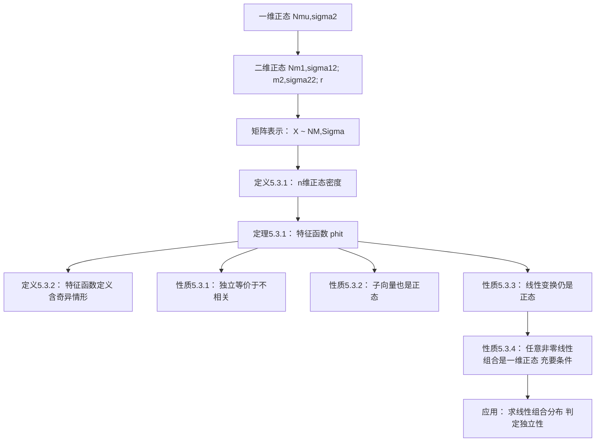
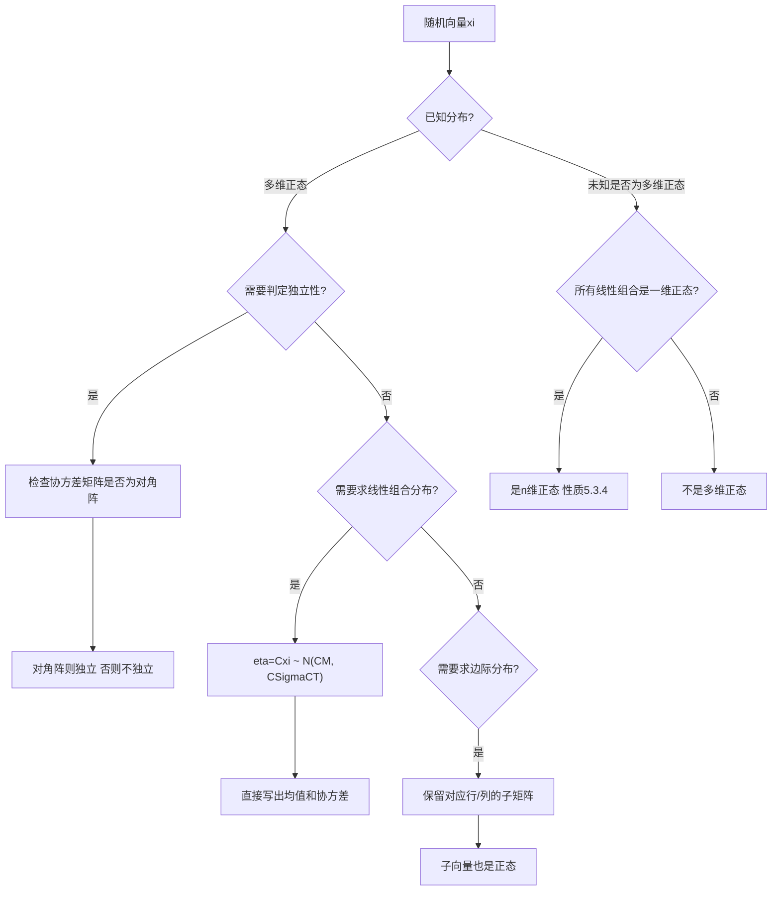

# 一、本章核心脉络

**核心问题**：多维正态分布是概率论中最重要的多元分布。能否用特征函数这个工具，将一维和二维正态的已知性质系统地推广到 $n$ 维，并揭示正态分布"独立等价于不相关"这一独特性质的本质原因？

> [!info] 学习导读
> **必要先修**：回看[[课程/概率论/知识点解析梳理/04b-多维随机变量的数字特征-知识梳理|协方差矩阵]]与[[课程/概率论/知识点解析梳理/05b-多维随机变量的特征函数-知识梳理|多维特征函数]]。
> **来源边界**：正文依据[[课程/概率论/PPT课件/MD/C5.3 多维正态随机变量及其特征函数|C5.3 课件源文]]重组；矩阵解释与自测属于补充学习内容。
> **阅读路线**：低维正态回顾 → 均值向量与协方差矩阵 → 联合特征函数 → 线性变换 → 正态情形下独立等价于不相关。

答案是：多维正态的特征函数 $\varphi(t) = \exp\{jM^T t - \frac{1}{2}t^T \Sigma t\}$ 形式极其简洁，由均值向量 $M$ 和协方差矩阵 $\Sigma$ **完全确定**。所有核心性质——线性变换不变性、边际正态性、独立等价于不相关——都从这个特征函数形式自然导出。

> 顺序说明：从低维到高维、从密度定义到特征函数定义、再从特征函数形式推导所有性质——这是"定义-表示-性质-应用"的标准数学逻辑链。

# 二、一维及二维正态的已知结论（复习）

## 2.1 一维正态

$\xi \sim N(\mu, \sigma^2)$，概率密度为

$$\varphi(x) = \frac{1}{\sqrt{2\pi}\sigma} e^{-\frac{(x-\mu)^2}{2\sigma^2}}, \quad x \in \mathbb{R}$$

已知两个重要性质：

1. **线性变换**：$a\xi + b \sim N(a\mu + b, a^2\sigma^2)$
2. **可加性**：若 $\xi \sim N(m_1, \sigma_1^2)$，$\eta \sim N(m_2, \sigma_2^2)$ 相互独立，则 $\xi + \eta \sim N(m_1 + m_2, \sigma_1^2 + \sigma_2^2)$

> 一句话来说：正态分布对线性运算"封闭"——缩放和平移不改变正态性，独立正态之和仍是正态。

## 2.2 二维正态

$(\xi, \eta) \sim N(m_1, \sigma_1^2; m_2, \sigma_2^2; r)$，五个参数：$m_1, m_2, \sigma_1 > 0, \sigma_2 > 0, |r| < 1$。

联合概率密度：

$$\varphi(x,y) = \frac{1}{2\pi\sigma_1\sigma_2\sqrt{1-r^2}} \exp\left\{-\frac{1}{2(1-r^2)}\left[\frac{(x-m_1)^2}{\sigma_1^2} - 2r\frac{(x-m_1)(y-m_2)}{\sigma_1\sigma_2} + \frac{(y-m_2)^2}{\sigma_2^2}\right]\right\}$$

**五个参数的含义**：
- $m_1, m_2$：中心位置（均值）
- $\sigma_1, \sigma_2$：两个方向的离散程度（标准差）
- $r$：相关程度（相关系数），决定椭圆等高线的倾斜方向和扁平程度

### 二维正态的核心结论

| 结论 | 内容 |
|:-----|:-----|
| 边际分布 | $\xi \sim N(m_1, \sigma_1^2)$，$\eta \sim N(m_2, \sigma_2^2)$ |
| 数字特征 | $E(\xi)=m_1$，$D(\xi)=\sigma_1^2$；$E(\eta)=m_2$，$D(\eta)=\sigma_2^2$；$Cov(\xi,\eta)=r\sigma_1\sigma_2$，$\rho_{\xi\eta}=r$ |
| 独立性 | $\xi$ 与 $\eta$ 相互独立 $\iff r=0$ $\iff$ $\xi$ 与 $\eta$ 不相关 |

> 一句话来说：在二维正态中，"独立"和"不相关"是完全等价的——这是一般分布不具备的特殊性质。

## 2.3 密度函数的矩阵表示（关键技巧）

记均值向量 $M = \begin{bmatrix} m_1 \\ m_2 \end{bmatrix}$，协方差矩阵 $\Sigma = \begin{bmatrix} \sigma_1^2 & r\sigma_1\sigma_2 \\ r\sigma_1\sigma_2 & \sigma_2^2 \end{bmatrix}$，则：

$$\varphi(x, y) = \frac{1}{2\pi |\Sigma|^{1/2}} \exp\left\{-\frac{1}{2}(X - M)^T \Sigma^{-1} (X - M)\right\}, \quad X = \begin{bmatrix} x \\ y \end{bmatrix}$$

记为 $(\xi, \eta) \sim N(M, \Sigma)$。

> 一句话来说：矩阵形式把五个参数"打包"进均值向量 $M$ 和协方差矩阵 $\Sigma$ 中，让公式看起来和一维正态 $e^{-(x-\mu)^2/(2\sigma^2)}$ 高度统一——$(X-M)^T\Sigma^{-1}(X-M)$ 就是多维版的"马氏距离平方"。

# 三、$n$ 维正态分布的定义（核心）

## 3.1 定义 5.3.1：密度定义

设 $n$ 维随机变量 $(\xi_1, \xi_2, \cdots, \xi_n)$ 的联合概率密度为

$$\varphi(x_1, x_2, \cdots, x_n) = \frac{1}{(2\pi)^{n/2} |\Sigma|^{1/2}} \exp\left\{-\frac{1}{2}(X - M)^T \Sigma^{-1} (X - M)\right\}$$

其中：
- $\Sigma = (\sigma_{ij})$ 是 $n$ 阶**对称正定矩阵**
- $X = (x_1, x_2, \cdots, x_n)^T$
- $M = (m_1, m_2, \cdots, m_n)^T$

则称 $(\xi_1, \xi_2, \cdots, \xi_n)$ 服从 $n$ 维正态分布 $N(M, \Sigma)$。

> 一句话来说：$n$ 维正态密度就是二维正态矩阵形式的直接推广——维度从 2 变成 $n$，$\Sigma$ 从 2x2 变成 nxn。

**验证 $\varphi$ 确实是概率密度**：因 $\Sigma$ 对称正定，存在正交矩阵 $Q$ 使 $Q\Sigma Q^T = \text{diag}(c_1^2, \cdots, c_n^2)$。做变换 $Y = C^{-1/2}Q(X - M)$，雅可比行列式为 $|\Sigma|^{1/2}$，积分化为 $n$ 个独立标准正态积分的乘积，结果恰好为 1。

**注**：若 $|\Sigma| = 0$（协方差矩阵奇异），上述密度无意义——此时需要用特征函数定义（定义 5.3.2）。

## 3.2 $M$ 和 $\Sigma$ 的概率意义

- $M = (m_1, m_2, \cdots, m_n)^T$ 是均值向量：$E(\xi_i) = m_i$
- $\Sigma = (\sigma_{ij})$ 是协方差矩阵：$\sigma_{ij} = E\{[\xi_i - E(\xi_i)][\xi_j - E(\xi_j)]\}$

> 一句话来说：$n$ 维正态分布由一阶矩（均值向量 $M$）和二阶矩（协方差矩阵 $\Sigma$）**完全确定**——不需要三阶及以上矩。

# 四、$n$ 维正态的特征函数（本章核心）

## 4.1 定理 5.3.1

$n$ 维正态分布随机向量 $\xi = (\xi_1, \xi_2, \cdots, \xi_n)^T \sim N(M, \Sigma)$ 的特征函数为

$$\varphi(t) = \exp\left\{jM^T t - \frac{1}{2}t^T \Sigma t\right\}, \quad t = (t_1, t_2, \cdots, t_n)^T$$

> 一句话来说：$n$ 维正态的特征函数就是一维正态特征函数 $e^{j\mu t - \frac{1}{2}\sigma^2 t^2}$ 的"矩阵升级版"——把 $\mu t$ 换成 $M^T t$，把 $\sigma^2 t^2$ 换成 $t^T \Sigma t$（$t$ 的二次型）。

**证明的核心洞察**：通过变换 $X = M + Q^T C^{1/2} Y$（其中 $Q\Sigma Q^T = C$ 对角化），积分拆成 $n$ 个独立的一维正态特征函数积分的乘积，每个为 $\exp\{j(C^{1/2}Qt)_i \cdot y_i - y_i^2/2\}$ 的积分，配方后等于 $\exp\{-\frac{1}{2}(C^{1/2}Qt)_i^2\}$。所有因子相乘，利用 $C = Q\Sigma Q^T$，得 $\exp\{jM^T t - \frac{1}{2}t^T \Sigma t\}$。

## 4.2 定义 5.3.2：特征函数定义（更一般）

若 $n$ 维随机向量 $\xi$ 具有特征函数

$$\varphi(t) = \exp\left\{jM^T t - \frac{1}{2}t^T \Sigma t\right\}$$

其中 $M = E(\xi)$，$\Sigma$ 是 $\xi$ 的协方差矩阵，则称 $\xi$ 服从 $n$ 维正态分布 $N(M, \Sigma)$。

**优势**：此定义不要求 $|\Sigma| > 0$。当 $|\Sigma| = 0$ 时，称为**退化正态分布**或**奇异正态分布**——此时没有联合概率密度，但特征函数仍然有意义。

> 一句话来说：特征函数定义比密度定义更一般——协方差矩阵奇异时（如随机向量落在低维子空间），密度不存在但特征函数定义仍然有效。

**问：退化正态有联合概率密度吗？** 没有。因 $|\Sigma| = 0$ 时密度公式中的 $|\Sigma|^{1/2}$ 和 $\Sigma^{-1}$ 无意义。退化正态的概率质量集中在一个低维超平面上。

## 4.3 例题

### 例 5.3.1：二维正态的特征函数和边际分布

$(\xi_1, \xi_2) \sim N(\mu_1, \sigma_1^2; \mu_2, \sigma_2^2; r)$，其特征函数为：

> [!solution]- 点击展开详细解析
> $$\varphi(t_1, t_2) = e^{j(\mu_1 t_1 + \mu_2 t_2) - \frac{1}{2}(\sigma_1^2 t_1^2 + 2\sigma_1\sigma_2 r t_1 t_2 + \sigma_2^2 t_2^2)}$$
> 
> 提取边际特征函数：
> - $\varphi_{\xi_1}(t_1) = \varphi(t_1, 0) = e^{j\mu_1 t_1 - \frac{1}{2}\sigma_1^2 t_1^2}$ $\Rightarrow$ $\xi_1 \sim N(\mu_1, \sigma_1^2)$
> - $\varphi_{\xi_2}(t_2) = \varphi(0, t_2) = e^{j\mu_2 t_2 - \frac{1}{2}\sigma_2^2 t_2^2}$ $\Rightarrow$ $\xi_2 \sim N(\mu_2, \sigma_2^2)$
> 
> **点评**：用特征函数提取边际分布比从联合密度积分简单得多——只需令不需要的变量对应的 $t_i = 0$。

### 例 5.3.2：利用联合特征函数求和的分布

设 $(X_1, X_2)$ 服从二维正态分布，$E(X_k) = k$（$k = 1, 2$），$Cov(X_k, X_j) = \min(k, j)$。求 $Y = X_1 + X_2$ 的分布。

> [!solution]- 点击展开详细解析
> **逐步分析**：
> 1. 由条件得：$M = \begin{bmatrix} 1 \\ 2 \end{bmatrix}$，$\Sigma = \begin{bmatrix} Cov(1,1) & Cov(1,2) \\ Cov(2,1) & Cov(2,2) \end{bmatrix} = \begin{bmatrix} 1 & 1 \\ 1 & 2 \end{bmatrix}$
> 2. 联合特征函数：$\varphi_{X_1,X_2}(t_1, t_2) = e^{j(t_1+2t_2) - \frac{1}{2}(t_1^2 + 2t_1t_2 + 2t_2^2)}$
> 3. 令 $t_1 = t_2 = t$：
>    $\varphi_Y(t) = \varphi_{X_1,X_2}(t, t) = e^{j3t - \frac{1}{2}(t^2 + 2t^2 + 2t^2)} = e^{j3t - \frac{5}{2}t^2}$
> 4. 对照一维正态特征函数 $e^{j\mu t - \frac{1}{2}\sigma^2 t^2}$，得 $Y \sim N(3, 5)$
> 
> **点评**：无需先求 $(X_1, X_2)$ 的联合密度再积分——直接从特征函数形式就能求出和的分布。

# 五、多维正态的核心性质

## 5.1 性质 5.3.1：独立等价于不相关 【必考·结论】

设 $(\xi_1, \xi_2, \cdots, \xi_n)$ 服从 $n$ 维正态分布，且 $D(\xi_i) > 0$（$i = 1, 2, \cdots, n$），则以下命题**等价**：

1. $\xi_1, \xi_2, \cdots, \xi_n$ 相互独立
2. $\xi_1, \xi_2, \cdots, \xi_n$ 两两不相关，即 $\rho_{ij} = 0$（$i \neq j$）
3. 协方差矩阵 $\Sigma$ 是对角矩阵，即 $\sigma_{ij} = 0$（$i \neq j$）

> 一句话来说：对于多维正态，独立和不相关是同一回事——这源于正态特征函数中交叉项 $t_i t_j \sigma_{ij}$ 的存在与否直接决定特征函数能否分解。

**证明核心**：当 $\Sigma$ 为对角阵 $\text{diag}(\sigma_1^2, \cdots, \sigma_n^2)$ 时，

$$\varphi(t_1, \cdots, t_n) = \exp\left\{j\sum m_i t_i - \frac{1}{2}\sum \sigma_i^2 t_i^2\right\} = \prod_{i=1}^{n} e^{j m_i t_i - \frac{1}{2}\sigma_i^2 t_i^2} = \prod_{i=1}^{n} \varphi_{\xi_i}(t_i)$$

由特征函数分解推出独立性。反之，独立自然推出不相关。

**警告**：这一等价性**仅对联合正态分布成立**。对于非正态分布，独立一定不相关，但不相关不能推出独立。

## 5.2 性质 5.3.2：子向量也是正态

$n$ 维正态分布随机变量的任一子向量 $(\xi_{k_1}, \xi_{k_2}, \cdots, \xi_{k_m})$（$m \leq n$）也服从正态分布 $N(\tilde{M}, \tilde{\Sigma})$，其中：
- $\tilde{M} = (m_{k_1}, m_{k_2}, \cdots, m_{k_m})$
- $\tilde{\Sigma}$ 是 $\Sigma$ 保留第 $k_1, k_2, \cdots, k_m$ 行及列所得的 $m$ 阶矩阵

> 一句话来说：联合正态，则边际必正态——但反过来不成立（边际正态不保证联合正态）。

**证明思路**：在联合特征函数中，令非子向量分量对应的 $t_i = 0$，特征函数形式保持 $\exp\{j\tilde{M}^T\tilde{t} - \frac{1}{2}\tilde{t}^T\tilde{\Sigma}\tilde{t}\}$。

## 5.3 性质 5.3.3：线性变换不变性（核心）

设 $\xi = (\xi_1, \xi_2, \cdots, \xi_n)^T \sim N(M, \Sigma)$，$C = (c_{jk})_{m \times n}$ 是任意矩阵，则

$$\eta = C\xi \sim N(CM, C\Sigma C^T)$$

> 一句话来说：正态随机向量经过任意线性变换后仍然是正态的——均值向量和协方差矩阵按照线性变换的规则相应地变换。这是正态分布最优雅的性质之一。

**证明**：对任意 $m$ 维实值列向量 $u$，
$$\varphi_\eta(u) = E(e^{ju^T\eta}) = E(e^{ju^T C\xi}) = E(e^{j(C^T u)^T \xi}) = \exp\left\{jM^T(C^T u) - \frac{1}{2}(C^T u)^T \Sigma (C^T u)\right\}$$
$$= \exp\left\{j(CM)^T u - \frac{1}{2}u^T (C\Sigma C^T) u\right\}$$

**重要特例**：
- 若 $C$ 是行向量 $L^T$，则 $L^T\xi$ 是一维正态 $N(L^T M, L^T \Sigma L)$
- 二维正态 $(X,Y)$ 经线性变换后仍是二维正态——如 $(X+Z, X-Z)$ 也是二维正态

## 5.4 性质 5.3.4：充要条件（了解即可）

$(\xi_1, \xi_2, \cdots, \xi_n)$ 服从 $n$ 维正态分布的**充要条件**是它的任何一个非零线性组合 $\sum_{i=1}^{n} l_i \xi_i$ 服从一维正态分布。

> 一句话来说：要检验一个随机向量是不是多维正态，只需检验它所有的线性组合是否为正态——这是一个"降维"的判定方法。

**必要性**：直接由性质 5.3.3 得（取 $C = L^T$）。

**充分性**：设每个 $\xi_i \sim N(m_i, \sigma_i^2)$，则 $b_{ij} = Cov(\xi_i, \xi_j)$ 存在。对任意 $L = (l_1, \cdots, l_n)^T$，$\eta = \sum l_i \xi_i$ 的特征函数为：
$$E(e^{jt\eta}) = \exp\left\{jt\sum l_i m_i - \frac{1}{2}t^2\sum l_i l_j b_{ij}\right\}$$
令 $t = 1$，$E(e^{jL^T\xi}) = \exp\{j L^T M - \frac{1}{2} L^T B L\}$，其中 $B = (b_{ij})$。由 $L$ 的任意性，这正是 $N(M, B)$ 的特征函数形式，故 $\xi \sim N(M, B)$。

**应用举例**：
- 若 $(\xi_1, \xi_2, \xi_3)$ 是三维正态，则 $\xi_1 + \xi_2 - \xi_3$ 和 $\xi_1 - \xi_2$ 均为一维正态
- $(\xi_1 + \xi_2, \xi_1 - \xi_2)$ 是二维正态
- 若 $\xi_1, \xi_2, \xi_3$ 两两独立（且联合正态），则三者相互独立

# 六、综合例题（难点）

### 例 5.3.3

设二维随机变量 $(X, Y) \sim N(1, 3^2; 0, 4^2; -0.5)$，$Z = \frac{X}{3} + \frac{Y}{2}$。求：
1. $Z$ 的数学期望和方差
2. $X$ 与 $Z$ 的相关系数 $\rho_{XZ}$
3. $X$ 与 $Z$ 是否相互独立？

> [!solution]- 点击展开详细解析
> **逐步分析**：
> 
> **(1) 求 $E(Z)$ 和 $D(Z)$**
> 
> $E(Z) = \frac{E(X)}{3} + \frac{E(Y)}{2} = \frac{1}{3} + 0 = \frac{1}{3}$
> 
> $D(Z) = \frac{D(X)}{3^2} + \frac{D(Y)}{2^2} + 2 \times \frac{1}{3} \times \frac{1}{2} \times \rho_{XY} \sqrt{D(X)} \sqrt{D(Y)}$
> 
> $= \frac{9}{9} + \frac{16}{4} + \frac{1}{3} \times (-0.5) \times 3 \times 4 = 1 + 4 - 2 = 3$
> 
> **(2) 求 $\rho_{XZ}$**
> 
> 先求协方差：
> 
> $Cov(X, Z) = Cov\left(X, \frac{X}{3} + \frac{Y}{2}\right) = \frac{1}{3}Cov(X, X) + \frac{1}{2}Cov(X, Y)$
> 
> $= \frac{1}{3}D(X) + \frac{1}{2}\rho_{XY}\sqrt{D(X)}\sqrt{D(Y)} = \frac{1}{3} \times 9 + \frac{1}{2} \times (-0.5) \times 3 \times 4 = 3 - 3 = 0$
> 
> 故 $\rho_{XZ} = 0$。
> 
> **(3) 判断 $X$ 与 $Z$ 是否独立**
> 
> 由性质 5.3.3，$(X, Z) = \begin{bmatrix} 1 & 0 \\ 1/3 & 1/2 \end{bmatrix} \begin{bmatrix} X \\ Y \end{bmatrix}$ 是 $(X, Y)$ 的线性变换，因此 $(X, Z)$ 也服从二维正态分布。
> 
> 对于二维正态，独立等价于相关系数为零。因 $\rho_{XZ} = 0$，故 $X$ 与 $Z$ **相互独立**。
> 
> **点评**：这个例子综合运用了三个关键知识点——(1) 线性变换后仍是正态；(2) 协方差的计算规则；(3) 正态分布中独立与不相关等价。步骤 (3) 的关键在于先确认 $(X, Z)$ 是联合正态（性质 5.3.3），然后才能在正态框架下用 $\rho = 0$ 推出独立。

# 七、判定/决策流程

# 八、核心公式速查表

| 公式/性质 | 表达式 |
|:---------|:------|
| $n$ 维正态密度 | $\varphi(X) = \frac{1}{(2\pi)^{n/2}|\Sigma|^{1/2}}\exp\{-\frac{1}{2}(X-M)^T\Sigma^{-1}(X-M)\}$ |
| $n$ 维正态特征函数 | $\varphi(t) = \exp\{jM^T t - \frac{1}{2}t^T \Sigma t\}$ |
| 二维正态特征函数 | $\varphi(t_1,t_2) = \exp\{j(\mu_1t_1+\mu_2t_2) - \frac{1}{2}(\sigma_1^2t_1^2 + 2r\sigma_1\sigma_2t_1t_2 + \sigma_2^2t_2^2)\}$ |
| 线性变换 | $\eta = C\xi \sim N(CM, C\Sigma C^T)$ |
| 一维线性组合 | $L^T\xi \sim N(L^T M, L^T \Sigma L)$ |
| 独立等价条件 | $\xi_i$ 相互独立 $\iff$ $\Sigma$ 是对角阵（仅对联合正态成立） |
| 子向量分布 | 保留对应行/列的子矩阵 $\tilde{\Sigma}$ 即得参数 |

| 性质 | 内容 | 范围 |
|:-----|:-----|:-----|
| 性质 5.3.1 | 独立 $\iff$ 不相关 $\iff$ $\Sigma$ 对角 | 联合正态 |
| 性质 5.3.2 | 子向量仍是正态（联合正态则边际正态） | 联合正态 |
| 性质 5.3.3 | 线性变换保持正态性 | 联合正态 |
| 性质 5.3.4 | 联合正态 $\iff$ 所有一维线性组合是正态 | 充要条件 |

# 九、易错点与注意事项

> [!warning] 易错点与注意事项
>
> 1. **"独立等价于不相关"只对联合正态成立**。这是多维正态最重要的特殊性质，也是一道常见"陷阱题"——给一个非正态分布，问"不相关能推出独立吗？"答案是不能。给一个正态分布，同样的问题答案是可以。
>
> 2. **边际正态 $\nRightarrow$ 联合正态**。性质 5.3.2 告诉我们联合正态 $\Rightarrow$ 边际正态，但反过来不成立。举例：$\xi \sim N(0,1)$，令 $\eta = \xi \cdot \text{sgn}(\xi)$（或更复杂的非正态联合），$\xi$ 和 $\eta$ 各自都是正态，但 $(\xi, \eta)$ 不是二维正态。
>
> 3. **$|\Sigma| = 0$ 时没有密度但有特征函数**。退化正态（奇异正态）的概率质量集中在一个低维超平面上（例如二维退化正态的点落在一条直线上）。此时用定义 5.3.2（特征函数定义）而不是定义 5.3.1（密度定义）。
>
> 4. **协方差矩阵 $\Sigma$ 与相关矩阵的区别**。$\Sigma$ 的对角元是方差，非对角元是协方差。对非对角元来说，$\sigma_{ij} = 0 \iff \rho_{ij} = 0$——所以"$\Sigma$ 为对角阵"等价于"两两不相关"。
>
> 5. **二维正态特征函数中的交叉项系数是 $2r\sigma_1\sigma_2$**。即 $t^T \Sigma t = \sigma_1^2 t_1^2 + 2r\sigma_1\sigma_2 t_1 t_2 + \sigma_2^2 t_2^2$，注意中间项的系数是 $2r\sigma_1\sigma_2$ 而不是 $r\sigma_1\sigma_2$——因为 $t^T\Sigma t$ 展开后 $t_1 t_2$ 出现两次：$\sigma_{12}t_1t_2 + \sigma_{21}t_2t_1 = 2r\sigma_1\sigma_2 t_1t_2$。
>
> 6. **性质 5.3.4 的"任一非零线性组合"必须对任意 $(l_1,\cdots,l_n) \neq 0$ 成立**。仅验证少数几个线性组合是正态不足以说明联合正态。需要所有可能的线性组合都是正态。

# 十、自测（新编）

设 $X=(X_1,X_2)^T\sim N(M,\Sigma)$，其中 $M=(1,2)^T$、$\Sigma=\begin{pmatrix}4&1\\1&9\end{pmatrix}$。求 $Z=2X_1-X_2$ 的分布。

> [!hint]- 提示
> 线性组合仍服从正态分布；均值为 $a^TM$，方差为 $a^T\Sigma a$。

> [!solution]- 解析
> 取 $a=(2,-1)^T$。$E(Z)=a^TM=0$，$D(Z)=a^T\Sigma a=21$，故 $Z\sim N(0,21)$。

# 十一、相关知识点链接

- [[5.1 一维特征函数的定义及性质]]（前置知识）：多维正态特征函数 $\exp\{jM^T t - \frac{1}{2}t^T\Sigma t\}$ 是一维正态特征函数的直接推广，必须先掌握一维情形。
- [[5.2 多维随机变量的特征函数]]（前置知识）：性质 5.3.1 的证明直接使用定理 5.2.2（特征函数分解等价于独立），性质 5.3.3 的证明依赖于多维特征函数的线性变换公式。
- [[C3.1 多维随机变量及其分布]]（前置知识）：需要熟悉多元随机变量的联合分布、边际分布、协方差矩阵等概念。
- [[C3.2 随机变量的独立性]]（前置知识）：性质 5.3.1 的核心——独立与不相关的关系——需要与一般情形下的定义做对比。
- [[C4.2 多维随机变量的数字特征]]（前置知识）：均值向量和协方差矩阵是多维正态的两个核心参数，需要熟悉它们的计算和性质。
- [[C1.5 事件的独立性]]：随机变量独立性的概率论根源。

# 十二、作业与练习

参见习题库中第 5.3 节对应练习（习题库路径：`课程/概率论/习题库/`）。

**做题建议**：
1. 熟练掌握性质 5.3.3（线性变换保持正态性），这是解题中使用频率最高的性质——绝大多数"求...是否正态""求...的分布"类题目都绕不开它。
2. 牢记性质 5.3.1（独立等价于不相关），但**每次使用前先确认"联合正态"的前提条件成立**——这是最容易丢分的地方。
3. 二维正态的五个参数和特征函数的关系必须烂熟于心——给定参数能写出特征函数，给定特征函数能读出参数。
4. 学会利用特征函数提取边际分布（令不必要的 $t_i = 0$），这比从密度积分求边际要简洁得多。

## 可复用知识条目

本章涉及以下独立条目；后续补充与跨课程应用统一维护在条目中。

### 概念入口

- [[概念/协方差与相关系数|协方差与相关系数]]
- [[概念/独立性|独立性]]

### 知识点入口

- [[知识点/二维正态分布|二维正态分布]]
- [[知识点/多维随机变量的特征函数|多维随机变量的特征函数]]
