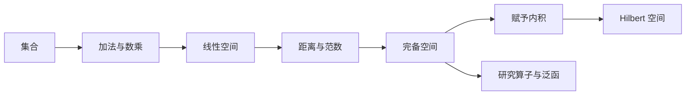

# 2026-09-15 第1节 泛函分析导论、选择公理与线性空间

## 资料来源

- 原始逐字稿：[[raw/2026-09-15-泛函分析课程导学-606784-逐字稿.md]]
- 智能纪要：[[raw/2026-09-15-泛函分析课程导学-606784-纪要.md]]
- 开始时间：2026-09-15 14:31
- 本课程目录中暂未发现可与本节可靠匹配的 PPT 或课件 MD，本笔记以课堂录音与纪要为依据。

## 一、本节课核心脉络

本节课先回答“为什么学泛函分析、它研究什么”，再介绍后续证明所依赖的集合论工具，最后回顾线性空间、线性流形、张成与线性相关性。教师强调，本课的价值不在抄下最终结论，而在跟随证明经历从定义、条件到结论的思维过程。

## 二、泛函分析研究什么

泛函分析把数学分析和线性代数的思想推广到函数空间、序列空间等无穷维对象。基本路线是先给集合逐层增加结构，再研究这些空间之间的映射：

1. 在集合上定义加法与数乘，得到线性空间；
2. 加入距离或范数，才能讨论收敛、连续与大小；
3. 要求完备性，保证 Cauchy 序列的极限仍留在空间内；
4. 进一步加入内积，可获得 Hilbert 空间中的角度、正交和投影结构；
5. 在这些空间之间研究线性算子、连续性、有界性及方程解的存在唯一性。

“函数”“泛函”“算子”的称呼常与定义域、值域有关：泛函通常把函数或向量映到标量，算子通常把一个空间中的元素映到另一个空间中的元素。课堂提醒，这些称呼是常用习惯，判断时仍应回到映射的定义域和值域。

> 一句话来说：泛函分析是在结构化的无穷维空间中研究映射，把有限维线性代数的思想推进到函数与算子层面。

## 三、课程路线图中的三个问题

课堂用三个问题展示后续核心定理能做什么：

| 问题 | 后续工具 | 想回答的本质 |
|:--|:--|:--|
| 连续但处处不可导的函数在连续函数空间中是多还是少 | Baire 纲定理 | 用“稠密、第一纲、剩余集”等方式比较无限集合中的典型性 |
| 从一族对象的逐点性质推出共同的整体控制 | 一致有界原理 | 把“对每个点都成立”提升为“整族算子一致有界” |
| 非线性方程无法显式求解时，能否证明解存在且唯一 | 压缩映射不动点定理 | 先证明唯一不动点，再用迭代逼近它 |

课堂以处处不可导连续函数、平方可和序列的共性问题及非线性方程为引子。本节录音中第二个例子的具体公式转写不完整，宜以后续正式定理和讲义为准，不在此补写未经确认的表达式。

## 四、有序集、良序集与超限归纳

### 1. 偏序与全序

集合 $X$ 上的关系 $\preceq$ 若满足

1. 自反性：$x\preceq x$；
2. 反对称性：$x\preceq y$ 且 $y\preceq x$ 推出 $x=y$；
3. 传递性：$x\preceq y$ 且 $y\preceq z$ 推出 $x\preceq z$，

则称 $(X,\preceq)$ 为偏序集。偏序不要求任意两个元素都能比较；若任意两元素均可比较，则称为全序集或链。

### 2. 良序集

若全序集的每个非空子集都有最小元，则称其为良序集。自然数按通常顺序是良序的，整数和实数按通常顺序则不是，因为某些非空子集没有最小元。

> 一句话来说：良序不仅要求元素能排先后，还要求任取一批元素都能找到“最先的那个”。

### 3. 超限归纳法

数学归纳法沿自然数顺序推进；超限归纳法把同一思想推广到一般良序集。证明命题 $P(\alpha)$ 对所有 $\alpha$ 成立时，通常验证：

- 最小元处命题成立；
- 假设所有 $\beta\prec\alpha$ 处均成立，能够推出 $P(\alpha)$ 成立。

若存在反例，则反例集合因良序性有最小元；而归纳步骤又排除了这个最小反例，从而得到矛盾。

## 五、选择公理、良序定理与佐恩引理

课堂介绍了集合论中彼此等价的三种表述：

### 1. 选择公理

对一族非空集合 $\{A_i\}_{i\in I}$，存在选择函数 $f$，使

$$
f(i)\in A_i,\qquad i\in I.
$$

有限个、带有明确选取规则的集合通常可以逐个构造选择；选择公理的关键价值在于，对任意甚至不可数的非空集合族，即使没有统一的显式规则，也保证能同时作出选择。

### 2. 良序定理

任意集合都可以赋予某个序关系，使其成为良序集。这里声称的是“存在一种良序”，不是说通常使用的大小关系一定已经是良序。

### 3. 佐恩引理

若非空偏序集 $P$ 的每条链在 $P$ 中都有上界，则 $P$ 至少有一个极大元。

> [!warning] 极大元不一定是最大元
> 极大元是“没有严格更大的可比较元素”，可能有多个；最大元必须大于等于集合中所有元素，若存在则唯一。

佐恩引理以后常用于证明“某个极大对象存在”，例如极大线性无关集和 Hamel 基的存在。证明时要明确偏序对象是什么、链是什么、链的上界怎样构造，不能只写“由佐恩引理可得”。

## 六、线性空间的结构

设 $X$ 是集合，标量域为 $\mathbb K$（$\mathbb R$ 或 $\mathbb C$）。若定义了向量加法和数乘，并满足下列八条公理，则称 $X$ 为 $\mathbb K$ 上的线性空间：

| 类别 | 公理 |
|:--|:--|
| 加法 | 结合律、交换律、存在零元、每个元素存在加法逆元 |
| 数乘 | $1x=x$、$(\alpha\beta)x=\alpha(\beta x)$ |
| 分配律 | $\alpha(x+y)=\alpha x+\alpha y$、$(\alpha+\beta)x=\alpha x+\beta x$ |

实空间与复空间的区别在于标量域。空间中的元素可以是数列、函数、矩阵等，不必是几何箭头；“向量”表示它能参与上述线性运算。

## 七、线性流形、张成与相关性

### 1. 线性流形

非空子集 $M\subseteq X$ 若对线性运算封闭，即

$$
x,y\in M,\ \alpha,\beta\in\mathbb K
\quad\Longrightarrow\quad
\alpha x+\beta y\in M,
$$

则 $M$ 是 $X$ 的线性流形，也称线性子空间。验证已有线性空间的子集是否为子空间时，通常只需检查非空与线性组合封闭，其余线性空间公理由母空间继承。

> 一句话来说：子空间必须允许你在其中做线性运算，而且运算结果不能“跑出集合”。

### 2. 线性包或张成

对 $S\subseteq X$，其线性包为所有有限线性组合构成的集合：

$$
\operatorname{span}(S)
=\left\{\sum_{k=1}^{n}\alpha_kx_k:
n\in\mathbb N,\ x_k\in S,\ \alpha_k\in\mathbb K\right\}.
$$

它是包含 $S$ 的最小线性流形：任何包含 $S$ 的线性流形都必须包含 $\operatorname{span}(S)$。

### 3. 线性相关与线性无关

有限向量组 $x_1,\ldots,x_n$ 线性相关，是指存在不全为零的标量 $\alpha_1,\ldots,\alpha_n$，使

$$
\sum_{k=1}^{n}\alpha_kx_k=0.
$$

若只有全零系数才能使线性组合为零，则该向量组线性无关。无穷集合 $S$ 线性无关的定义是：$S$ 的每个有限子集都线性无关，因为线性组合按定义只涉及有限项。

## 八、易错点与学习要求

> [!warning] 易错点
> - 偏序不要求任意两元素可比较，全序才要求。
> - “任意集合可良序”是存在性结论，不一定提供显式排法。
> - 使用佐恩引理时要区分链的上界、极大元与最大元。
> - 线性空间的元素不必是有限维坐标向量，也可以是函数或序列。
> - 无穷集合的线性无关性通过所有有限子集来检验，不允许直接写无穷线性组合。

- 课堂证明应跟随每一步条件与推理，不以背诵最终板书代替理解。
- 加入课程 QQ 群，以接收作业与课程通知。
- 复习线性代数中的向量空间、子空间、张成和线性相关概念。

## 课堂导航

- 上级索引：[[README|泛函分析课堂笔记]]
