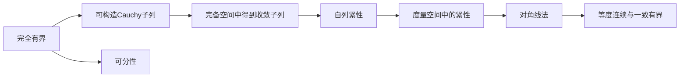

# 2026-10-13 第6节 紧性、对角线法与等度连续

## 资料来源

- 原始逐字稿：[[raw/2026-10-13-泛函分析紧性与等度连续讲座-961344-逐字稿.md]]
- 智能纪要：[[raw/2026-10-13-泛函分析紧性与等度连续讲座-961344-纪要.md]]
- 教材：[[课程/泛函分析/泛函分析(第2版) (江泽坚, 孙善利) (z-library.sk, 1lib.sk, z-li/泛函分析(第2版) (江泽坚, 孙善利) (z-library.sk, 1lib.sk, z-li|《泛函分析》第2版]]第一章第 6 节
- 课次说明：10 月 6 日为国庆假期，不计入实际授课次数；自动生成的第 7 节已校正为第 6 节。

## 一、本节课核心脉络

本节继续研究度量空间中的紧性。先完成“完全有界与列紧性”的关系并证明完全有界集可分，再从开覆盖定义建立紧性与自列紧性的等价；随后介绍对角线法，最后进入函数族的一致有界与等度连续，为 Arzelà–Ascoli 定理作准备。

## 二、完全有界与列紧性

集合 $M$ 完全有界，是指对任意 $\varepsilon>0$，都存在有限的 $\varepsilon$-网覆盖 $M$。

### 1. 列紧必然完全有界

若 $M$ 不完全有界，则存在 $\varepsilon_0>0$，使其没有有限 $\varepsilon_0$-网。可以递归选择 $x_n\in M$，使

$$
d(x_n,x_m)\geq\varepsilon_0,\qquad n\ne m.
$$

这样的序列没有 Cauchy 子列，因而不可能有收敛子列，与列紧性矛盾。

### 2. 完备空间中完全有界推出列紧

取一列 $\varepsilon_k\downarrow0$。用每一级有限 $\varepsilon_k$-网覆盖当前仍含无穷多项的子集，总能找到一个球包含无穷多个序列项。逐层嵌套并各取一项，得到子列 $\{x_{n_k}\}$，其尾部两点距离受 $2\varepsilon_k$ 控制，所以是 Cauchy 序列。若环境空间完备，该子列收敛。

因此在完备度量空间中，完全有界与列紧等价。

> [!warning] 完全有界不等于普通有界
> 普通有界只要求集合落在一个大球中；完全有界要求在任意精度下都能由有限个小球覆盖。在无穷维空间中，前者通常远弱于后者。

## 三、完全有界推出可分

对每个正整数 $n$，取 $M$ 的有限 $1/n$-网 $N_n\subset M$，并令

$$
N=\bigcup_{n=1}^{\infty}N_n.
$$

有限集的可数并仍是可数集。给定 $x\in M$ 和任意 $\varepsilon>0$，选 $n$ 使 $1/n<\varepsilon$，即可在 $N_n$ 中找到与 $x$ 距离小于 $\varepsilon$ 的点。因此 $N$ 在 $M$ 中稠密，$M$ 可分。

## 四、紧性与自列紧性

集合 $M$ 称为紧的，是指 $M$ 的任意开覆盖都有有限子覆盖。自列紧则要求 $M$ 中任意序列都有一个收敛子列，且极限仍属于 $M$。

在度量空间中，二者等价。

### 1. 紧性推出自列紧

反设序列 $\{x_n\}\subset M$ 没有收敛到 $M$ 中某点的子列。对每个 $\xi\in M$，可选邻域 $B(\xi,\delta_\xi)$，使其至多包含该序列的一个不同点。这些球构成开覆盖；若存在有限子覆盖，则只能容纳有限个不同的 $x_n$，与序列有无穷多个不同项矛盾。

### 2. 自列紧推出紧性

课堂证明先利用自列紧推出完全有界和可分，从可数稠密集与有理半径构造可数开覆盖基。若原开覆盖没有有限子覆盖，就能依次选出 $x_n$ 落在前 $n$ 个基元素覆盖之外。自列紧性给出收敛子列，其极限属于某个开覆盖成员，最终与构造矛盾。

## 五、对角线法

设对每个 $k$，数列 $\{\alpha_{kn}\}_{n\ge1}$ 都有收敛子列。逐行抽取：第二行的子列从第一行已选子列中再抽取，第三行再从第二行的选择中抽取，依此进行。最后取嵌套子列阵列的对角线指标 $n(j)$。

对任意固定的 $k$，当 $j$ 足够大时，对角线序列都属于第 $k$ 行所选的收敛子列，所以

$$
\{\alpha_{k,n(j)}\}_{j\ge1}
$$

收敛。这样得到一个对所有行同时有效的公共子列。

> [!important] 对角线法的作用
> 它把“每个坐标分别能抽出收敛子列”升级为“存在一个对子列中所有固定坐标都收敛的统一选择”，是后续函数空间紧性证明的核心工具。

## 六、函数族的等度连续与一致有界

设 $\mathcal F$ 是从度量空间 $X$ 到度量空间 $Y$ 的函数族。

### 1. 等度连续

$\mathcal F$ 等度连续，是指对任意 $\varepsilon>0$，存在同一个 $\delta>0$，使对所有 $f\in\mathcal F$，只要

$$
d_X(x,x')<\delta,
$$

就有

$$
d_Y(f(x),f(x'))<\varepsilon.
$$

关键是 $\delta$ 不依赖于具体函数 $f$，即“一把尺子量整个函数族”。

### 2. 一致有界

函数族一致有界，是指存在统一常数 $C$，使所有 $f\in\mathcal F$ 在整个定义域上的函数值都受同一个界控制。对实值函数常写成

$$
|f(x)|\leq C,
\qquad \forall f\in\mathcal F,\ \forall x\in X.
$$

课堂由列紧性说明函数族在上确界距离下完全有界，因而能被有限多个固定半径球覆盖，再用一个更大的球统一控制整个函数族。

### 3. 与 Arzelà–Ascoli 定理的衔接

教材中的结论是：$\mathcal F\subset C[0,1]$ 列紧，当且仅当 $\mathcal F$ 一致有界且等度连续。本节已建立所需概念并开始说明必要性；完整充分性证明将在后续继续。

## 七、课堂强调

- 证明过程用于训练如何构造反例序列、有限网和子列，比孤立背诵结论更重要；
- 紧性在一般度量空间中应从开覆盖或序列刻画理解，不能直接照搬有限维空间“闭且有界”的直觉；
- 对角线法需要理解嵌套抽取关系，而不是只记最终对角线。

## 课堂疑惑与解答

当日日计划 `每日疑惑/2026-10-13.md` 尚未生成，本次无可回写的课堂疑惑。

## 课堂导航

- 上一课：[[2026-10-09-第5节-泛函分析空间完备性讲座|第5节 完备化与完全有界性]]
- 上级索引：[[README|泛函分析课堂笔记]]
