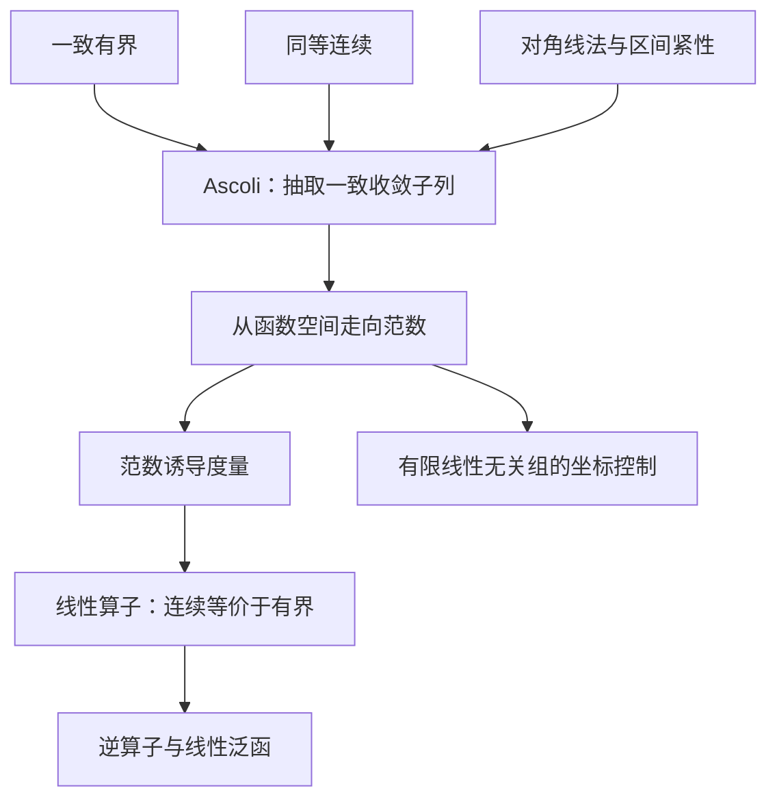
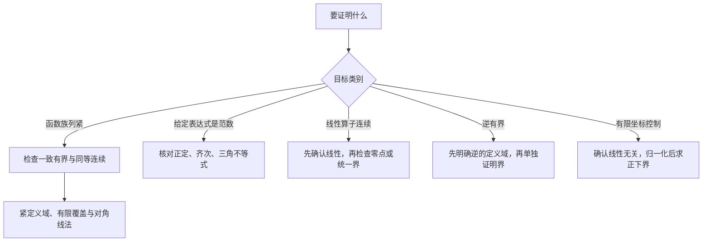

# 2026-10-20 第7节 Ascoli定理与赋范线性空间

## 课程信息与来源边界

- 日期与课表：2026-10-20，第8周星期二第5—6节，14:30—16:05；录音自14:30:36开始。
- [[课程/泛函分析/课堂笔记/raw/2026-10-20-泛函分析课程授课-963456-逐字稿|逐字稿]]、[[课程/泛函分析/课堂笔记/raw/2026-10-20-泛函分析课程授课-963456-纪要|纪要]]均保留原样。下文时间戳为录音相对时间。
- 对照教材：[[课程/泛函分析/泛函分析(第2版) (江泽坚, 孙善利) (z-library.sk, 1lib.sk, z-li/泛函分析(第2版) (江泽坚, 孙善利) (z-library.sk, 1lib.sk, z-li|《泛函分析》第2版]]第一章 §6（定理6.4及自学线索）、§7（范数、线性算子、引理7.1）。未找到本次教师展示的对应PPT/PDF课件，以本地教材校正公式和条件，不把教材整节冒充当堂全部内容。
- 课次：承接[[课程/泛函分析/课堂笔记/2026-10-13-第6节-泛函分析紧性与等度连续讲座|10月13日第6节]]；10月16日在课表中明确停课，不应计课或建缺失记录，所以本次为第7节，纠正自动生成的第9节。10月6日假期沿用前次已核对的扣除口径，10月10日按星期三补课，不产生本课程周二、五课次。
- 录音约01:01—01:12及末尾证明存在缺损；教材补足部分明确标注。课后旁谈不列作授课内容。“已完成”不等于原始资料完整或自测已掌握。

## 一、本次课核心脉络

本课从“怎样保证一族连续函数能抽出一致收敛子列”出发，完成 Ascoli 定理，再进入有线性结构的空间，研究范数、连续线性算子以及有限坐标的稳定性。

**最小先修**：

- 上确界距离为 $d_\infty(f,g)=\max_{t\in[0,1]}|f(t)-g(t)|$；按此距离收敛就是一致收敛，不是一般的逐点收敛。
- 完全有界要求任意精度都存在有限网；列紧要求任意序列有收敛子列。
- 不熟悉时回看[[课程/泛函分析/课堂笔记/2026-10-13-第6节-泛函分析紧性与等度连续讲座|上一课的完全有界、对角线法与等度连续]]；$C[0,1]$ 完备性可回看[[课程/泛函分析/课堂笔记/2026-09-29-第4节-缺少逐字稿|第4节非逐字稿补全中的证明]]。

阅读路线：先把 Ascoli 的两方向证明读清，再学范数公理与例子，最后掌握“放缩到小邻域”的算子证明技巧。

## 二、Ascoli定理的条件究竟是什么（核心）

来源：00:00—06:03；教材第一章定理6.4。

设 $\mathcal F\subset C[0,1]$，赋予上确界距离。

**一致有界**是存在 $M<\infty$，使所有 $f\in\mathcal F$、所有 $t\in[0,1]$ 都满足 $|f(t)|\le M$。

**同等连续（本课也称等度连续）**是

$$
\forall\varepsilon>0\ \exists\delta>0\
\forall f\in\mathcal F\ \forall s,t\in[0,1],
\quad |s-t|<\delta\Rightarrow |f(s)-f(t)|<\varepsilon.
$$

同一个 $\delta$ 对整族函数都有效，而不依赖具体选了哪一个 $f$。

**Arzelà–Ascoli定理**：$\mathcal F$ 的任意序列都有子列在 $C[0,1]$ 中收敛，当且仅当 $\mathcal F$ 一致有界且同等连续。极限允许在 $\mathcal F$ 外；教材称这种性质为“列紧”。若还要求极限在 $\mathcal F$ 内，需再检查闭性，不能直接说该族本身必紧。

> 一句话来说：共同的高度控制加上共同的变化速度控制，使整族函数不至于无限逃散或长出越来越尖的局部变化。

**补充解释**：纪要“闭区间上连续函数的收敛与一致收敛等价”应限定为**按 $C[0,1]$ 的上确界距离收敛**与一致收敛等价；闭区间上的逐点收敛仍不自动一致。

## 三、必要性：用有限网得到统一控制（难点）

来源：06:51—16:36。以下结合教材整理完整步骤。

若 $\mathcal F$ 列紧，则完全有界。

### 1. 为什么必然一致有界

取有限的1-网 $g_1,\ldots,g_m\in C[0,1]$。每个连续函数在紧区间上有界；对任意 $f\in\mathcal F$，可选 $g_j$ 使 $\|f-g_j\|_\infty<1$，故

$$
\|f\|_\infty
\le\|f-g_j\|_\infty+\|g_j\|_\infty
<1+\max_{1\le j\le m}\|g_j\|_\infty.
$$

右端与 $f$ 无关，得到整族统一上界。

### 2. 为什么必然同等连续

给定 $\varepsilon>0$，取有限 $\varepsilon/3$-网 $g_1,\ldots,g_m$。各 $g_j$ 在 $[0,1]$ 上一致连续，且只有有限个，因此可取一个共同的 $\delta>0$，使

$$
|s-t|<\delta
\Rightarrow |g_j(s)-g_j(t)|<\varepsilon/3
\quad\text{对所有 }j.
$$

对任意 $f$，选近似它的 $g_j$，用三角不等式：

$$
\begin{aligned}
|f(s)-f(t)|
&\le |f(s)-g_j(s)|+
|g_j(s)-g_j(t)|+
|g_j(t)-f(t)|\\
&<\varepsilon/3+\varepsilon/3+\varepsilon/3=\varepsilon.
\end{aligned}
$$

**关键依赖**：有限网控制第一、三项；有限个中心函数的一致连续性控制中间项。不能直接把“每个函数分别连续”当成整族统一的 $\delta$。

## 四、充分性：从可数点升级到全区间（难点）

来源：17:37—34:56；以教材定理6.4补齐量词与完备性步骤。

任取 $f_n\in\mathcal F$，目标是抽出在整个 $[0,1]$ 上一致收敛的子列。

1. 将 $[0,1]\cap\mathbb Q$ 枚举为 $r_1,r_2,\ldots$。由一致有界，每个数列 $f_n(r_j)$ 有界。
2. 对 $r_1$ 抽收敛子列，再在其内部对 $r_2$ 抽，依次进行。取递进子列指标的对角线，得到 $g_k=f_{n_k}$，使对每个固定 $j$，$g_k(r_j)$ 收敛。这里只得到**各有理点逐点收敛**，并未得到有理点集上一致收敛。
3. 给定 $\varepsilon>0$，由同等连续取 $\delta>0$，使任意 $g_k$ 在距离小于 $\delta$ 的两点间变化小于 $\varepsilon/3$。
4. 有理数稠密，区间紧，故可选有限个有理点 $r_1',\ldots,r_m'$，使它们的 $\delta$-邻域覆盖全区间。
5. 在这些有限点上，$g_k(r_j')$ 都是Cauchy序列。取有限个阈值的最大值为 $N$，则 $k,l\ge N$ 时，对所有中心同时有 $|g_k(r_j')-g_l(r_j')|<\varepsilon/3$。

对任意 $t$，选离它小于 $\delta$ 的中心 $r_j'$：

$$
\begin{aligned}
|g_k(t)-g_l(t)|
&\le |g_k(t)-g_k(r_j')|
+|g_k(r_j')-g_l(r_j')|
+|g_l(r_j')-g_l(t)|\\
&<\varepsilon.
\end{aligned}
$$

故 $\|g_k-g_l\|_\infty\le\varepsilon$。如需严格小于任给误差，可先对其一半执行上述构造。于是 $\{g_k\}$ 在 $C[0,1]$ 中是Cauchy序列；利用 $C[0,1]$ 完备，得到连续极限与全区间一致收敛。

> 一句话来说：对角线法管可数个点，紧性把区间缩成有限个代表点，同等连续把代表点的控制传给所有点。

### 自测（新编）：只保留一个条件够不够

在 $[0,1]$ 上令 $f_n(t)=t^n$。它们是否一致有界？能否抽出一致收敛子列？指出 Ascoli 的哪个条件失败。

> [!hint]- 提示
> 先求逐点极限；一致收敛的连续函数列必有连续极限。也可比较 $t=1$ 与 $t=1-1/n$。

> [!solution]- 解析
> $0\le f_n\le1$，故一致有界。任意指标趋于无穷的子列都逐点趋于 $f(t)=0$（$t<1$）、$f(1)=1$，极限不连续，故没有一致收敛子列。
> 整族不等度连续：两点距离 $1/n\to0$，但 $1-(1-1/n)^n\to1-e^{-1}>0$。不能选出对所有 $n$ 有效的统一 $\delta$。

**补充反例：列紧不保证族本身闭**。常函数族 $\{f_n(t)=1/n:n\ge1\}$ 一致有界、同等连续，子列可在 $C[0,1]$ 中收敛到零函数，但零函数不在该族内；它相对紧，却不是自身紧。

## 五、从度量走向范数（核心）

来源：37:24—43:14、56:58—01:01:02；教材定义7.1与命题7.1。

先有实或复线性空间 $X$，才能谈加法与数乘的兼容。映射 $\|\cdot\|:X\to[0,\infty)$ 为范数，须满足：

$$
\begin{aligned}
&\|x\|=0\Longleftrightarrow x=0;\\
&\|\alpha x\|=|\alpha|\,\|x\|;\\
&\|x+y\|\le\|x\|+\|y\|.
\end{aligned}
$$

这里 $\alpha$ 为标量；实、复数都取其绝对值或模。不能只写“零元素范数为零”而漏掉反向蕴含。

定义 $d(x,y)=\|x-y\|$，由三公理得正定、对称和三角不等式，故范数诱导度量；范数收敛就是 $\|x_n-x\|\to0$。加法、数乘与此收敛兼容。

> 一句话来说：范数是与线性运算相容的“大小”，两点的距离取差向量的大小；不能把物理“能量”类比直接当成范数定义。

### 1. 范数本身为何连续

由三角不等式及交换 $x,y$，

$$
\bigl|\|x\|-\|y\|\bigr|\le\|x-y\|.
$$

因此若 $x_n\to x$，则 $\|x_n\|\to\|x\|$；范数甚至是1-Lipschitz函数。

### 2. 一个给定度量未必来自范数

**依课堂无穷序列例整理具体式（教材补充解释）**：在全体标量序列上可用

$$
d(x,y)=\sum_{k=1}^\infty2^{-k}
\frac{|x_k-y_k|}{1+|x_k-y_k|}.
$$

该度量不具有范数诱导距离应有的齐次性。以下自测将用一个坐标核对；结论是**此给定度量不能精确写为某范数的差距离**，不据此断言该向量集合不能另外配备任何范数。

### 自测（新编）：检查齐次性

令 $e_1=(1,0,0,\ldots)$。计算上述度量的 $d(e_1,0)$ 与 $d(2e_1,0)$；它们是否符合范数诱导距离的比例关系？

> [!hint]- 提示
> 求和只有第一项不为零，前面的权重为 $2^{-1}$。

> [!solution]- 解析
> $d(e_1,0)=\frac12\frac12=\frac14$；$d(2e_1,0)=\frac12\frac23=\frac13$。
> 如果由范数诱导，应有 $d(2e_1,0)=2d(e_1,0)=1/2$，与1/3不同，故此度量不是范数诱导的。

## 六、常见赋范空间与测度记号（核心与了解分层）

来源：40:43—55:53；具体公式以教材 §7 例1—5核对。

### 1. 紧集上的连续函数：$C(K)$

设 $K$ 非空紧，连续实值或复值函数逐点相加、数乘，定义

$$
\|f\|_\infty=\max_{t\in K}|f(t)|.
$$

紧性保证连续函数有界且最大值可取到；正定与齐次来自绝对值，三角不等式来自逐点不等式取最大值。若定义域非紧，不能直接对所有连续函数不加限制地取有限最大值。

### 2. $L^p$：须识别几乎处处相等

设 $(\Omega,\Sigma,\mu)$ 是测度空间，$1\le p<\infty$，

$$
L^p(\Omega,\mu)=
\left\{[f]: f\text{可测},\ \int_\Omega|f|^p\,d\mu<\infty\right\},
\qquad
\|f\|_p=\left(\int_\Omega|f|^p\,d\mu\right)^{1/p}.
$$

$[f]$ 表示几乎处处相等的函数构成的等价类。积分为零只推出几乎处处为零；若不取等价类，便不能满足范数的正定性。齐次性由积分直接验证，三角不等式由 Minkowski 不等式给出，完整依据见教材第一章 §3。

> 一句话来说：$L^p$ 记录的是忽略零测集差异之后的积分大小，而不是要求函数逐点相同。

**转写校正**：$\Sigma$ 为 $\sigma$-代数，$\mu$ 是定义在 $\Sigma$ 上的测度。教材例子中的“$\sigma$-有限”指

$$
\Omega=\bigcup_{j=1}^\infty E_j,\qquad \mu(E_j)<\infty,
$$

不是“可列可加”的另一名称。可列可加要求对两两不交的可测集 $A_j$ 有 $\mu(\bigcup_jA_j)=\sum_j\mu(A_j)$；这是不同的性质。概率测度是特殊测度，$\mu(\Omega)=1$；一般测度不要求总质量为1。

### 3. $\ell^p$ 是计数测度的特例

取 $\Omega=\mathbb N$、每个单点质量为1，则积分变求和：

$$
\ell^p=
\left\{x=(x_k):\sum_{k=1}^\infty|x_k|^p<\infty\right\},
\qquad
\|x\|_p=\left(\sum_{k=1}^\infty|x_k|^p\right)^{1/p}.
$$

自然数集的总计数测度无限，但可由有限前缀覆盖，所以仍是 $\sigma$-有限。不是任意无穷序列都属于 $\ell^p$。

### 4. Hardy空间（了解即可）

课堂只要求了解名称和来源，以下公式由教材补齐，不扩展为本课已证明的复分析理论。设 $D=\{z:|z|<1\}$，$f$ 在 $D$ 内解析，$1\le p<\infty$：

$$
m_p(f;r)=\left(\frac1{2\pi}\int_0^{2\pi}
|f(re^{i\theta})|^p\,d\theta\right)^{1/p},
\quad 0\le r<1,
$$

$$
H^p=\left\{f\text{解析}:\sup_{0\le r<1}m_p(f;r)<\infty\right\},
\qquad
\|f\|_{H^p}=\sup_{0\le r<1}m_p(f;r).
$$

$H^\infty$ 为盘内有界解析函数，范数为 $\sup_{z\in D}|f(z)|$。重点是有限的圆周积分平均再对半径取上确界；不能只写某个固定半径的积分而称完整 Hardy 范数。

## 七、线性算子：一点连续等价于有界（核心）

来源：01:14:02—01:22:01；定义及算子范数由教材定义7.2补齐。

设 $X,Y$ 为赋范空间，$T:X\to Y$ 线性，即

$$
T(\alpha x+\beta y)=\alpha Tx+\beta Ty.
$$

有界线性算子存在同一常数 $M$，使

$$
\|Tx\|_Y\le M\|x\|_X\quad(\forall x\in X).
$$

它不是说所有输出都落入同一个固定球，而是说输入大小受到控制时，输出按统一比例受控。算子范数为最小可用常数：

$$
\|T\|=\sup_{\|x\|_X=1}\|Tx\|_Y
=\sup_{x\ne0}\frac{\|Tx\|_Y}{\|x\|_X}.
$$

零空间的情形按 $\|T\|=0$ 处理。

**定理7.1**：对线性 $T$，“某一点连续”“处处连续”“有界”等价；特别可只检查零点连续。不要求空间完备。

### 完整证明：局部控制怎样变成全空间控制

有界推出处处连续，因为

$$
\|Tx-Ty\|_Y=\|T(x-y)\|_Y\le M\|x-y\|_X.
$$

处处连续显然推出某一点连续。反过来，若 $T$ 在 $x_0$ 连续，取 $\delta>0$，使

$$
\|h\|_X<\delta
\Rightarrow
\|T(x_0+h)-Tx_0\|_Y<1.
$$

对任意 $x\ne0$，令 $h=\delta x/(2\|x\|_X)$，于是 $\|h\|_X=\delta/2$，且由线性性

$$
\frac{\delta}{2\|x\|_X}\|Tx\|_Y
=\|Th\|_Y<1,
\qquad
\|Tx\|_Y<\frac2\delta\|x\|_X.
$$

$x=0$ 时 $T0=0$，同样满足不等式。取 $M=2/\delta$ 即得有界。

> 一句话来说：线性性允许把任意向量缩小到一个受控邻域，再把局部估计等比例放回去。

## 八、值域、逆算子与泛函（核心定义）

来源：01:22:14—01:28:05；教材 §7。

- 值域 $R(T)=\{Tx:x\in X\}\subset Y$。
- 满射是 $R(T)=Y$，不能把“有值域”写成“就是满射”。
- 单射是每个像至多有一个原像；等价地，值域中每点恰有一个原像。线性情形亦等价于 $\ker T=\{0\}$。
- 仅单射时，$T^{-1}:R(T)\to X$ 可定义；再有满射时，才得到 $T^{-1}:Y\to X$。
- $T^{-1}$ 的线性由 $T$ 的线性和单射推出：令 $y_i=Tx_i$，则 $T(\alpha x_1+\beta x_2)=\alpha y_1+\beta y_2$，取唯一原像即可。
- 逆算子存在不自动保证有界；若原有界线性算子是双射，逆亦有界，才称有界可逆。本课未给出一般逆有界定理，不提前套后续完备空间结果。

**线性泛函**是取值在标量域 $\mathbb R$ 或 $\mathbb C$ 的线性算子；仍适用连续与有界等价。不能把所有标量值函数都不加条件称作“线性泛函”。

> 一句话来说：逆的代数定义先解决“能否唯一找回输入”，有界性另问“找回过程对小误差是否稳定”。

### 自测（新编）：有界单射的逆一定有界吗

按教材积分算子的例子，$T:C[0,1]\to C[0,1]$，$(Tf)(x)=\int_0^x f(t)\,dt$，两边都用上确界范数。证明 $T$ 有界且单射，写出值域上的逆；再用 $g_n(x)=\sin(nx)/n$ 判断这个逆是否有界。

> [!hint]- 提示
> 先估计积分，逆为求导。注意值域不是整个 $C[0,1]$，并比较 $\|g_n\|_\infty$ 与 $\|g_n'\|_\infty$。

> [!solution]- 解析
> $|(Tf)(x)|\le x\|f\|_\infty\le\|f\|_\infty$，故有界；若 $Tf=0$，微分得 $f=0$，故单射。$R(T)=\{g\in C^1[0,1]:g(0)=0\}$，逆为 $T^{-1}g=g'$。
> $g_n\in R(T)$，$\|g_n\|_\infty\le1/n$，而 $\|g_n'\|_\infty=\|\cos(nx)\|_\infty=1$。若逆有界，就应有 $1\le M/n$ 对所有 $n$ 成立，矛盾。
> 此例不是有界双射在两个Banach空间之间的反例，因为按上确界范数赋予值域时，不能直接假定值域完备；本课只问值域上的逆。

## 九、有限线性无关组为何能控制坐标（难点）

来源：01:28:21—01:34:13。录音止于引理的归一化、下确界和逼近序列构造；以下结论与完整收尾由教材引理7.1补足，不能写成录音中已完整讲完。

若 $x_1,\ldots,x_m$ 在赋范空间 $X$ 中线性无关，则存在 $\mu>0$，对所有标量 $\alpha_j$ 都有

$$
\sum_{j=1}^m|\alpha_j|
\le\mu\left\|\sum_{j=1}^m\alpha_jx_j\right\|.
$$

这是**不等式**，不是“范数恰等于坐标绝对值之和”；常数依赖这组固定向量。

### 证明：归一化、抽子列、排除极限为零

设

$$
c=\inf\left\{\left\|\sum_j\alpha_jx_j\right\|:
\sum_j|\alpha_j|=1\right\}\ge0.
$$

由下确界定义，取系数列 $\alpha^{(k)}$，其绝对值和为1，令 $y_k=\sum_j\alpha_j^{(k)}x_j$，使 $\|y_k\|\to c$。每个系数有界，且只有有限多个坐标，逐次抽子列得 $\alpha_j^{(k_l)}\to\beta_j$ 对所有 $j$ 同时成立。

由有限求和与绝对值连续，$\sum_j|\beta_j|=1$，故系数不全零；线性无关性推出 $y=\sum_j\beta_jx_j\ne0$。又

$$
\|y_{k_l}-y\|
\le\sum_j|\alpha_j^{(k_l)}-\beta_j|\,\|x_j\|\to0.
$$

由范数连续，$c=\lim_l\|y_{k_l}\|=\|y\|>0$。对任意不全零系数，除以 $s=\sum_j|\alpha_j|$ 归一化，可得 $\|\sum_j\alpha_jx_j\|\ge cs$。取 $\mu=1/c$ 即得所需不等式；全零系数情形显然。

> 一句话来说：固定有限个线性无关方向后，坐标很大却几乎完全抵消的情况受到统一限制。

**证明边界（补充解释）**：这里用的是有限个标量坐标的有界子列性质，而不是预先使用“所有有限维范数等价”，从而避免循环论证。若向量线性相关，非零系数可合成零向量，不等式立即失败。

### 自测（新编）：常数是否能对所有基统一

在欧氏 $\mathbb R^2$ 中取 $x_1=(1,0)$、$x_2=(1,\varepsilon)$，其中 $\varepsilon>0$。以系数 $(1,-1)$ 代入上面不等式，求 $\mu$ 必须满足的下界，并说明 $\varepsilon\to0$ 时的含义。

> [!hint]- 提示
> 系数绝对值和为2，合成向量为 $(0,-\varepsilon)$。

> [!solution]- 解析
> $2\le\mu\varepsilon$，故 $\mu\ge2/\varepsilon$。每个固定 $\varepsilon>0$ 的向量组都线性无关，但所需常数可任意大；定理没有承诺对所有接近线性相关的向量组使用同一个常数。

## 十、判定流程与公式速查

| 内容 | 公式或结论 | 关键边界 |
|:--|:--|:--|
| Ascoli | 一致有界且同等连续等价于列紧 | 紧定义域，上确界度量；本族不一定闭 |
| 范数诱导度量 | $d(x,y)=\Vert x-y\Vert$ | 先有线性结构与三公理 |
| 范数连续 | $\bigl\vert\Vert x\Vert-\Vert y\Vert\bigr\vert\le\Vert x-y\Vert$ | 由三角不等式推出 |
| 线性算子有界 | $\Vert Tx\Vert\le M\Vert x\Vert$ | 同一个常数对所有输入有效 |
| 线性算子连续 | 一点连续等价于处处连续、有界 | 必须线性，不要求完备 |
| 系数控制 | $\sum_j\vert\alpha_j\vert\le\mu\Vert\sum_j\alpha_jx_j\Vert$ | 固定有限线性无关组 |

## 十一、易错点、课堂疑惑与待查

> [!warning] 本次重点勘误
> - 在 $C[0,1]$ 中按距离收敛才等价于一致收敛；不能删掉“按哪个距离”的限定。
> - 有理点上的逐点收敛不等于有理点上一致收敛；还须用同等连续与有限覆盖升级。
> - 列紧允许极限落在环境空间，不一定留在函数族内。
> - $\sigma$-有限、$\sigma$-代数与可列可加不是同一概念。
> - $L^p$ 的零元素按几乎处处相等识别；范数三公理中的正定是双向条件。
> - 线性算子有界不是全空间输出统一有界；逆线性也不代表逆有界。
> - 有限线性无关组给出不等式，而非坐标和与范数恒等。

当日日计划“每日疑惑/2026-10-20.md”未找到，无可提取并回写的当日用户问题；新编自测不作为用户提问登记。

既往核对：9月29日第4节已是“已补全（无逐字稿）”；本课程当前没有其他未补的“缺少逐字稿”占位课。10月16日为明确停课，不创建第7节缺失记录，后续编号顺延。

待补：本课PPT及末尾证明录音。教材补足不等于恢复教师原话、板书细节和当堂证明的完整讲授范围。

## 十二、相关链接与课堂练习

- [[课程/泛函分析/泛函分析(第2版) (江泽坚, 孙善利) (z-library.sk, 1lib.sk, z-li/泛函分析(第2版) (江泽坚, 孙善利) (z-library.sk, 1lib.sk, z-li|教材第一章§6—§7]]：定理6.4、定义7.1—7.3、定理7.1、引理7.1的准确依据；未表示整章后续命题已经讲完。
- [[课程/泛函分析/课堂笔记/2026-10-13-第6节-泛函分析紧性与等度连续讲座|上一课]]：回看完全有界、紧性与对角线法。
- [[课程/泛函分析/课堂笔记/README|课堂索引]]：核对课次、补全与后续衔接。

教师明确的自学、练习线索：

1. 自行阅读教材 §6 的解析函数族引理6.1与Montel定理6.5；它们承接 Ascoli，不是本次已逐步证明的内容。
2. 写一遍范数诱导度量的三条性质。
3. 写出单射线性算子的逆在值域上线性的证明。
4. Hardy空间了解即可，有复分析兴趣再展开。

本笔记四道自测为新编练习，不代替教师原题，也不在未作答时标记“已掌握”。
