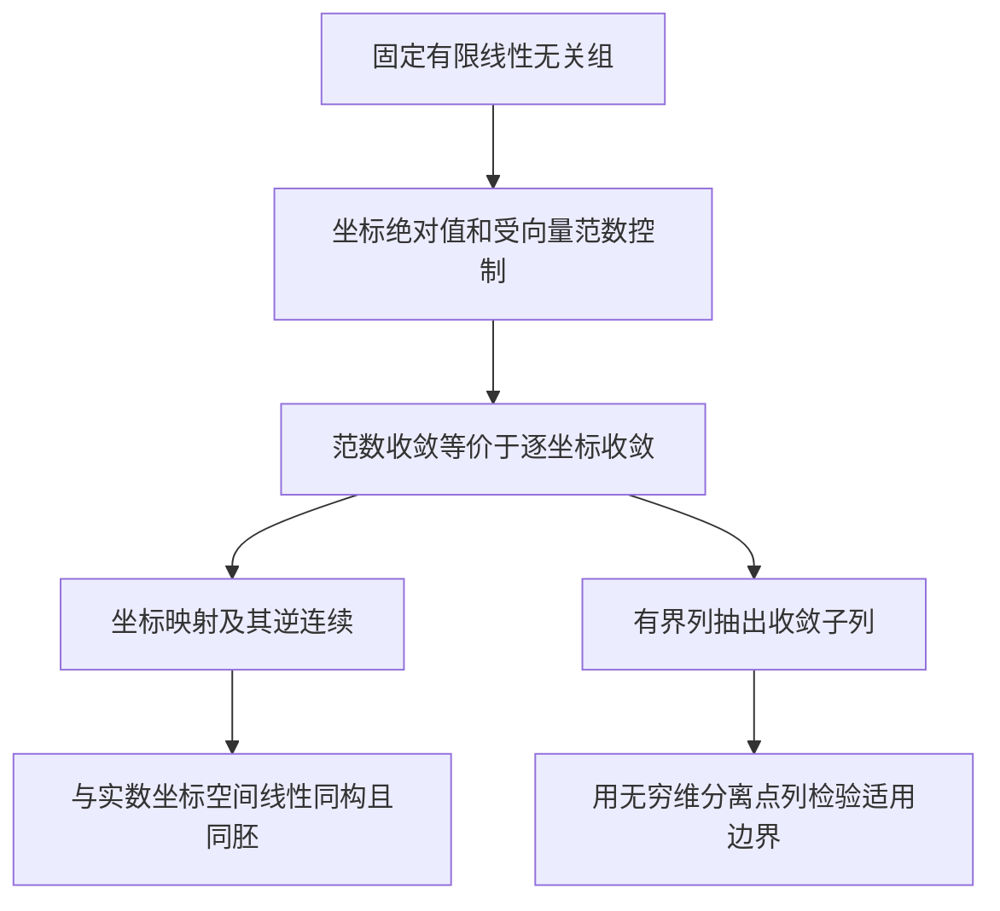
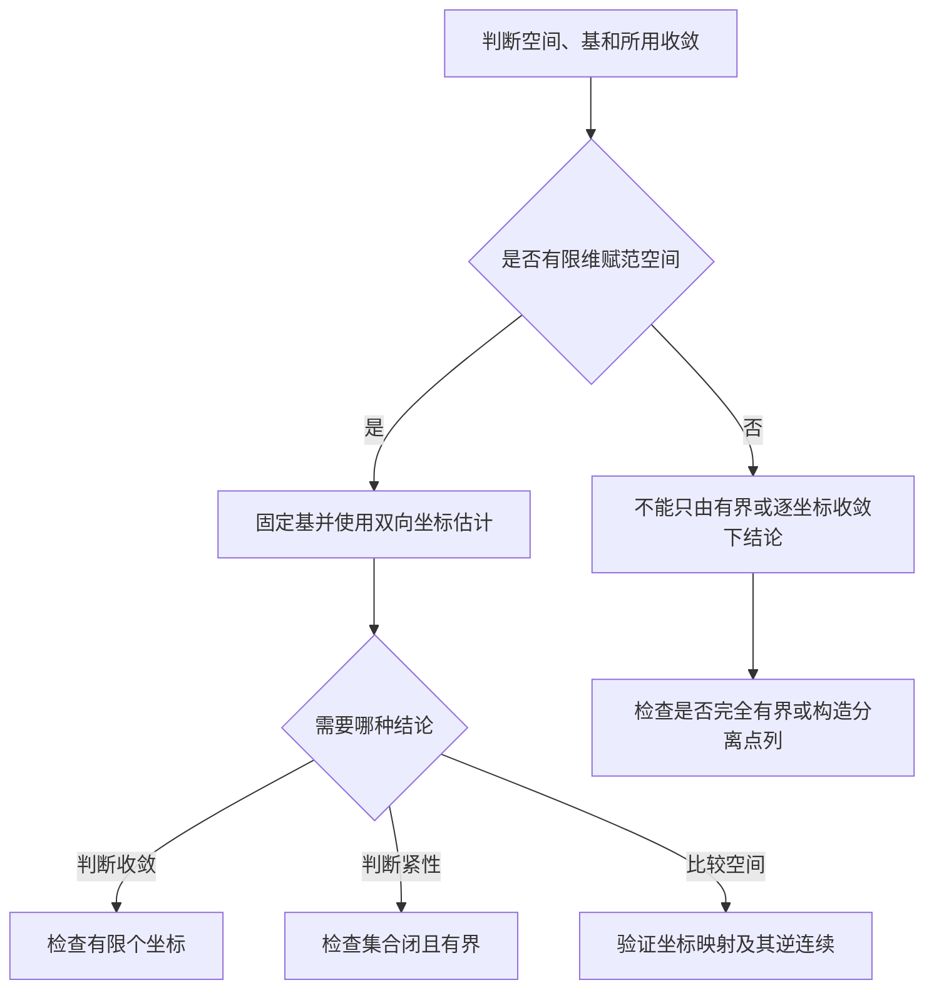

# 2026-10-23 第8节 有限维赋范空间、坐标同胚与无穷维反例

## 课程信息与来源边界

- 星期五第7—8节，16:20—17:55，教师邓志亮。承接[[课程/泛函分析/课堂笔记/2026-10-20-第7节-泛函分析课程授课|第7节]]；沿用前次已核对的假期及停课扣除口径，10月16日停课不计课，故本次为第8节，纠正自动归档的第10节。
- 原始逐字稿：[[课程/泛函分析/课堂笔记/raw/2026-10-23-泛函分析基础概念讲座-029888-逐字稿|完整转写]]；纪要：[[课程/泛函分析/课堂笔记/raw/2026-10-23-泛函分析基础概念讲座-029888-纪要|定位用纪要]]。
- 教材依据：[[课程/泛函分析/泛函分析(第2版) (江泽坚, 孙善利) (z-library.sk, 1lib.sk, z-li/泛函分析(第2版) (江泽坚, 孙善利) (z-library.sk, 1lib.sk, z-li|教材第一章第7节]]引理7.1、命题7.2—7.4，核对本次主线；第三章第7节只用于弱收敛的补充理解。未发现可匹配本课的 PPT/PPTX、PDF 课件，采用已有教材源 MD。
- 覆盖范围：开头有限线性无关组引理的收尾，坐标收敛、同构同胚、聚点原理，无穷维反例，以及课尾切空间与微分的动机说明。
- 纪要中的“有界线性空间”结合录音和教材应校为“有限维赋范线性空间”；不能把整个空间有界当成定理条件。补充例子和解释单独标明，原始资料不改写。

## 一、本次课核心脉络

核心问题：为什么抽象有限维空间中的函数、向量等对象，都能用有限个坐标处理其收敛性？这套方法为什么不能直接推广到无穷维？

必要先修：

- 基的含义：每个向量 $x$ 能唯一写成有限线性组合 $\sum_{j=1}^n\alpha_je_j$；向量与系数不是同一个对象。
- 范数收敛：$\|x_k-x\|\to0$；三角不等式和齐次性用于估计组合的范数，见[[课程/泛函分析/课堂笔记/2026-10-20-第7节-泛函分析课程授课#五、从度量走向范数（核心）|范数的定义与连续性]]。
- 线性算子有界当且仅当连续，见[[课程/泛函分析/课堂笔记/2026-10-20-第7节-泛函分析课程授课#七、线性算子：一点连续等价于有界（核心）|上一节完整证明]]。
- 收敛列必为 Cauchy 列；紧性涉及任意开覆盖/点列而非单个点列，见[[课程/泛函分析/课堂笔记/2026-10-13-第6节-泛函分析紧性与等度连续讲座|紧性与完全有界]]。

阅读路线：先理解控制坐标的常数为何严格为正，再掌握坐标收敛的双向证明；随后看同胚与聚点原理，最后以两个反例检查有限维假设。切空间部分是后续对偶空间的动机，不是本次新建立的一套微分几何理论。

## 二、开头引理收尾：为什么下确界不可能为零（难点）

来源：00:00:25—00:07:12，承接上节未讲完的证明。

设 $e_1,\ldots,e_n$ 是赋范空间中固定的有限线性无关向量。则存在依赖该组向量及范数的 $\mu>0$，使任意系数满足

$$
\boxed{
\sum_{j=1}^n|\alpha_j|
\le\mu\left\|\sum_{j=1}^n\alpha_je_j\right\|.
}
$$

> 一句话来说：固定有限个线性无关方向后，合成向量很小就迫使所有坐标都很小。

完整证明还可回看[[课程/泛函分析/课堂笔记/2026-10-20-第7节-泛函分析课程授课#证明：归一化、抽子列、排除极限为零|归一化和下确界构造]]。本节课堂把关键收尾讲完，整理如下。

令

$$
c=\inf\left\{
\left\|\sum_{j=1}^n\alpha_je_j\right\|:
\sum_{j=1}^n|\alpha_j|=1
\right\}\ge0.
$$

由下确界定义，选系数列 $\alpha_j^{(k)}$，使绝对值和为1、相应组合的范数趋于 $c$。每个坐标的绝对值不超过1；由于坐标只有有限个，逐次抽取同一个子列 $k_l$，使所有 $\alpha_j^{(k_l)}\to\beta_j$。

有限求和可与极限交换，得到 $\sum_j|\beta_j|=1$，因此系数不全零。线性无关保证

$$
y=\sum_j\beta_je_j\ne0.
$$

另一方面，三角不等式给出

$$
\left\|\sum_j\alpha_j^{(k_l)}e_j-y\right\|
\le\sum_j|\alpha_j^{(k_l)}-\beta_j|\,\|e_j\|\to0.
$$

由范数连续性，$c=\|y\|>0$。将一般非零系数除以其绝对值和归一化，取 $\mu=1/c$ 即得结论；全零系数显然成立。

**证明洞察**：严格正下界不是“每个组合非零，所以自动有统一正下界”。必须利用有限坐标的子列，再用线性无关排除极限组合为零。此处只使用实数有限坐标的聚点原理，不预先使用即将证明的抽象有限维结论，以免循环论证。

## 三、范数收敛与坐标收敛等价（核心）

来源：00:07:12—00:11:09；教材命题7.2。

设 $X$ 是 $n$ 维赋范线性空间，固定基 $e_1,\ldots,e_n$，写

$$
x_k=\sum_{j=1}^n\alpha_j^{(k)}e_j,\qquad
x=\sum_{j=1}^n\alpha_je_j.
$$

则

$$
\boxed{x_k\to x\text{（范数）}
\iff\alpha_j^{(k)}\to\alpha_j\quad(j=1,\ldots,n).}
$$

> 一句话来说：在固定的有限维基下，向量靠近和所有坐标同时靠近是一回事。

### 必要性：范数小，坐标差就小

由引理，

$$
|\alpha_j^{(k)}-\alpha_j|
\le\sum_{i=1}^n|\alpha_i^{(k)}-\alpha_i|
\le\mu\|x_k-x\|\to0.
$$

同一个 $\mu$ 对所有 $k$ 成立，这是固定基的统一控制。

### 充分性：有限个趋零项相加仍趋零

由三角不等式，

$$
\|x_k-x\|
\le\sum_{j=1}^n|\alpha_j^{(k)}-\alpha_j|\,\|e_j\|\to0.
$$

每个 $\|e_j\|$ 是固定常数，项数有限，因此右侧趋零。课堂还提示可用 Hölder/Cauchy–Schwarz 来估计，但这里直接有限求和已经足够。

**边界**：无穷维时，逐坐标趋零不自动控制无限和；后面的 $\ell^2$ 单位向量就是反例。

### 自测（新编）：在函数空间里读坐标

在 $X=\operatorname{span}\{1,t\}\subset C[0,1]$ 配上确界范数。令 $f_k(t)=(1+1/k)+(2-1/k)t$，证明 $f_k\to f(t)=1+2t$，并直接算出误差范数。

> [!hint]- 提示
> 先看两项系数，再计算 $f_k-f=(1-t)/k$ 的上确界。

> [!solution]- 解析
> 两个坐标分别趋于1、2，故由命题收敛。直接计算 $\|f_k-f\|_\infty=\sup_{0\le t\le1}|1-t|/k=1/k\to0$，两种验证一致。

## 四、坐标映射：线性同构不等于对象相同（核心）

来源：00:11:35—00:29:37；教材命题7.3。

设 $X$ 是 $n$ 维**实**赋范线性空间，固定基 $e_1,\ldots,e_n$。定义

$$
T:X\longrightarrow\mathbb R^n,\qquad
T\left(\sum_{j=1}^n\alpha_je_j\right)
=(\alpha_1,\ldots,\alpha_n).
$$

$\mathbb R^n$ 使用欧氏范数 $\|\cdot\|_2$。

### 1. 为什么是线性同构

- 基表示唯一，所以 $T$ 是单射。
- 任意实坐标都能合成为 $X$ 中元素，所以 $T$ 是满射。
- 对 $x,y\in X$、实数 $a,b$，展开系数可得 $T(ax+by)=aTx+bTy$，所以 $T$ 线性。

这证明代数结构保持。不能只说“双射”就称为线性同构，还须保持加法和标量乘法。

### 2. 为什么 $T$ 连续

利用 $\ell^2$ 范数不超过 $\ell^1$ 范数，

$$
\|Tx\|_2
=\left(\sum_j|\alpha_j|^2\right)^{1/2}
\le\sum_j|\alpha_j|
\le\mu\|x\|.
$$

所以 $T$ 是有界线性算子，因而连续。

### 3. 为什么逆映射也连续

令 $C=(\sum_j\|e_j\|^2)^{1/2}$，它与具体输入坐标无关。由三角不等式和 Cauchy–Schwarz，

$$
\begin{aligned}
\|T^{-1}\alpha\|
&=\left\|\sum_j\alpha_je_j\right\|\\
&\le\sum_j|\alpha_j|\,\|e_j\|
\le C\|\alpha\|_2.
\end{aligned}
$$

因此 $T^{-1}$ 有界且连续，$T$ 是同胚。

$$
\boxed{X\text{ 与 }\mathbb R^n\text{ 线性同构且同胚}.}
$$

> 一句话来说：固定基后，抽象向量可以用坐标完整表达代数运算和收敛关系，但它没有因此变成那个数列本身。

**补充解释**：两边使用范数诱导的距离与拓扑。同胚表示双射及正逆映射都连续，不表示距离相等；不是一般的等距同构。若 $X$ 是复 $n$ 维空间，复线性版本对应 $\mathbb C^n$，不能直接写成复线性同构于 $\mathbb R^n$。

### 4. 课堂函数例子与换基

来源：00:15:55—00:17:35。在三角函数张成的有限维空间中，

$$
f(t)=a_1\sin t+\cdots+a_n\sin(nt)
$$

是函数，$(a_1,\ldots,a_n)$ 是给定基下的坐标。两者一一对应，但不是同一类型的对象。

**补充小例子**：$p(t)=1+2t$ 在基 $(1,t)$ 下是 $(1,2)$，在基 $(1,1+t)$ 下是 $(-1,2)$。变的是坐标，不是函数本身；有限维同构同胚结论也不因换基而失效。

## 五、有限维中的聚点原理（核心）

来源：00:30:03—00:30:54；教材命题7.4。

有限维赋范空间 $X$ 中，每个有界点列都有一个在 $X$ 中收敛的子列。

> 一句话来说：有限维时，有界性让我们能从任意点列里挑出一串真正靠拢的点。

**证明**：设 $\|x_k\|\le M$，以固定基展开。引理保证

$$
\sum_{j=1}^n|\alpha_j^{(k)}|\le\mu M.
$$

故有限个坐标列均有界。对坐标依次应用实数的 Bolzano–Weierstrass 定理，得到同一个子列 $k_l$，满足每个坐标 $\alpha_j^{(k_l)}\to\beta_j$。由上节坐标收敛命题，

$$
x_{k_l}\to\sum_{j=1}^n\beta_je_j\in X.
$$

**补充说明：别把几个命题混成一句。** 在有限维赋范空间中，集合紧当且仅当闭且有界；仅有界的集合未必紧，因为抽出的子列极限可能在集合之外。例如 $(0,1)\subset\mathbb R$ 有界但不紧。要使极限仍在集合内，需要闭性。度量空间中紧性与自列紧性等价的先修证明见[[课程/泛函分析/课堂笔记/2026-10-13-第6节-泛函分析紧性与等度连续讲座#四、紧性与自列紧性|前课紧性结论]]。

## 六、无穷维反例：有界却无收敛子列（核心）

### 1. $\ell^2$ 中的单位向量列

来源：00:31:11—00:34:41。设

$$
\ell^2=\left\{x=(x_j)_{j\ge1}:\sum_{j=1}^\infty|x_j|^2<\infty\right\},\qquad
e_n=(0,\ldots,0,1,0,\ldots),
$$

其中1位于第 $n$ 个坐标。令 $A=\{e_n:n\ge1\}$。有

$$
\|e_n\|_2=1,\qquad
\|e_n-e_m\|_2=\sqrt2\quad(n\ne m).
$$

所以 $A$ 有界，但任何子列的不同项之间仍相距 $\sqrt2$，不可能为 Cauchy 列，因此没有范数收敛子列。

> 一句话来说：点可以都待在单位球面上，却始终彼此隔开；“有界”并不等于“能挤出聚点”。

**开覆盖的同一反例**：$\{B(e_n,1/2):n\ge1\}$ 覆盖 $A$，每个球只包含 $A$ 中的一个点。任意有限子族只能覆盖有限个 $e_n$，所以没有有限子覆盖，$A$ 不紧。

**补充解释：逐坐标收敛为何失灵**。对每个固定坐标 $j$，当 $n>j$ 时 $(e_n)_j=0$，故逐坐标趋于零；但 $\|e_n\|_2=1$ 恒定。这里不能把有限求和的证明偷换成无限求和。

### 2. Fourier 函数族：有界不保证范数子列收敛

来源：00:34:41—00:37:55。录音提到 $[0,2\pi]$ 上三角/Fourier 系统，但未清晰保留具体函数及归一化；下面给出**补充解释用的明确版本，不冒充原板书**：

在实 $L^2(0,2\pi)$ 中取

$$
f_n(t)=\frac{\sin(nt)}{\sqrt\pi},\qquad n=1,2,\ldots.
$$

三角函数正交性给出 $\|f_n\|_2=1$，且 $n\ne m$ 时

$$
\|f_n-f_m\|_2^2
=\|f_n\|_2^2+\|f_m\|_2^2-2\langle f_n,f_m\rangle=2.
$$

它同样没有范数收敛子列。这里讨论的是函数列 $\{f_n\}$，不是某个带系数的 Fourier 级数 $\sum_na_nf_n$ 的部分和；后者是另外一个收敛问题。

### 3. 弱收敛只是预告，不和范数收敛混用

课堂00:37附近提示后续可讨论弱收敛，没有在本次展开完整理论。

**补充理解**：在 $\ell^2$ 中，对任意固定 $y=(y_j)\in\ell^2$，

$$
\langle e_n,y\rangle=\overline{y_n}\to0
$$

（实数情形无需共轭）。因此单位向量列可以在 Hilbert 空间的弱意义下趋于零，同时不在范数意义下趋于零。这里使用 $\ell^2$ 中 $y_n\to0$ 的必要性质；弱收敛的完整理论回看教材第三章第7节，不将其写成本次已经证明的一般定理。

> [!warning] 反例的逻辑边界
> 不能把“无穷维空间中有界集未必紧”改写成“无穷维空间没有紧集”。单点集、有限集，以及适当的收敛列连同其极限都可以是紧集。本次反例否定的是把有限维聚点原理不加条件地推广到无穷维。

### 自测（新编）：给出不紧性的证据

对 $A=\{e_n\}\subset\ell^2$，说明为何它不是完全有界集。只写“无穷维”是否构成对该集合的证明？

> [!hint]- 提示
> 取半径 $r<\sqrt2/2$ 的球，利用三角不等式判断同一个球能否装下两个 $e_n$。

> [!solution]- 解析
> 若同球包含两个不同点，则两点距离小于 $2r<\sqrt2$，与实际距离矛盾。因此任何有限个这种半径的球只能覆盖有限个 $e_n$，不存在有限网，$A$ 非完全有界。仅说空间无穷维不能排除其中具体集合紧，须给出本题这样的分离证据。

## 七、课尾动机：$dx$ 为什么可以是对偶空间元素（了解即可）

来源：00:38:33—00:51:04。教师以大一微分记号为动机，说明切空间、线性泛函和对偶空间的重要性；以下用明确记号整理其关系，公式展开属于**补充解释**，不是新声称录音完整证明了微分几何。

### 1. 从增量到线性近似

对可微函数 $f:\mathbb R^n\to\mathbb R$，在点 $p$ 处，

$$
f(p+h)-f(p)=df_p(h)+o(\|h\|),\qquad
df_p(h)=\sum_{i=1}^n\frac{\partial f}{\partial x^i}(p)\,h^i.
$$

$h$ 是输入增量向量，$df_p$ 是作用于向量的线性映射，$df_p(h)$ 是实数。微分不等于实际函数增量，二者相差高阶小量。

### 2. 切向量基与对偶基

在坐标下，把 $T_p\mathbb R^n$ 的基写成

$$
\left.\frac{\partial}{\partial x^1}\right|_p,\ldots,
\left.\frac{\partial}{\partial x^n}\right|_p.
$$

它们作用于光滑函数，取该函数在点 $p$ 的对应偏导数。对偶基 $dx^1_p,\ldots,dx^n_p$ 则作用于切向量，满足

$$
dx^i_p\left(\left.\frac{\partial}{\partial x^j}\right|_p\right)=\delta^i_j.
$$

因此若 $v=\sum_jv^j\partial_{x^j}|_p$，则 $dx^i_p(v)=v^i$，而

$$
\boxed{
df_p=\sum_i\frac{\partial f}{\partial x^i}(p)\,dx^i_p.
}
$$

> 一句话来说：切向量描述方向，对偶向量读取方向的分量，函数微分读取该方向上的一阶变化。

**区分作用对象**：$\partial_{x^i}|_p$ 可以视为作用于函数的求导算子；$dx^i_p$ 是作用于切向量的线性泛函。两者不能都笼统叫作“同一个微分算子”。$\delta^i_j$ 是 Kronecker 符号，不是数学物理方程课的 Dirac $\delta$ 分布。

### 自测（新编）：让抽象符号真正作用一次

设 $f(x,y)=x^2y$、$p=(1,2)$、$v=3\partial_x|_p-\partial_y|_p$，求 $dx_p(v),dy_p(v),df_p(v)$。

> [!hint]- 提示
> 对偶基先读取两个方向分量，再代入偏导数组成的线性组合。

> [!solution]- 解析
> $dx_p(v)=3,dy_p(v)=-1$。$f_x(p)=4,f_y(p)=1$，故 $df_p=4dx_p+dy_p$，$df_p(v)=4\times3-1=11$。方向导数值为11，$df_p$ 本身则是线性泛函，不是数字11。

## 八、判定流程与公式速查

| 对象 | 关键关系 | 不可省略的条件 |
|:--|:--|:--|
| 坐标控制 | $\sum_j\vert\alpha_j\vert\le\mu\Vert\sum_j\alpha_je_j\Vert$ | 固定有限线性无关组；绝对值应读作模 |
| 组合控制 | $\Vert\sum_j\alpha_je_j\Vert\le C\Vert\alpha\Vert_2$ | $C=(\sum_j\Vert e_j\Vert^2)^{1/2}$ |
| 坐标同胚 | $\Vert Tx\Vert_2\le\mu\Vert x\Vert,\ \Vert T^{-1}\alpha\Vert\le C\Vert\alpha\Vert_2$ | $n$ 维实赋范空间对应 $\mathbb R^n$ |
| 有界列的聚点 | 有界列存在范数收敛子列 | 有限维；极限在给定集合内还需闭性 |
| $\ell^2$ 反例 | $\Vert e_n\Vert_2=1,\ \Vert e_n-e_m\Vert_2=\sqrt2$ | $n\ne m$，使用范数收敛 |
| 坐标微分 | $dx^i_p(v)=v^i$ | 对偶基作用于切向量 |
| 函数微分 | $df_p(v)=\sum_if_{x^i}(p)v^i$ | $f$ 在 $p$ 可微 |

## 九、易错点、课堂疑惑与待查

> [!warning] 六个必要区分
> 1. “有限维赋范”不等于“有界空间”；非零线性空间本身一般无界。
> 2. 有限维中逐坐标收敛等价于范数收敛；无穷维不能直接交换无限和与极限。
> 3. 线性同构保持运算，同胚还要求正逆连续；同胚不要求等距。
> 4. 抽象函数 $f$ 和固定基下的系数向量不是同一对象，换基改变坐标。
> 5. 无限维有界集未必紧，不是无限维没有紧集；Fourier 函数列也不等于 Fourier 级数。
> 6. $dx$ 作为线性泛函与数值增量 $\Delta x$ 的类型不同；使用时要说清点、向量和作用对象。

### 课堂疑惑与解答

当日日计划“每日疑惑/2026-10-23.md”不存在，没有可提取和回写的个人疑惑。正文自测与补充解释均为本次整理新增，不虚构个人疑问或已掌握情况。

### 资料边界与缺勤回查

- Fourier 反例原板书的具体函数及采用范数未完整转写，正文给出标明来源性质的 $L^2$ 示例，不强行声称就是老师的原题。
- 切空间部分是课堂动机，完整流形定义、坐标变换和一般对偶空间理论未在本次展开。
- 9月29日第4节已经“已补全（无逐字稿）”。今天内容没有提供能进一步还原该课原板书、作业和互动的新依据，因此不重复追加，也不将其误改为“有逐字稿”。
- 本次两份原始素材齐全，没有新增缺失课次。“已完成”只表示可确认课堂范围已梳理，不表示读者已掌握。

## 十、相关链接与练习安排

- [[课程/泛函分析/课堂笔记/README|课堂索引]]：核对停课顺延与历史补全状态。
- [[课程/泛函分析/课堂笔记/2026-10-20-第7节-泛函分析课程授课|前次课]]：回看引理完整证明、有界线性算子和连续性的等价。
- [[课程/泛函分析/课堂笔记/2026-10-13-第6节-泛函分析紧性与等度连续讲座|紧性基础]]：看完全有界、开覆盖紧与自列紧的关系。
- [[课程/泛函分析/课堂笔记/2026-09-29-第4节-缺少逐字稿|完备性补全笔记]]：复习“收敛必 Cauchy”与“Cauchy 在完备空间收敛”。
- 教材第一章第7节可用于复查命题7.2—7.4；录音没有可靠的新作业题号，不凭空生成教师作业。
