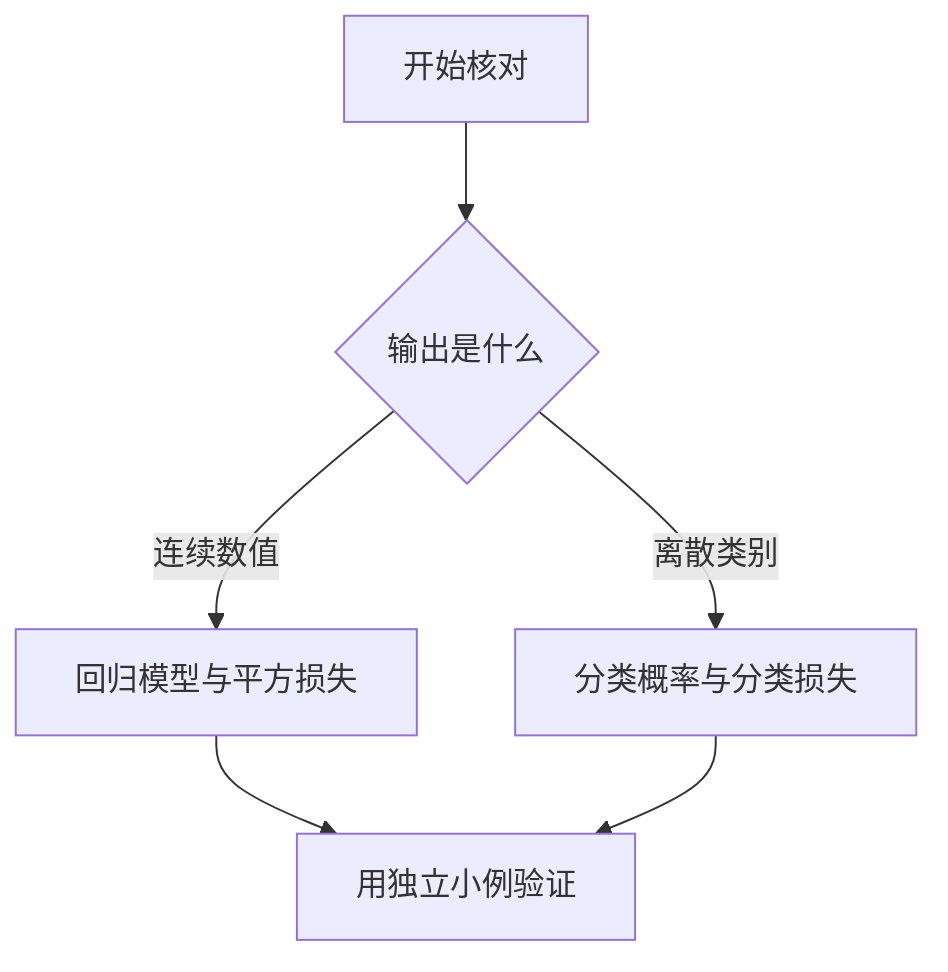

# 2026-08-31 第1节 深度学习导论与课程准备

> [!warning] 录音说明
> 本条腾讯会议录音实际识别为设备故障下的面试片段，无法还原课堂内容。因此本笔记以课程 [[课程/深度学习/PPT/Chapter1/Chapter1|Chapter 1 课件]] 为主，录音仅保留归档链接，不据此补写课堂发言。

## 资料来源

- 配套课件：[[课程/深度学习/PPT/Chapter1/Chapter1|Chapter 1：深度学习导论]]
- 课件 PDF：[[课程/深度学习/PPT/Chapter1.pdf]]
- 原始逐字稿：[[课程/深度学习/课堂笔记/raw/2026-08-31-转写_电子科大王君豪的快速会议-407873-逐字稿.md]]
- 智能纪要：[[课程/深度学习/课堂笔记/raw/2026-08-31-转写_电子科大王君豪的快速会议-407873-纪要.md]]

## 课件与代码阅读路线

> [!info] 2026-10-22重整依据
> 课件：[[课程/深度学习/PPT/Chapter1/Chapter1|Chapter1]]。本课无独立配套演示脚本。 保留原录音、个人疑惑及正确推导；新增解释与自测不冒充教师原话。

先修与路线：先确认向量内积、平方损失的意义；再读第四节回归，最后看设备准备。

## 一、本节课核心脉络

本节从人工智能的发展与应用出发，区分人工智能、机器学习和深度学习，再用回归问题说明“从数据学习函数”的基本范式，最后介绍 Python、PyTorch 与 GPU 环境，为后续模型训练做准备。

## 二、人工智能、机器学习与深度学习

- **人工智能（AI）**是让机器完成感知、推理、决策和生成等智能任务的广义领域。
- **机器学习（ML）**不直接为每种输入手写规则，而是利用数据估计输入到输出的映射。
- **深度学习（DL）**是机器学习的一类方法，使用多层参数化结构逐级学习表示。

三者是包含关系，而不是并列关系。深度学习属于机器学习，机器学习又是人工智能的重要实现路线之一。

![[课程/深度学习/PPT/Chapter1/images/5bce2dae1cb12190ff1c0b560fd499d1f2669199463587505d59da13510cc3a2.jpg|700]]

*图：课件中的人工智能发展时间线。时间线有助于理解技术浪潮，但具体事件仍应结合课程文本辨析。*

## 三、机器学习的基本问题

设输入为 $x\in\mathbb{R}^{d}$，真实但未知的目标关系为 $y=f(x)$。我们拥有有限数据集

$$
\mathcal{D}=\{(x_n,y_n)\}_{n=1}^{N},
$$

希望从某个带参数的函数族中找到学习器 $\hat f(x;\theta)$，使其既能拟合训练数据，也能对未见样本作出合理预测。

> 一句话来说：机器学习是在有限样本上猜测背后的函数规律，并用新数据检验这种猜测是否可靠。

### 监督学习中的输入与输出

| 任务 | 输入 | 输出 | 例子 |
|:--|:--|:--|:--|
| 回归 | 特征向量 | 连续数值 | 预测温度、价格 |
| 分类 | 特征向量 | 离散类别 | 手写数字识别 |
| 生成 | 条件或上下文 | 结构化内容 | 文本、图像生成 |

图像通常表示为像素张量，文本则需先经过分词和数值编码。模型接收的是数值表示，而不是人类直接感知的“图片”或“句子”。

## 四、回归作为第一个学习实例

### 1. 线性回归

线性模型写为

$$
\hat f(x)=w^{\mathsf T}x+b.
$$

参数 $w,b$ 通过最小化预测值与标签的差异得到。例如平方损失为

$$
L(w,b)=\frac{1}{N}\sum_{n=1}^{N}\left(\hat f(x_n)-y_n\right)^2.
$$

### 2. 多项式回归

当一维关系存在明显弯曲时，可扩大模型容量：

$$
\hat f(x)=\sum_{k=0}^{P}w_kx^k.
$$

次数 $P$ 越高，模型能表示的函数越多，但也更容易把样本噪声当成规律。后续将用训练误差与测试误差区分“拟合得好”和“泛化得好”。

![[课程/深度学习/PPT/Chapter1/images/a1b7fb8a3f473145e42f3dd77357debc316c0d60e261289c26a9718b5631bb20.jpg|480]]

*图：多项式学习器对离散样本点进行拟合。红点是样本，曲线是学习到的近似函数。*

## 五、为什么还要学习编程

生成式 AI 可以解释代码、补全函数和帮助排错，但学习者仍需理解：

1. 数据的形状和含义是否正确。
2. 模型、损失函数与任务是否匹配。
3. 训练过程是否存在泄漏、过拟合或数值问题。
4. 输出结果是否符合理论和实验常识。

不会判断代码正确性，就无法可靠地使用自动生成的代码。课程后续以 Python、NumPy 和 PyTorch 为主要实践工具。

## 六、PyTorch 与计算设备准备

- **Tensor** 是 PyTorch 的基本数据结构，除数值外还包含形状、数据类型和所在设备。
- CPU 适合通用逻辑和小规模实验；GPU 擅长大规模并行的张量运算。
- 使用 GPU 需要显卡驱动、CUDA 环境与 PyTorch 版本匹配。
- 编写程序时应显式检查 `shape`、`dtype` 和 `device`，避免隐式错误。

最小自检思路：创建张量、执行矩阵乘法、检查 PyTorch 能否识别 CUDA，再运行一个小规模模型，而不是一开始就训练大型网络。

## 七、本节课速查

| 术语 | 核心含义 |
|:--|:--|
| 特征 | 描述样本的输入分量 |
| 标签 | 监督学习中希望预测的输出 |
| 学习器 | 用于近似目标函数的参数化模型 |
| 参数 | 从数据中训练得到的模型变量 |
| 损失函数 | 衡量预测与目标差异的函数 |
| 泛化 | 模型在未见数据上的表现能力 |

## 八、易错点与课后准备

> [!warning] 易错点
> - 深度学习不是人工智能的全部。
> - 训练误差小不等于模型真正学到了可推广的规律。
> - 多项式次数越高不保证测试效果越好。
> - GPU 可用不等于所有代码都会自动在 GPU 上运行。

- 配置 Python 与 PyTorch 环境。
- 熟悉向量、矩阵、函数和最小二乘的基本概念。
- 能解释数据集、特征、标签、模型和损失函数之间的关系。

## 从课件回归例子到可检验的计算（补充解释）

本课有效录音不可用，仍按课件重建，不声称还原教师发言。Chapter1 的线性回归可把偏置并入最后一列：

$$
A=\begin{pmatrix}x_1^{\mathsf T}&1\\ \vdots&\vdots\\x_N^{\mathsf T}&1\end{pmatrix},
\qquad \beta=(w^{\mathsf T},b)^{\mathsf T},\qquad
\min_\beta N^{-1}\Vert A\beta-y\Vert_2^2.
$$

这里 $A$ 为 $N\times(d+1)$；“对输入非线性”的多项式仍可以“对待估系数线性”。后续[[课程/深度学习/演示代码/Chapter2.py|Chapter2.py]]把同一思想推广为多项式的设计矩阵；这是后续实践链接，不是第一课已有该代码演示的证据。

> 一句话来说：先把每个参数乘的已知特征写成矩阵的一列，就能看清最小二乘在求什么。

### 自测（新编）

用 $p(x)=a_0+a_1x$ 拟合 $(0,1),(1,3),(2,5)$。写设计矩阵、系数和训练MSE。

> [!hint]- 提示
> 第一列为常数1，第二列为样本横坐标。

> [!solution]- 解析
> $A=\begin{pmatrix}1&0\\1&1\\1&2\end{pmatrix}$；$a=(1,2)^{\mathsf T}$，预测恰等于标签，MSE为0。

## 判定流程与核心公式速查

| 对象 | 公式或规则 |
|---|---|
| 回归 | $\hat y=w^{\mathsf T}x+b$ |
| 平方损失 | $N^{-1}\sum_n(\hat y_n-y_n)^2$ |

## 课堂导航

- 上级索引：[[课程/深度学习/课堂笔记/README|深度学习课堂笔记]]
- 后续课程：[[课程/深度学习/课堂笔记/2026-09-02-第2节-机器学习基础概念与模型构建教学|第2节 机器学习基础概念与模型构建]]
