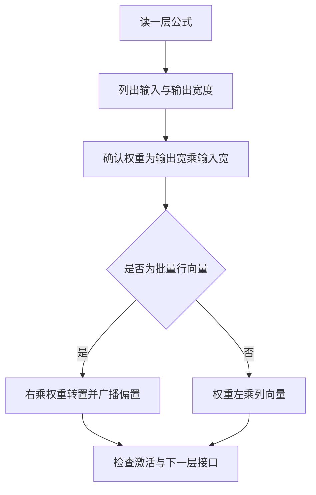

# 2026-09-09 第4节 课堂内容待补

> [!warning] 缺少逐字稿
> 根据 [[课表|2026—2027 学年第一学期课表]]，深度学习在星期三有固定排课。前后记录分别为 2026-09-07 第3节和 2026-09-14 第5节，可可靠确认 2026-09-09 对应第4节；截至 2026-10-12，全库未发现匹配的逐字稿、纪要或录音资料。

## 缺失记录

- 日期：2026-09-09
- 预计课次：第4节
- 判断依据：固定课表及前后连续课次共同确认。
- 缺失资料：逐字稿、智能纪要、课堂录音。
- 当前结果：已补入前馈网络必要衔接知识；本课实际讲授边界、例题、教师强调与作业仍不能可靠确定。

## 后续补全规则

后续只依据对应课件、前后课堂的明确章节进度和教师回顾补全可可靠还原的知识内容，并标注“根据课件及前后课程补全（非逐字稿）”。

## 根据课件及前后课程补全（非逐字稿）

> [!info] 依据与可确认范围
> 第3节停留在神经元、激活函数；[[课程/深度学习/课堂笔记/raw/2026-09-14-神经网络反向传播算法推导与复杂度分析讲座-881792-逐字稿|第5节录音]]开头已在使用逐层前向传播和参数表示。结合[[课程/深度学习/PPT/Chapter3/Chapter3|Chapter3的前馈网络、全连接网络和前向传播]]，补入学习第5节所需的结构知识。没有第4节逐字稿，不能证明当日讲完以下全部内容，也不还原教师原话、板书数值或作业。

### 要解决的问题与先修

一个神经元只能形成一种局部变换，怎样把它们组合成更丰富的函数？先回看[[课程/深度学习/课堂笔记/2026-09-07-第3节-机器学习基础与NumPy实操讲座|第3节的仿射变换与非线性激活]]，再按“网络结构—逐层公式—形状—参数量”的顺序学习。

### 前馈、全连接与深度

前馈网络由有向无环的计算依赖组成，可按依赖顺序求值；全连接是其中一种规则结构，相邻两层每个神经元互连。不是所有前馈网络都必须全连接。

取层宽 $m_0=d,m_1,\ldots,m_D=d'$，以D表示可训练仿射层的数量，不计输入层：

$$
q^\ell=W^\ell y^{\ell-1}+b^\ell,\qquad
y^\ell=\sigma^\ell(q^\ell),\quad y^0=x.
$$

其中 $W^\ell\in\mathbb R^{m_\ell\times m_{\ell-1}}$，$b^\ell,q^\ell,y^\ell\in\mathbb R^{m_\ell}$。回归输出层常取恒等激活，隐藏层取ReLU等非线性。没有非线性时，多层仿射变换仍可合并成一个仿射变换。

> 一句话来说：架构确定运算如何连接，参数确定每个连接采用什么权重，前向传播就是按依赖求值。

### 手算示范与代码桥梁（补充例子）

取 $x=(1,2)^{\mathsf T}$，
$W^1=\begin{pmatrix}1&0\\0&1\\1&1\end{pmatrix}$、$b^1=0$，
则ReLU隐藏层输出为 $(1,2,3)^{\mathsf T}$。输出层取 $W^2=(1,-1,2),b^2=0$，最终输出为5。

该 $2\to3\to1$ 网络有 $3\times2+3+1\times3+1=13$ 个参数。一般参数量为 $\sum_{\ell=1}^D m_\ell(m_{\ell-1}+1)$。后续[[课程/深度学习/演示代码/Chapter5.py|Chapter5.py]]以Linear和ReLU实现同样的结构；那是后续回归示例，不是第4节存在这份演示的证据。

批量数据按行存放时，$X\in\mathbb R^{N\times d}$，第一层实现对应 $X(W^1)^{\mathsf T}+b^1$，其结果为 $N\times m_1$；数学列向量公式和批量行向量实现并不矛盾。

### 判定流程与公式速查

| 内容 | 规则 |
|---|---|
| 单层参数量 | $m_{\rm out}(m_{\rm in}+1)$ |
| 单点前向 | $y=\sigma(Wx+b)$ |
| 批量前向 | $Y=\sigma(XW^{\mathsf T}+\mathbf1b^{\mathsf T})$ |
| 深度 | 本段按可训练仿射层计，不计输入层 |

> [!warning] 仍待确认
> 本段是前后课程间的必要知识衔接，不代表本课实录。具体激活函数讲授范围、课堂例题与布置要求仍待补；原缺失状态保留。

### 自测（新编）

取 $4\to5\to2$ 网络，计算参数数；若有7个样本，第一层与最终输出各是什么形状？

> [!hint]- 提示
> 分别计算两层的权重与偏置，批量维一直保留。

> [!solution]- 解析
> 参数为 $5(4+1)+2(5+1)=37$；形状分别为 $(7,5)$、$(7,2)$。

## 课堂导航

- 上一课：[[课程/深度学习/课堂笔记/2026-09-07-第3节-机器学习基础与NumPy实操讲座|第3节]]
- 下一课：[[课程/深度学习/课堂笔记/2026-09-14-第5节-神经网络反向传播算法推导与复杂度分析讲座|第5节]]
- 上级索引：[[课程/深度学习/课堂笔记/README|深度学习课堂笔记]]
