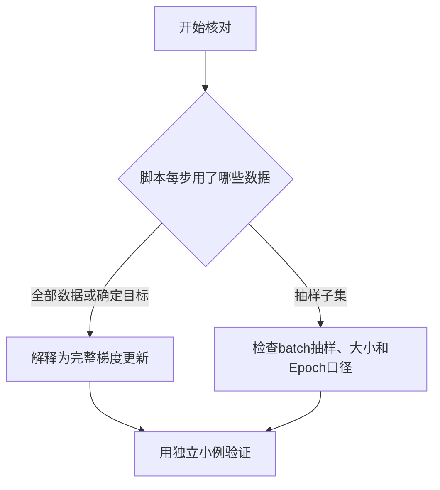

# 2026-09-21 第7节 小批量随机梯度、梯度稳定性与 PyTorch 优化器

## 资料来源

- 原始逐字稿：[[课程/深度学习/课堂笔记/raw/2026-09-21-随机优化算法讲解-857280-逐字稿.md]]、[[课程/深度学习/课堂笔记/raw/2026-09-21-优化算法与深度学习课程-815808-逐字稿.md]]
- 智能纪要：[[课程/深度学习/课堂笔记/raw/2026-09-21-随机优化算法讲解-857280-纪要.md]]、[[课程/深度学习/课堂笔记/raw/2026-09-21-优化算法与深度学习课程-815808-纪要.md]]
- 配套课件：[[课程/深度学习/PPT/Chapter4/Chapter4|Chapter4 优化]]、[[课程/深度学习/PPT/Chapter5 (1)/Chapter5 (1)|Chapter5 回归过渡]]
- 开始时间：2026-09-21 10:19
- 小批量优化与优化器实现对应现已上传的Chapter4及其演示；最后的回归模型过渡用Chapter5核对。章节编号以资料正文内容为准，录音中的口述编号不替代匹配。

## 课件与代码阅读路线

> [!info] 2026-10-22重整依据
> 课件：[[课程/深度学习/PPT/Chapter4/Chapter4|Chapter4]]、[[课程/深度学习/PPT/Chapter5 (1)/Chapter5 (1)|Chapter5 (1)]]。演示：[[课程/深度学习/演示代码/Chapter4(1).py|Chapter4(1).py]]。 保留原录音、个人疑惑及正确推导；新增解释与自测不冒充教师原话。

先修与路线：先读Epoch与小批量，再核对脚本究竟有没有抽样；然后沿目标定义、前向、清零、反传和更新阅读程序。

## 一、本节课核心脉络

本节从“大数据集上的完整损失计算太昂贵”出发，引出用小批量近似完整梯度的方法，并区分迭代次数与训练轮数。随后用深层网络中的连乘结构解释梯度消失和梯度爆炸，再将理论落到 PyTorch：定义可求导参数、构造优化器、计算损失，并反复执行梯度清零、反向传播和参数更新。最后通过 SGD、Adam、RMSProp 的简单数值实验比较收敛曲线，并转入深度学习回归模型的数学表述。

## 二、完整梯度与小批量随机梯度

设训练集为 $\{(x_n,y_n)\}_{n=1}^{N}$，经验损失为

$$
L(\theta)=\frac{1}{N}\sum_{n=1}^{N}
\ell\bigl(f(x_n;\theta),y_n\bigr).
$$

完整梯度需要遍历全部 $N$ 个样本：

$$
\nabla L(\theta)=\frac{1}{N}\sum_{n=1}^{N}
\nabla_\theta\ell_n(\theta).
$$

当 $N$ 达到百万甚至更大规模时，每一步迭代都计算全部样本会很慢，也可能无法一次装入内存。于是从索引集合 $\{1,\ldots,N\}$ 中选取大小为 $S$ 的小批量 $B_k$，使用

$$
g_k=\frac{1}{S}\sum_{n\in B_k}
\nabla_\theta\ell_n(\theta_k)
$$

近似完整梯度，并更新

$$
\theta_{k+1}=\theta_k-\eta_k g_k.
$$

课堂用“100 个样本的平均值”和“抽取 10 个样本的平均值”作类比：二者一般不会完全相等，但若抽样具有代表性，小批量结果可作为整体的近似。批量更小意味着单步计算更便宜、噪声更大；批量更大意味着估计更稳定、单步代价更高。

> [!warning] 近似需要条件
> 小批量不是随意丢弃数据。若抽样长期偏向某一类样本，梯度会带有系统偏差；实际训练通常先打乱数据，再按批次遍历。课堂也强调“约等于”不是无条件成立，理论分析需要概率假设与误差估计。

### 迭代与 Epoch

- **一次迭代**：用一个小批量计算梯度并更新一次参数。
- **一轮（Epoch）**：训练集中的每个样本大致被使用一次。
- 若 $N$ 能被 $S$ 整除，一轮包含 $N/S$ 次迭代；否则通常取 $\lceil N/S\rceil$ 个批次。

因此“一轮”不等于“一次迭代”。训练多轮的意义是让所有样本反复参与参数更新，而每一步仍只承担小批量的计算成本。极端情形 $S=1$ 是逐样本随机梯度；$S=N$ 则退化为完整批量梯度下降。

## 三、深层网络中的梯度消失与梯度爆炸

对宽度为 $1$ 的深层前馈网络作示意，较前层权重的梯度会包含许多权重和激活函数导数的连乘：

$$
\frac{\partial f}{\partial w^1}
\propto
\left(\prod_{\ell=2}^{L+1}w^\ell\right)
\left(\prod_{\ell=1}^{L}\sigma_\ell'(z^\ell)\right)x.
$$

网络越深，链式法则产生的乘数越多。

### 1. 梯度消失

若多数乘数的绝对值小于 $1$，连乘会随深度指数衰减，靠近输入端的梯度可能接近机器精度：

$$
\left|\frac{\partial f}{\partial w^1}\right|\approx 0.
$$

结果是前层参数几乎不更新，训练看起来“停住”。小权重初始化与饱和激活函数的较小导数都可能加剧这一现象。

### 2. 梯度爆炸

若多数乘数的绝对值大于 $1$，连乘会迅速放大。课堂以大量权重接近 $10$ 为例说明：深度达到百层时可能出现 $10^{100}$ 量级，超出常用浮点数的稳定表示范围。此时参数更新会剧烈跳动，甚至出现无穷大或非数值。

课堂提到的直观应对包括减少网络深度和对梯度作归一化或裁剪。更完整的工程手段还包括合适初始化、非饱和激活、归一化层与残差连接；这些属于补充理解，不是本节展开的重点。

## 四、PyTorch 中的优化流程

### 1. 参数必须进入自动微分系统

待优化变量应为 Tensor，并设置 requires_grad=True。这样，对参数进行的运算才会被记录成计算图，后续调用 backward() 时才能沿图反向应用链式法则。

优化器接收的是参数列表和超参数，例如学习率：

    parameters = torch.tensor(initial_value, requires_grad=True)
    optimizer = torch.optim.SGD([parameters], lr=0.01)

把 SGD 换成 Adam 或 RMSprop，训练循环的基本结构仍然相同；算法差异被封装在优化器的 step() 中。

### 2. 每次迭代的核心三步

    optimizer.zero_grad()
    loss.backward()
    optimizer.step()

三步的含义依次是：

1. **zero_grad()**：清除上一次迭代保存在参数上的梯度。PyTorch 默认累加梯度，不清零会把新旧梯度相加。
2. **backward()**：从标量损失出发沿计算图反向传播，计算损失对各参数的梯度。
3. **step()**：按优化器的更新规则改变参数。

正确顺序还要求先在当前参数下完成前向计算并得到 loss，再执行上述三步。若需要保存损失曲线，应使用 loss.item() 取出普通数值，避免把整张计算图一并保留在列表中。

### 3. 平方损失示例

课堂以回归问题为例，逐样本累加平方误差：

$$
L(\theta)=\frac1N\sum_{n=1}^{N}
\left(f(x_n;\theta)-y_n\right)^2.
$$

代码可以手工累加，也可以调用库中的均方误差函数。无论损失表达式多复杂，只要它由 PyTorch 支持的可微运算构成，自动微分都能基于计算图求梯度。

## 五、SGD、Adam 与 RMSProp 的课堂对比

课堂在同一个简单目标函数上保持其他设置基本一致，分别运行 SGD、Adam 和 RMSProp：

- SGD 的曲线较平稳，反映固定学习率下相对稳定的步长。
- Adam 使用一阶矩、二阶矩形成自适应缩放，课堂示例中出现一定震荡。
- RMSProp 在该示例里把损失降到了接近机器精度，表现最好。

> [!important] 不能从单个例子推出普遍排名
> 课堂明确提醒：RMSProp 只是在这个简单问题和这组超参数下最好。优化器效果还受目标函数、数据尺度、初始化、批量大小、学习率和训练预算影响。公平比较应固定随机种子，并分别调节适合各优化器的学习率。

## 六、从优化器转向深度学习回归模型

给定有界区域 $K\subset\mathbb R^d$ 上的目标函数 $f:K\to\mathbb R$，训练数据可写成

$$
x_n\in K,\qquad y_n=f(x_n)+\varepsilon_n,
$$

其中 $\varepsilon_n$ 表示可能存在的观测噪声。回归任务的输出取连续值。

在训练前，需要先确定神经网络的架构：

- 网络深度；
- 各隐藏层宽度；
- 激活函数；
- 输出层形式。

架构确定后得到一个参数化函数族 $\mathcal F$。训练就是在该函数族中寻找使经验损失较小的模型：

$$
\min_{\phi\in\mathcal F}
\frac1N\sum_{n=1}^{N}
\left(\phi(x_n)-y_n\right)^2.
$$

网络结构决定“允许搜索哪些函数”，优化器决定“怎样在参数空间中搜索”。表达能力强不代表一定能被当前算法有效训练。

## 七、易错点与课堂安排

> [!warning] 易错点
> - 小批量梯度通常不等于完整梯度，它是带噪声的估计。
> - Epoch 与 iteration 不是同义词；前者描述数据集被遍历的次数。
> - backward() 负责求梯度，step() 才负责更新参数。
> - zero_grad() 不能省略，否则梯度会跨迭代累加。
> - requires_grad=True 应设在需要优化的参数上，而不是无差别用于全部数据。
> - 某优化器在一次实验中最优，不等于它对所有问题都最优。

- 课堂计划采用网页版编程考试；教师将结合学生是否携带电脑安排分组和分批考试。
- 建议自行实现一个小型回归例子，记录 SGD、Adam、RMSProp 的损失曲线，并尝试改变学习率和批量大小解释差异。

## Chapter4(1).py：程序实际做了什么？

来源为[[课程/深度学习/PPT/Chapter4/Chapter4|第4章末尾演示]]与[[课程/深度学习/演示代码/Chapter4(1).py|原始代码]]。取 $d=5$，脚本优化

$$
F(x)=\frac1{d-3}\sum_{i=1}^{d-3}
\left(x_{i-1}x_i+x_ix_{i+1}+x_{i+1}x_{i+2}-\frac{i}{d-3}\right)^2.
$$

上式**使用Python零起始的分量下标**；循环i从1至d-3，故第一项用x的0—3号分量。若按课件一始下标，应同时把各分量下标平移，不能只改一处。

| 设置 | 原脚本 |
|---|---|
| 待优化参数 | x，全1、requires_grad=True |
| 三种方法 | SGD、Adam、RMSprop，各自重新创建x |
| 学习率／步数 | 0.01／1000 |
| 记录值 | loss.detach()写入NumPy数组，最后额外记录一次更新后的值 |
| 曲线 | semilogy，纵轴对数刻度 |

**名称不等于采样策略：** 此处SGD优化器接收的是同一个确定函数的完整梯度；脚本没有随机抽取训练样本，不应把图中的每一步称为mini-batch训练。只更换优化器不会自动生成小批量。

> [!warning] 运行前提（补充校验）
> 原代码以CPU张量开始，f内的torch.Tensor([0])也在默认设备创建；若单独把x移动到GPU却不处理这个常量，可能发生设备不一致。这里没有把原脚本改成GPU程序，也没有据课堂一次曲线给优化器作普遍排名。

> 一句话来说：优化器决定怎么利用梯度，小批量策略决定用哪些数据计算梯度，两者不能混为一谈。

### 自测（新编）

若数据10000条、batch size为128，不丢最后一批，一轮有几步、末批几条？原脚本1000步是否能直接换算为该数据集的1000轮？

> [!hint]- 提示
> 做带余除法，并检查原脚本有没有该数据集。

> [!solution]- 解析
> 79步，末批16条；原脚本没有这个数据集或小批量循环，不能作这样的轮数换算。

## 判定流程与核心公式速查

| 对象 | 公式或规则 |
|---|---|
| 小批量梯度 | $S^{-1}\sum_{n\in B_k}\nabla\ell_n$ |
| 每轮步数 | $\lceil N/S\rceil$，不丢最后一批 |

## 课堂导航

- 上一节：[[课程/深度学习/课堂笔记/2026-09-16-第6节-深度学习优化理论讲座|第6节 神经网络逼近理论与优化算法]]
- 上级索引：[[课程/深度学习/课堂笔记/README|深度学习课堂笔记]]
