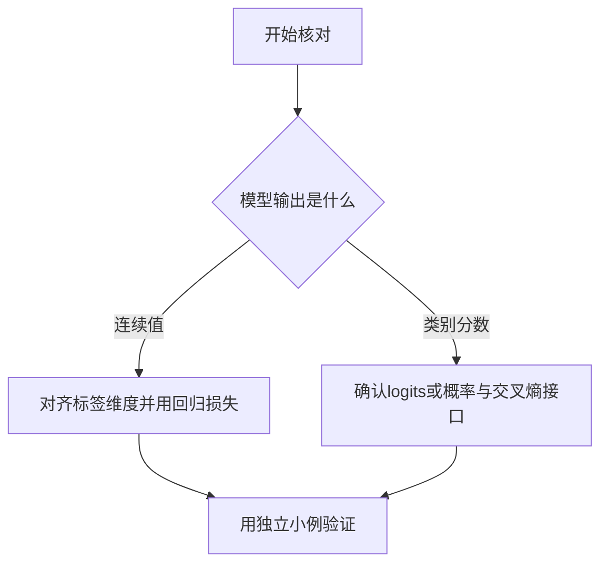

# 2026-10-12 第11节 深度学习编程与分类模型

## 资料来源

- 原始逐字稿：[[课程/深度学习/课堂笔记/raw/2026-10-12-深度学习编程与分类模型宣讲-586304-逐字稿.md]]
- 智能纪要：[[课程/深度学习/课堂笔记/raw/2026-10-12-深度学习编程与分类模型宣讲-586304-纪要.md]]
- 对应课件：[[课程/深度学习/PPT/Chapter5 (1)/Chapter5 (1)|Chapter5 回归]]、[[课程/深度学习/PPT/Chapter6/Chapter6|Chapter6 分类]]
- 说明：课次依据既有记录与国庆停课校正为第 11 节；自动生成的“第 13 节”未扣除 10 月 5 日、7 日停课。

## 课件与代码阅读路线

> [!info] 2026-10-22重整依据
> 课件：[[课程/深度学习/PPT/Chapter5 (1)/Chapter5 (1)|Chapter5 (1)]]、[[课程/深度学习/PPT/Chapter6/Chapter6|Chapter6]]。演示：[[课程/深度学习/演示代码/Chapter5.py|Chapter5.py]]、[[课程/深度学习/演示代码/Chapter6.py|Chapter6.py]]。 保留原录音、个人疑惑及正确推导；新增解释与自测不冒充教师原话。

先修与路线：先检查回归输出与标签是否同形，再走训练循环；分类部分独立转入第六章，不能把两类损失或代码配置混用。

## 一、本节课核心脉络

本节先用 PyTorch 回归代码串起“定义网络—前向传播—计算损失—反向传播—更新参数”的完整训练流程，再把输出从一个连续值推广为 $J$ 类概率向量，引出 one-hot 标签、Softmax 与交叉熵。


## 二、回归任务的 PyTorch 实现

### 1. 数据形状

输入张量的每一行对应一个样本。若网络输出形状为 $(N,1)$、标签形状为 $(N)$，应先把输出压平成一维再计算损失，避免广播造成错误：

```python
prediction = net(x).flatten()
loss = criterion(prediction, y)
```

### 2. 网络与参数

`nn.Sequential` 可按顺序组合线性层与激活函数，调用 `net(x)` 即完成前向传播。`net.parameters()` 返回需要优化的参数；也可通过具体层的 `.weight`、`.bias` 检查权重和偏置。

回归的均方误差为

$$
L(\theta)=\frac{1}{N}\sum_{n=1}^{N}\left(\phi(x_n;\theta)-y_n\right)^2.
$$

### 3. 标准训练循环

```python
optimizer.zero_grad()
prediction = net(x).flatten()
loss = criterion(prediction, y)
loss.backward()
optimizer.step()
```

- `zero_grad()` 清空上一轮累积梯度；
- `backward()` 按计算图求梯度；
- `step()` 按优化器规则更新参数；
- `loss.item()` 可取得用于打印的标量损失。

课堂示例将学习率从 $10^{-2}$ 逐步减小到 $10^{-4}$。减小学习率有助于后期稳定收敛，但具体衰减时机应结合损失变化判断。

## 三、从回归推广到多分类

对 $J$ 分类问题，网络为每个样本输出 $J$ 个分量。Softmax 把 logits $z_j$ 转换为概率：

$$
p_j=\frac{e^{z_j}}{\sum_{k=1}^{J}e^{z_k}},
\qquad \sum_{j=1}^{J}p_j=1.
$$

类别标签可写为 one-hot 向量 $y$。单样本交叉熵为

$$
\ell(y,p)=-\sum_{j=1}^{J}y_j\log p_j,
$$

由于 one-hot 标签仅在真实类别处为 1，上式就是该类别预测概率的负对数。训练集损失取所有样本交叉熵的平均。

> [!important] PyTorch 接口注意
> 课堂推导中显式写出 Softmax 便于理解概率含义；实际使用 `nn.CrossEntropyLoss` 时通常直接输入 logits，因为该损失内部已组合 `log_softmax` 与负对数似然。是否另加 Softmax 必须以所用损失函数接口为准。

## 四、考试说明

- 考试安排在第 9 周；
- 允许使用电脑；
- 范围以课堂讲过的代码和作业为主；
- 重点包括基本数据类型、NumPy 数组及课堂中的模型实现；
- 忘记具体命令时，可用清晰伪代码表达算法思想。

## 五、易错点

1. 输出与标签形状不一致时直接计算 MSE；
2. 忘记 `zero_grad()`，导致梯度跨轮累积；
3. 把网络输出概率与类别编号直接做均方误差；
4. 在 `CrossEntropyLoss` 前重复使用 Softmax；
5. 只看训练损失，不检查数据形状和预测结果。

## 课堂疑惑与解答

当日日计划 `每日疑惑/2026-10-12.md` 尚未生成，本次无可回写的课堂疑惑。

## 回归代码收尾与分类模型过渡

回归部分对应[[课程/深度学习/演示代码/Chapter5.py|Chapter5.py]]、第五章；多分类定义对应[[课程/深度学习/PPT/Chapter6/Chapter6|第六章]]及后续[[课程/深度学习/演示代码/Chapter6.py|分类演示]]。本次据内容拆分引用，不再以第五章支撑Softmax分类。

回归输入为 $(10000,5)$，输出 $(10000,1)$，标签 $(10000,)$。源代码使用squeeze消去长度1的输出维；正文flatten是整理示例。**补充解释：** 当batch size为1时，不带维度的squeeze也会删掉batch维；明确使用squeeze(-1)更能体现“只去掉输出维”的意图。

学习率序列由linspace给出5000项，从 $10^{-2}$ 线性降到 $10^{-4}$：

$$
\eta_n=10^{-2}+\frac n{4999}(10^{-4}-10^{-2}),
\qquad n=0,\ldots,4999.
$$

这不是指数衰减。三组回归实验的最后一组有循环边界问题，见[[课程/深度学习/课堂笔记/2026-09-23-第8节-深度学习模型训练与正则化讲座#第五章回归课件与Chapter5.py的完整对应|代码校验]]，不把源文件“能通过语法检查”写成完整训练成功。

### 从概率到稳定交叉熵（第六章补充解释）

对logits $z_j$、真实类y，令 $m=\max_j z_j$：

$$
\ell=-z_y+m+\log\sum_j e^{z_j-m}.
$$

减去最大值不改Softmax概率，但避免直接计算巨大正指数。课件中的softmax分母OCR出现重复末下标，应以 $\sum_j e^{z_j}$ 为准。原脚本先softmax再log的数学意义正确，但极端输入可能下溢；库接口的输入应按官方文档核对。

> 一句话来说：回归先对齐连续输出，分类先确定概率／logits接口，再选择相应损失。

### 自测（新编）

两个logits为1000、999，真实类为第一类。不要直接算 $e^{1000}$，求交叉熵表达式。

> [!hint]- 提示
> 共同减去最大logit。

> [!solution]- 解析
> $\ell=\log(1+e^{-1})\approx0.3133$，与logits为1、0时相同。


## 判定流程与核心公式速查



| 对象 | 公式或规则 |
|---|---|
| MSE | $N^{-1}\sum_n(\phi(x_n)-y_n)^2$ |
| 稳定交叉熵 | $-z_y+m+\log\sum_j e^{z_j-m}$，$m=\max_jz_j$ |

## 课堂导航

- 上一课：[[课程/深度学习/课堂笔记/2026-09-30-第10节-缺少逐字稿|第10节 课堂内容待补]]
- 上级索引：[[课程/深度学习/课堂笔记/README|深度学习课堂笔记]]
