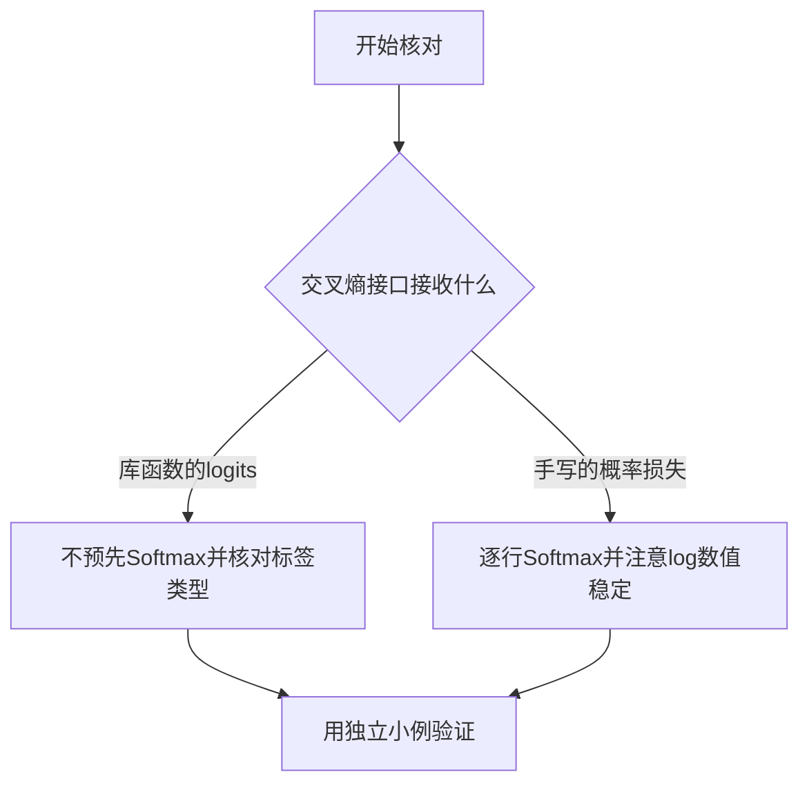

# 2026-10-14 第12节 Softmax分类网络的代码实现

## 资料来源

- 原始逐字稿：[[课程/深度学习/课堂笔记/raw/2026-10-14-神经网络分类模型代码编写-252544-逐字稿.md]]
- 智能纪要：[[课程/深度学习/课堂笔记/raw/2026-10-14-神经网络分类模型代码编写-252544-纪要.md]]
- 对应课件：[[课程/深度学习/PPT/Chapter6/Chapter6|Chapter6 分类模型]]
- 课次说明：10月5日、7日为国庆假期，不计入授课次数；自动生成的第14节已校正为第12节。

## 课件与代码阅读路线

> [!info] 2026-10-22重整依据
> 课件：[[课程/深度学习/PPT/Chapter6/Chapter6|Chapter6]]。演示：[[课程/深度学习/演示代码/Chapter6.py|Chapter6.py]]。 保留原录音、个人疑惑及正确推导；新增解释与自测不冒充教师原话。

先修与路线：先看二维点、1—4类别与one-hot列号，再走网络分支、逐行Softmax和交叉熵；最后检查预测编号与测试准确率。

## 一、本节课核心脉络

本节把上一课的分类模型公式落实为完整代码：生成按象限分类的二维数据，利用布尔索引构造类别标签，再定义深度可调的全连接网络，最后把标签转换为 one-hot 概率向量并手动实现交叉熵训练。


## 二、训练集与测试集

课堂示例使用：

- 训练集 $N_{\mathrm{train}}=10000$；
- 测试集 $N_{\mathrm{test}}=1000$；
- 输入维数 $d=2$；
- 类别数 $J=4$。

输入矩阵每一行是一个二维样本，可用标准正态分布生成：

```python
X_train = torch.normal(
    mean=torch.zeros(N_train, 2),
    std=torch.ones(N_train, 2),
)
```

四个类别由样本所在象限确定。先创建全零标签向量，再通过两个坐标的符号条件构造布尔掩码：

```python
mask = (X_train[:, 0] >= 0) & (X_train[:, 1] >= 0)
y_train[mask] = 1
```

其余象限按同样方法赋为2、3、4。布尔向量可直接作为行索引；逻辑“与”两侧的比较表达式应加括号，避免运算优先级造成错误。

测试集必须使用同一分类规则独立生成，不能直接把训练数据复制为测试数据。

## 三、深度可调的全连接网络

课堂不再只用 `nn.Sequential`，而是通过继承 `nn.Module` 自定义网络类。输入层宽度为2，隐藏层宽度为 $M$，输出层宽度为4；隐藏层使用 ReLU，输出层使用 Softmax。

若深度固定，可以逐层定义线性层；若希望任意调整深度，应把隐藏层放入 `nn.ModuleList`，以确保参数被 PyTorch 正确注册。

前向传播可概括为

$$
h_1=\operatorname{ReLU}(W_1x+b_1),
$$

$$
h_{\ell}=\operatorname{ReLU}(W_{\ell}h_{\ell-1}+b_{\ell}),
$$

$$
p=\operatorname{Softmax}(W_Lh_{L-1}+b_L).
$$

对批量矩阵，Softmax 必须沿类别维执行：

```python
p = torch.softmax(logits, dim=1)
```

`dim=1` 表示每一行分别归一化；若把所有元素一起归一化，就不再是“每个样本一个类别概率向量”。

## 四、把类别标签转换为one-hot向量

若整数标签取值为1、2、3、4，则 one-hot 矩阵形状为 $(N,4)$，每行只有真实类别对应列为1：

$$
Y_{nj}=\mathbf1_{\{y_n=j\}}.
$$

课堂采用循环配合布尔索引进行赋值。实现时要统一类别编号与列下标：Python列下标从0开始，而课堂标签从1开始，因此写入列时应使用 `label - 1`，避免整体错位。

## 五、手动实现交叉熵

设网络输出概率矩阵为 $P$，one-hot标签矩阵为 $Y$，则平均交叉熵为

$$
L=-\frac1N\sum_{n=1}^{N}\sum_{j=1}^{4}Y_{nj}\log P_{nj}.
$$

对应代码为：

```python
prob = net(X_train)
loss = -(Y_train * torch.log(prob)).sum(dim=1).mean()
```

先逐元素相乘，再沿类别维求和，最后对样本取平均。由于one-hot向量仅在真实类别位置为1，该损失等于真实类别预测概率的负对数平均。

> [!important] 与库函数的区别
> 课堂代码为了对应公式，显式使用Softmax后再取对数。若改用 `nn.CrossEntropyLoss`，应直接输入未经Softmax的logits，因为该函数内部已完成 `log_softmax`；两种写法不能混用。

## 六、训练配置

- 网络宽度示例：$M=10$；
- 网络深度示例：$L=3$；
- 优化器：Adam；
- 初始学习率：$10^{-4}$；
- 迭代次数：5000；
- 后续可按训练进度衰减学习率。

标准训练步骤仍为：清空梯度、前向传播、计算损失、反向传播、更新参数。训练后还应在独立测试集上比较预测类别与真实标签，不能只报告训练损失。

## 七、易错点

1. 将样本按列排布，导致线性层与Softmax维度错误；
2. 布尔表达式缺少括号或把逻辑索引当成整数索引；
3. 标签1—4与列下标0—3没有对齐；
4. Softmax未指定 `dim=1`；
5. 动态层使用普通Python列表，参数未被注册；
6. 使用 `CrossEntropyLoss` 前重复添加Softmax。

## 课堂疑惑与解答

当日日计划 `每日疑惑/2026-10-14.md` 尚未生成，本次无可回写的课堂疑惑。

## Chapter6.py逐段对照与运行边界

本课应以[[课程/深度学习/PPT/Chapter6/Chapter6|第六章分类模型]]和[[课程/深度学习/演示代码/Chapter6.py|Chapter6.py]]为对应资料；第五章是回归模型，不再误作本课分类公式来源。

| 对象 | 原脚本形状／含义 |
|---|---|
| x_train | $(10000,2)$，标准正态二维点 |
| y_train | $(10000,)$，数值标签1—4，原脚本创建为浮点张量 |
| v_train | $(10000,4)$，one-hot概率标签 |
| net(x_train) | $(10000,4)$，dim=1逐行Softmax |
| my_net_class | 仅支持L=3或L=5两种分支，不是任意深度 |
| L=3,M=10 | 2→10→10→4，共184个参数 |
| L=5,M=10 | 2→10→10→10→10→4，共404个参数 |

原代码one-hot列用j-1，预测则indices+1，两个平移必须一致。正文关于ModuleList的是支持任意深度的补充方案，**原始脚本并未使用ModuleList**。

训练循环每一步使用完整10000点损失；Adam本身不会自动切mini-batch。学习率5000项从 $10^{-4}$ 线性降至 $10^{-6}$，每100步绘图。原代码先创建loss，更新参数后重新计算loss，逻辑上仍为“当前参数的新图用于下一步”，不是重复使用旧计算图。

> [!warning] 运行与损失接口（补充校验）
> - 源文件开头强制默认设备为cuda，没有可用CUDA的环境不能原样运行；这不是语法错误。
> - 使用CrossEntropyLoss的整数标签接口时，应让网络返回logits，并把1—4标签减一、转为long；也支持与logits同形的浮点概率标签。两种标签接口均不表示输入端应先softmax。
> - 原脚本显式softmax后log与库函数直接接收logits不是同一种调用约定，不能把已经归一化的概率再误送为logits。
> - 评估可用no_grad；设备、dtype、标签与形状都要同步，而非只改一行损失。

接口依据：[CrossEntropyLoss](https://docs.pytorch.org/docs/stable/generated/torch.nn.CrossEntropyLoss.html)、[Linear](https://docs.pytorch.org/docs/stable/generated/torch.nn.Linear.html)。原.py保留，不把CPU核验版冒充教师文件。

> 一句话来说：类别编号、one-hot列号和预测下标必须对齐，概率与logits必须和损失接口匹配。

### 自测（新编）

两个点为 $(0,-1)$、$(-1,0)$。按原代码边界规则写类别与one-hot向量；若改整数交叉熵接口，目标下标是什么？

> [!hint]- 提示
> 零归入坐标非负一侧，类别标签从1开始、张量列从0开始。

> [!solution]- 解析
> 分别为类别4、2；one-hot为 $(0,0,0,1)$、$(0,1,0,0)$；整数目标为3、1。


## 判定流程与核心公式速查



| 对象 | 公式或规则 |
|---|---|
| Softmax | $p_j=e^{z_j}/\sum_k e^{z_k}$ |
| one-hot交叉熵 | $-N^{-1}\sum_n\sum_jv_{nj}\log p_{nj}$ |
| 预测标签 | $1+\arg\max_{j=0,\ldots,3}p_j$ |

## 课堂导航

- 上一课：[[课程/深度学习/课堂笔记/2026-10-12-第11节-深度学习编程与分类模型宣讲|第11节 回归代码与分类模型]]
- 上级索引：[[课程/深度学习/课堂笔记/README|深度学习课堂笔记]]
